# Microsoft IT Support Specialist Professional Certificate
## Course 1 — Introduction to Computers and IT Support
### Chapter 1: Course Introduction, Learning Outcomes and Study Framework

> **Source basis:** This README is based on the supplied Chapter 1 course material from the Microsoft IT/cloud support curriculum. The source introduces the course scope, learning outcomes, modules, assessment goals, and study recommendations.  
>
> **Important note:** Where this README provides deeper explanations, examples, troubleshooting intuition, or technical background beyond the supplied introductory chapter, those sections are clearly presented as **Instructor Expansion**. They are intended to make the source material easier to understand and apply; they should not be treated as verbatim course content.

---

## Table of Contents

1. [Chapter Overview](#chapter-overview)
2. [What This Course Is Preparing You For](#what-this-course-is-preparing-you-for)
3. [The IT and Cloud Support Mindset](#the-it-and-cloud-support-mindset)
4. [Core Learning Outcomes](#core-learning-outcomes)
5. [Course Roadmap](#course-roadmap)
6. [Module 1 — Introduction to Computers](#module-1--introduction-to-computers)
7. [Module 2 — Enterprise Systems and Security](#module-2--enterprise-systems-and-security)
8. [Module 3 — Business Systems Applications](#module-3--business-systems-applications)
9. [Module 4 — Final Project and Assessment](#module-4--final-project-and-assessment)
10. [Core Concepts Introduced in Chapter 1](#core-concepts-introduced-in-chapter-1)
11. [Hardware, Software and the Operating System](#hardware-software-and-the-operating-system)
12. [CPU, Memory and Storage — The Basic Mental Model](#cpu-memory-and-storage--the-basic-mental-model)
13. [Peripherals and Input/Output](#peripherals-and-inputoutput)
14. [Operating Systems](#operating-systems)
15. [CPU Processes](#cpu-processes)
16. [Memory Management](#memory-management)
17. [Device Drivers](#device-drivers)
18. [Hardware–Software Abstraction](#hardwaresoftware-abstraction)
19. [System Updates and Patching](#system-updates-and-patching)
20. [Network Communication](#network-communication)
21. [Servers, Storage and Backups](#servers-storage-and-backups)
22. [Computing Environments](#computing-environments)
23. [Security and the Threat Landscape](#security-and-the-threat-landscape)
24. [Business Software and Email Applications](#business-software-and-email-applications)
25. [Data Storage in Business](#data-storage-in-business)
26. [IT Troubleshooting Mindset](#it-troubleshooting-mindset)
27. [The IT Consultant Scenario](#the-it-consultant-scenario)
28. [MS-900 and AZ-900 Preparation](#ms-900-and-az-900-preparation)
29. [Study Strategy](#study-strategy)
30. [Practical Learning Workflow](#practical-learning-workflow)
31. [Fun Facts](#fun-facts)
32. [Practice Questions](#practice-questions)
33. [Exercises](#exercises)
34. [Memory Hooks](#memory-hooks)

---

# Chapter Overview

The chapter establishes the purpose and structure of the programme. It positions IT and cloud support as a practical field requiring knowledge of:

- Computer hardware
- Operating systems
- Software
- Networking
- Security
- Storage and backups
- Enterprise systems
- Business applications
- Cloud technologies
- Microsoft Azure
- Microsoft 365
- Troubleshooting and diagnostics
- Maintenance and patching
- Compliance
- Resource monitoring
- Disaster recovery
- Cost optimisation

The supplied material describes a learning approach combining:

- Instructional videos
- Assessments
- Practical activities
- Real-world scenarios
- Projects
- A final graded assessment

The course is intended to establish a foundation for entry-level IT and cloud support work and to contribute towards preparation for Microsoft fundamentals examinations, including **MS-900 Microsoft 365 Fundamentals** and **AZ-900 Microsoft Azure Fundamentals**.

> **Source reference:** The programme emphasises a holistic understanding of hardware, software, networking, compliance, diagnostics, Azure resource management, security and cost optimisation. fileciteturn0file0L2-L4

---

# What This Course Is Preparing You For

## The big picture

Modern organisations depend on technology to operate their businesses. IT support therefore goes beyond simply fixing a computer that will not start.

An IT support professional may need to understand:

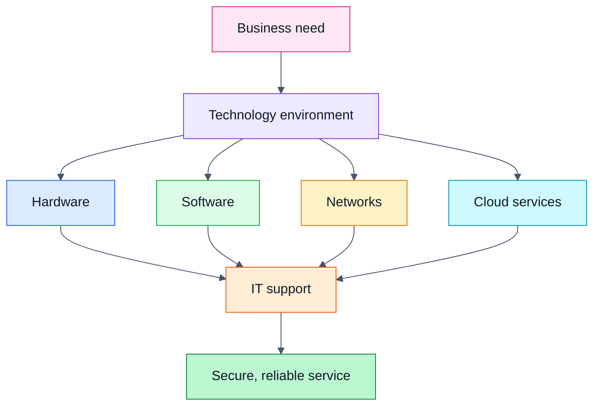

### What is IT support?

**What:**  
IT support is the function responsible for helping users and organisations use, maintain, secure and troubleshoot technology.

**Why it matters:**  
A technical failure can prevent employees from working, interrupt business processes, expose information, or create financial and reputational risk.

**How it works:**  
Support professionals combine technical knowledge with a structured diagnostic process:

1. Understand the problem.
2. Gather evidence.
3. Identify the affected component or service.
4. Test likely causes.
5. Apply an appropriate fix.
6. Verify the result.
7. Document what happened.

**When to use this mindset:**  
Whenever a user reports a technology problem — from a failed application to a connectivity issue or hardware fault.

### Practical example

A user says:

> "My computer is connected to Wi-Fi, but I cannot access the company application."

Do not immediately assume that the Wi-Fi connection is the problem.

A structured support investigation could examine:

- Whether the computer has network connectivity.
- Whether other websites work.
- Whether the application server is available.
- Whether the user's account is working.
- Whether the application itself is failing.
- Whether a recent update changed behaviour.
- Whether other users have the same problem.

This is the beginning of diagnostic thinking.

---

# The IT and Cloud Support Mindset

The source material repeatedly connects IT support with both traditional computer systems and cloud environments.

## Traditional IT support

A traditional support environment may involve:

- Physical computers
- Local storage
- Printers and peripherals
- Operating systems
- Local applications
- Corporate networks
- Servers
- Backup systems

## Cloud support

A cloud environment may additionally involve:

- Cloud-hosted applications
- Virtual infrastructure
- Cloud storage
- Identity and access management
- Resource monitoring
- Security controls
- Cost management
- Disaster recovery
- Cloud configuration

The course specifically introduces Azure as an important part of the cloud-support learning journey.

> **Source reference:** The supplied material describes gaining experience with cloud-borne applications using Azure services and infrastructure and learning to use cloud-native features in Microsoft 365. fileciteturn0file0L2-L3

---

# Core Learning Outcomes

By the end of the course, the source states that learners should be able to:

### 1. Identify computer components

You should recognise major components such as:

- CPU
- Memory
- Storage
- Input/output devices
- Peripherals

### 2. Explain the relationship between hardware and the operating system

You should understand:

- CPU processing
- Memory management
- Device drivers
- Operating-system interaction with hardware

### 3. Understand hardware and software relationships

You should understand the conceptual relationship between:

- Hardware
- Operating systems
- Software
- Abstraction
- System architecture

> **Source reference:** These learning outcomes are explicitly listed in the supplied material. fileciteturn0file0L19-L25

---

# Course Roadmap

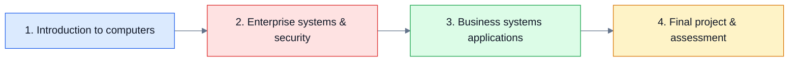

| Module | Main focus | Key outcomes |
|---|---|---|
| Introduction to computers | Hardware, OS, software, memory, networking | Understand computer-system fundamentals |
| Enterprise systems and security | Servers, storage, backups, environments, patching | Reduce operational and security risks |
| Business systems applications | Business software, email, data storage | Understand workplace technology |
| Final project and assessment | Applied computer-support scenario | Combine knowledge into a practical solution |

> **Source reference:** The source describes these four areas and their associated outcomes. fileciteturn0file0L29-L73

---

# Module 1 — Introduction to Computers

## 1. Computer Hardware

### What

Hardware is the physical part of a computer system.

Examples introduced in the source include:

- CPU
- Memory
- Storage
- Input/output devices
- Peripherals

### Why

Hardware provides the physical resources required for software to execute.

### How

A simplified flow is:

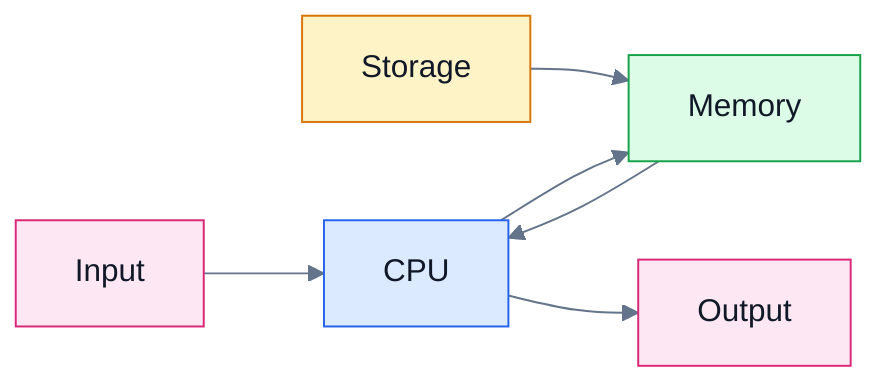

### When

Hardware knowledge is required when:

- Diagnosing performance problems
- Recommending upgrades
- Replacing faulty components
- Checking compatibility
- Supporting peripherals

### Practical example

If a computer becomes extremely slow when several applications are open, memory capacity may be one possible area to investigate.

> **Instructor Expansion:** A slow computer is not automatically a memory problem. A support specialist should gather evidence rather than replace hardware based only on symptoms.

---

# CPU, Memory and Storage — The Basic Mental Model

A useful beginner mental model is:

- **CPU = performs computation**
- **Memory/RAM = working area**
- **Storage = persistent data location**

This is an analogy rather than a complete architectural description.

## CPU

### What

The Central Processing Unit executes instructions.

### Why

Applications ultimately require instructions to be processed by computing hardware.

### How

At a simplified level, the processor repeatedly:

1. Fetches instructions.
2. Decodes them.
3. Executes them.
4. Produces results.


### When

CPU knowledge matters when investigating:

- High CPU utilisation
- Application slowness
- Processor compatibility
- Hardware upgrades

---

## Memory

### What

Memory generally refers to the working memory used by active programs and the operating system.

### Why

Applications need fast access to data and instructions while they run.

### How

A simplified model:

```text
Storage
   |
   | Load program/data
   v
RAM / Memory
   |
   | Instructions/data available to CPU
   v
CPU
```

### When

Memory becomes especially relevant when:

- Many applications run simultaneously.
- Applications require large amounts of working data.
- The operating system is under memory pressure.
- Diagnosing system performance.

---

## Storage

### What

Storage provides persistent data retention.

Examples include:

- SSDs
- Hard disk drives
- External storage
- Network storage
- Cloud storage

### Why

RAM is not intended to be the permanent home of user files.

### How

A typical application may:

1. Exist as files on storage.
2. Be loaded into memory.
3. Have instructions processed by the CPU.
4. Save resulting data back to storage.

### When

Storage concepts matter when:

- A disk is nearly full.
- Data needs to be backed up.
- Storage needs to be upgraded.
- Data must be recovered.
- Business data needs an appropriate storage strategy.

---

# Peripherals and Input/Output

## What

Peripherals are devices connected to a computer to provide additional functionality.

Examples include:

- Keyboard
- Mouse
- Monitor
- Printer
- Webcam
- External storage

### Why

Computers need ways to receive information and provide results to users.

### How

A simplified interaction looks like:

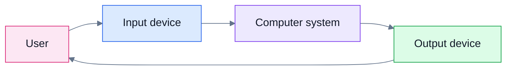

### Practical example

If a printer stops working:

- Check power.
- Check connection.
- Check whether the OS detects the printer.
- Check the printer driver.
- Check the print queue.
- Check network connectivity if it is a network printer.

This demonstrates why support professionals need knowledge across hardware and software rather than treating them as isolated systems.

---

# Operating Systems

## What

An operating system, or OS, is the core software layer that manages computer resources and provides services for applications and users.

Examples include:

- Windows
- Linux
- macOS

> **Instructor Expansion:** The supplied chapter focuses on the OS's role rather than providing a detailed operating-system taxonomy.

## Why

Without an operating system, applications would need to interact directly with hardware in highly hardware-specific ways.

The OS provides an abstraction layer between applications and hardware.

## How

A simplified architecture is:

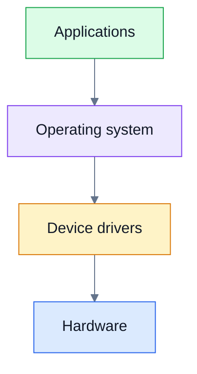

## When

Operating-system knowledge is essential when:

- Installing software
- Managing users
- Troubleshooting applications
- Managing hardware
- Applying updates
- Diagnosing system behaviour

---

# CPU Processes

## What

A process can be understood as a running instance of a program.

### Why

The operating system needs to manage multiple running activities and allocate system resources to them.

### How

At a simplified level:

```text
Application
     |
     v
Running process
     |
     +--> CPU time
     +--> Memory
     +--> Files/resources
```

The OS coordinates access to these resources.

### When

Process knowledge helps when:

- An application becomes unresponsive.
- CPU usage is unexpectedly high.
- Multiple applications compete for resources.
- A support technician needs to identify a problematic process.

---

# Memory Management

## What

Memory management is the operating system's handling of memory resources.

## Why

Many programs can run simultaneously, but physical memory is finite.

## How

The OS tracks which portions of memory are being used and by which processes.

A simplified conceptual model:

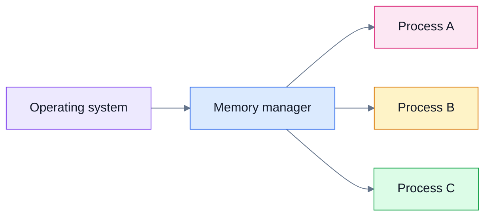

### When

Memory management becomes relevant when diagnosing:

- Application crashes
- Memory exhaustion
- Performance degradation
- Excessive background processes

---

# Device Drivers

## What

A device driver is software that enables the operating system to communicate with particular hardware.

## Why

Different hardware devices have different capabilities and interfaces. The OS needs a mechanism for interacting with them.

## How

Conceptually:

```text
Application
    ↓
Operating system
    ↓
Device driver
    ↓
Hardware device
```

For example:

```text
Print command
    ↓
Application
    ↓
Windows
    ↓
Printer driver
    ↓
Printer
```

## When

Driver knowledge is especially useful when:

- A device is not recognised.
- A peripheral behaves incorrectly.
- Hardware was recently installed.
- A driver update introduced a problem.
- A device requires vendor-specific support.

> **Important troubleshooting principle:** A hardware problem can actually be a software/driver problem, and a software symptom can sometimes be caused by hardware.

---

# Hardware–Software Abstraction

## What

Abstraction hides unnecessary implementation details behind a simpler interface.

## Why

Without abstraction, application developers would need detailed knowledge of every underlying hardware device.

## How

Consider printing:

```text
User
 ↓
Application: "Print this document"
 ↓
Operating system
 ↓
Driver
 ↓
Printer hardware
```

The application generally does not need to understand the electrical details of the printer.

## When

Abstraction is useful whenever different layers of a system need to interact without exposing every implementation detail.

---

# System Updates and Patching

## What

A software update changes software to improve functionality, fix bugs, address security issues, or otherwise maintain the system.

A patch is commonly used to describe a targeted software update, particularly one addressing a defect or vulnerability.

## Why

Unpatched systems can contain known vulnerabilities.

The source explicitly connects maintenance and patching with reducing vulnerabilities.

> **Source reference:** The enterprise-systems module states that learners should understand the significance of maintenance and patches in reducing vulnerabilities. fileciteturn0file0L40-L49

## How

A simplified patch-management lifecycle is:

```mermaid
%%{init: {
  "theme": "base",
  "themeVariables": {
    "primaryColor": "#fee2e2",
    "lineColor": "#64748b"
  }
}}%%
flowchart LR
    A["Identify update"]:::identify --> B["Assess impact"]:::assess
    B --> C["Test"]:::test
    C --> D["Deploy"]:::deploy
    D --> E["Verify"]:::verify
    E --> F["Document"]:::document

    classDef identify fill:#dbeafe,stroke:#2563eb,color:#111827
    classDef assess fill:#fef3c7,stroke:#d97706,color:#111827
    classDef test fill:#ede9fe,stroke:#7c3aed,color:#111827
    classDef deploy fill:#dcfce7,stroke:#16a34a,color:#111827
    classDef verify fill:#cffafe,stroke:#0891b2,color:#111827
    classDef document fill:#fce7f3,stroke:#db2777,color:#111827
```

## When

Patching matters during:

- Routine maintenance
- Vulnerability remediation
- Security incident response
- Application lifecycle management
- Operating-system maintenance

---

# Network Communication

## What

Network communication allows systems and devices to exchange information.

## Why

Modern IT systems rarely operate in isolation.

Users need networks to access:

- Business applications
- Shared resources
- Internet services
- Cloud services
- Servers

## How

A simplified model:

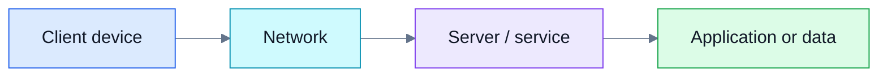

## When

Network concepts matter whenever:

- A user cannot access an application.
- Devices cannot communicate.
- A cloud service cannot be reached.
- Shared resources are unavailable.

---

# Module 2 — Enterprise Systems and Security

The source identifies three major themes:

1. Servers
2. Storage and backups
3. Computing environments
4. Maintenance and patching

The module is strongly connected to reliability and risk reduction.

> **Source reference:** The module learning outcomes explicitly include servers, storage, backups, computing environments, maintenance and patches. fileciteturn0file0L40-L49

---

# Servers, Storage and Backups

## Servers

### What

A server is a system that provides services or resources to other systems or users.

### Why

Centralised services can allow organisations to provide shared capabilities.

### How

Conceptually:

```text
Client 1 ─┐
Client 2 ─┼──> Server ──> Service / Data
Client 3 ─┘
```

### When

Servers are relevant when organisations need shared services, applications, data or infrastructure.

---

## Backups

### What

A backup is a separate copy of data maintained so that data can be recovered after loss or corruption.

### Why

Data can be lost through:

- Hardware failure
- Accidental deletion
- Software failure
- Security incidents
- Operational mistakes
- Other disruptive events

### How

A simplified backup strategy:

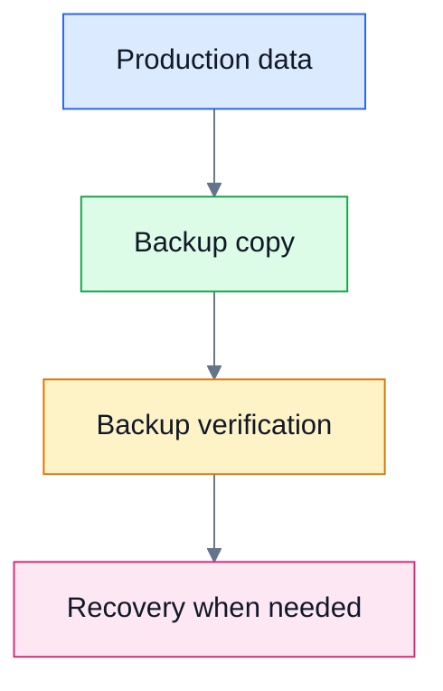

### When

Backups are required whenever data is sufficiently valuable that losing it would cause unacceptable consequences.

> **Critical distinction:** A backup is useful only if it can actually be restored. A support professional should therefore think about both backup creation and recovery.

---

# Computing Environments

## What

A computing environment describes the technological context in which systems operate.

Examples may include:

- Local/on-premises systems
- Cloud environments
- Hybrid environments

> **Instructor Expansion:** These categories provide a useful general framework for understanding the environments introduced by the course. The supplied chapter does not provide a detailed taxonomy of each environment.

## Why

Different environments have different:

- Management responsibilities
- Security considerations
- Cost structures
- Availability characteristics
- Operational procedures

## How

A simplified comparison:

| Environment | Basic idea | Typical consideration |
|---|---|---|
| On-premises | Organisation manages physical infrastructure | Hardware and facilities management |
| Cloud | Infrastructure/services are provided through a cloud platform | Configuration, identity, security and cost |
| Hybrid | Combination of on-premises and cloud resources | Integration and governance |

---

# Security and the Threat Landscape

## What

Security protects systems, users, applications and information against unauthorised or harmful activity.

The supplied chapter introduces security threats as an important starting point for computer support professionals.

> **Source reference:** The course begins by examining the current threat landscape and the challenges it creates for computer support specialists. fileciteturn0file0L10-L12

## Why

Security incidents can affect:

- Confidentiality
- Integrity
- Availability
- Business continuity
- User trust

## How

A support professional contributes to security through activities such as:

- Applying updates
- Following access controls
- Recognising suspicious activity
- Protecting data
- Following organisational procedures
- Escalating security incidents appropriately

## When

Security should be considered during every IT-support activity rather than only after an incident.

---

# Module 3 — Business Systems Applications

The source introduces business software as technology that improves productivity by helping users perform organisational tasks.

> **Source reference:** The business-systems module focuses on business software, its uses, email applications and business data-storage solutions. fileciteturn0file0L51-L60

---

# Business Software

## What

Business software is software used to perform or support organisational activities.

Examples can include:

- Email applications
- Productivity applications
- Collaboration tools
- Business databases
- Customer-management applications
- Finance applications

## Why

Technology should support business outcomes, not merely exist as technology.

## How

A business application typically:

```text
Business requirement
        ↓
Software capability
        ↓
User workflow
        ↓
Business outcome
```

## When

Business-software knowledge matters when:

- Selecting software
- Supporting users
- Troubleshooting applications
- Recommending upgrades
- Assessing limitations

---

# Email Applications

The source specifically calls out common email-app functions and secure usage.

## What

An email application enables users to compose, send, receive, organise and manage email.

## Why

Email is a common business communication mechanism and therefore also an important security surface.

## How

A support professional may need to consider:

- Account configuration
- Connectivity
- Authentication
- Mail synchronisation
- Attachments
- Spam/junk handling
- Suspicious messages

## When

Email support is required when:

- Messages are not sending.
- Messages are not arriving.
- Synchronisation fails.
- An account cannot authenticate.
- A suspicious message is reported.

> **Instructor Expansion:** Security awareness is particularly important for email because malicious messages can attempt to manipulate users into revealing information, opening unsafe content, or performing unauthorised actions.

---

# Data Storage in Business

## What

Business data storage is the set of technologies and practices used to retain organisational information.

## Why

Businesses need data to be:

- Available
- Protected
- Recoverable
- Appropriately managed

## How

Possible storage approaches include:

- Local storage
- Server storage
- Network storage
- Cloud storage
- Backup storage

## When

Storage decisions become important when:

- A business is growing.
- Storage capacity is becoming insufficient.
- Data needs stronger protection.
- Users need shared access.
- Recovery requirements change.

---

# Module 4 — Final Project and Assessment

The final project places the learner in the role of an IT consultant.

The source states that the scenario involves helping a business:

- Set up computer systems.
- Select appropriate hardware.
- Select appropriate software.
- Plan connectivity.
- Design a practical solution based on business needs.

> **Source reference:** The final project is described as a real-life-style computer support scenario involving hardware, software and connectivity decisions. fileciteturn0file0L62-L65

---

# The IT Consultant Scenario

A strong IT consultant does not begin with:

> "Which computer should we buy?"

A better question is:

> "What does the business need to accomplish, and what technology best supports those requirements?"

## Requirements-first thinking

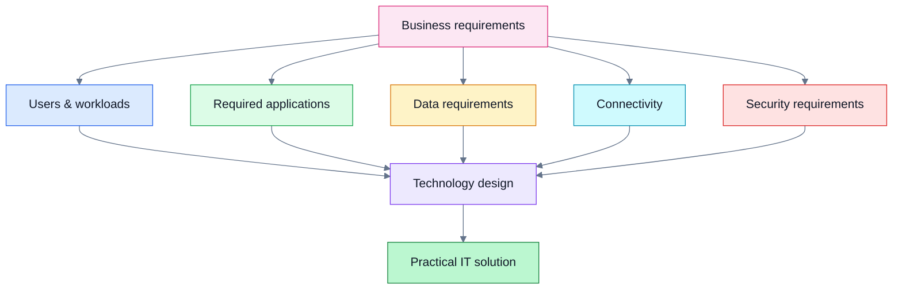

## Example

Imagine a small company with:

- 20 employees
- Email requirements
- Shared business documents
- Video meetings
- A business application
- Remote workers

A technology recommendation should consider:

1. User requirements.
2. Application requirements.
3. Device specifications.
4. Network connectivity.
5. Data storage.
6. Security.
7. Backup and recovery.
8. Ongoing maintenance.
9. Cost.

The best solution is not necessarily the most expensive one.

---

# IT Troubleshooting Mindset

The source emphasises diagnostic skills and analysing diagnostic-tool outputs.

> **Source reference:** The programme describes skills including analysing diagnostic outputs, recommending upgrades, diagnosing IT issues, implementing backup strategies, managing updates, enforcing compliance, monitoring resources and creating disaster-recovery plans. fileciteturn0file0L4-L4

## A general troubleshooting framework

### Step 1 — Define the problem

Ask:

- What exactly is failing?
- Who is affected?
- When did it start?
- What changed?

### Step 2 — Gather evidence

Collect:

- Error messages
- Symptoms
- Logs
- Diagnostic output
- User observations
- Recent changes

### Step 3 — Form hypotheses

Possible causes might include:

- Hardware
- Software
- Configuration
- Network
- Account/permissions
- Update
- External service

### Step 4 — Test one hypothesis at a time

Avoid changing ten things simultaneously.

### Step 5 — Apply the smallest appropriate fix

A controlled change makes troubleshooting easier.

### Step 6 — Verify

Confirm that:

- The original problem is resolved.
- The expected functionality works.
- No new problem has been introduced.

### Step 7 — Document

Record:

- Symptoms
- Root cause
- Resolution
- Actions taken
- Relevant evidence

---

# Diagnostic Thinking: Symptoms vs Root Cause

A key IT-support distinction:

```text
Symptom ≠ Root cause
```

Example:

> "The application is slow."

Possible causes:

- High CPU usage
- Insufficient memory
- Network latency
- Application-server load
- Database performance
- Disk performance
- Software defect

Therefore, a support professional should not automatically equate the symptom with the cause.

---

# Technical Concepts and Mathematics

This introductory chapter does not present mathematical formulas that require calculation.

However, one useful general systems concept is resource utilisation.

For example, CPU utilisation can conceptually be expressed as:

$$
\text{CPU Utilisation} =
\frac{\text{CPU time spent doing useful work}}
{\text{Total available CPU time}}
\times 100\%
$$

> **Instructor Expansion:** This formula is provided as supporting technical context. It is not presented as a formula in the supplied chapter.

A similar conceptual approach can be used for storage:

$$
\text{Storage Utilisation} =
\frac{\text{Used Storage}}
{\text{Total Storage Capacity}}
\times 100\%
$$

These measurements can help support professionals interpret diagnostic information.

---

# MS-900 and AZ-900 Preparation

The source identifies two Microsoft fundamentals exams as part of the programme's preparation:

- **MS-900 — Microsoft 365 Fundamentals**
- **AZ-900 — Microsoft Azure Fundamentals**

> **Source reference:** The supplied material explicitly states that the programme prepares learners for MS-900 and AZ-900. fileciteturn0file0L4-L5

## Why fundamentals certifications matter

They can provide structured validation of foundational knowledge.

However, certification knowledge should be combined with practical ability.

A good support professional should be able to answer both:

> "What is this technology?"

and:

> "How would I troubleshoot or use it in a real environment?"

---

# Study Strategy

The source gives several recommendations for succeeding in an online course.

## 1. Set daily study goals

Make goals specific and measurable.

Bad:

> "Study IT today."

Better:

> "Complete the Module 1 videos and finish the associated activity."

## 2. Create a dedicated study space

A consistent study environment can make learning easier.

## 3. Schedule study time

Put learning sessions on your calendar.

## 4. Keep yourself accountable

Use:

- Friends
- Communities
- Course discussions
- Progress sharing

## 5. Take notes

The source specifically recommends note-taking to encourage active thinking and improve comprehension.

## 6. Join discussions

Discussion forums can help with:

- Questions
- Assignments
- Resources
- Peer learning

## 7. Do one thing at a time

Avoid excessive multitasking.

## 8. Take breaks

Breaks can improve sustained learning and help when you are stuck.

## 9. Complete practical activities

The source strongly encourages completing quizzes, activities and practical learning environments.

> **Source reference:** The supplied learning guidance covers daily goals, dedicated study space, scheduling, accountability, notes, discussions, focused work, breaks and completion of practical activities. fileciteturn0file0L79-L125

---

# Practical Learning Workflow

For technical subjects, use a four-stage loop:

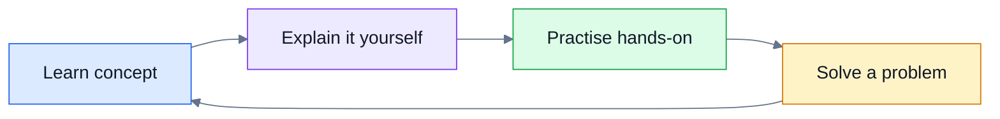

For every major topic, ask:

1. What is it?
2. Why does it exist?
3. How does it work?
4. When would I use or troubleshoot it?
5. What can go wrong?
6. How would I prove the cause?
7. How would I verify the fix?

---

# Code and Command Examples

The supplied Chapter 1 text does not contain PowerShell, Bash or Python code.

Therefore, no source-derived commands are included here.

> **Instructor Expansion:** When later course chapters introduce commands, the recommended note-taking format is:

```powershell
# Example only — not taken from the supplied Chapter 1 material.
# Get-ComputerInfo retrieves operating-system and computer information.
Get-ComputerInfo
```

When documenting a command, record:

- Command name
- Purpose
- Syntax
- Important parameters
- Expected output
- Common errors
- Safe troubleshooting use cases

---

# Fun Facts

## Fun Fact 1 — The CPU is not the whole computer

It is tempting to think:

> "The processor is the computer."

In reality, useful computing depends on multiple layers working together:

**Hardware + firmware + operating system + drivers + applications + data + networking**

---

## Fun Fact 2 — A "software problem" can be caused by hardware

For example, an application crash may be associated with:

- Memory problems
- Storage problems
- Overheating
- Driver faults
- Power problems

This is why diagnosis should be evidence-driven.

---

## Fun Fact 3 — The operating system is an abstraction layer

Applications can request services without needing to know the low-level electrical details of every hardware device.

That abstraction is one of the reasons modern computing is practical at scale.

---

## Fun Fact 4 — A backup is not the same thing as recovery

Having a backup file does not automatically prove that an organisation can recover successfully.

A useful operational question is:

> "Have we tested restoration?"

---

## Fun Fact 5 — The best IT support is preventative

Fixing a failure is important.

Preventing the failure is often even better.

Examples include:

- Patching systems
- Monitoring resources
- Maintaining backups
- Documenting configurations
- Applying security controls

---

# Practice Questions

## Multiple-choice questions

### Q1. Which component primarily executes computer instructions?

A. Storage device  
B. CPU  
C. Monitor  
D. Keyboard

**Answer:** B — CPU.

---

### Q2. Which component is primarily used as working memory for active processes?

A. RAM  
B. SSD  
C. Printer  
D. Monitor

**Answer:** A — RAM.

---

### Q3. What is one major role of an operating system?

A. Only display images  
B. Manage hardware and provide services for applications  
C. Replace all hardware  
D. Permanently store every file

**Answer:** B.

---

### Q4. What is a device driver?

A. A physical storage device  
B. Software that helps the OS communicate with hardware  
C. A type of network cable  
D. A backup copy

**Answer:** B.

---

### Q5. Why are patches important?

A. They always increase storage capacity.
B. They can help address vulnerabilities and software defects.
C. They eliminate the need for backups.
D. They replace the CPU.

**Answer:** B.

---

### Q6. What is the main purpose of a backup?

A. Increase CPU speed  
B. Recover data after loss or corruption  
C. Improve monitor resolution  
D. Replace an operating system

**Answer:** B.

---

## Short-answer questions

1. Explain the difference between hardware and software.
2. Why does an operating system need to manage memory?
3. What role does a device driver play?
4. Why should IT support professionals gather evidence before changing a system?
5. Why is patch management important?
6. What is the purpose of a backup?
7. Name three areas an IT consultant should consider when designing a business computer solution.
8. Why is security relevant to everyday IT support?
9. Explain the difference between a symptom and a root cause.
10. Why is practical experience important alongside theoretical knowledge?

---

## Scenario-based troubleshooting questions

### Scenario 1 — Slow computer

A user reports:

> "My computer is very slow."

What should you investigate?

**Expected reasoning:**

- Ask when the problem started.
- Determine whether all applications are affected.
- Check CPU usage.
- Check memory usage.
- Check storage capacity/performance.
- Ask about recent updates or software installations.
- Determine whether the issue affects only one user/device.

Do not immediately recommend replacing the computer.

---

### Scenario 2 — Printer unavailable

A user cannot print.

Develop a troubleshooting sequence covering:

1. Power.
2. Physical/network connection.
3. Device detection.
4. Driver.
5. Print queue.
6. Application.
7. Network availability if applicable.

---

### Scenario 3 — Business application unavailable

Several employees report that the same business application cannot be accessed.

What does this tell you?

**Possible inference:** The problem may be broader than an individual workstation.

Investigate:

- Whether multiple users are affected.
- Whether the network is working.
- Whether the application service is available.
- Whether authentication is working.
- Whether a recent change occurred.

---

# Exercises

## Exercise 1 — Build a computer-system map

Draw a diagram containing:

- CPU
- RAM
- Storage
- OS
- Device drivers
- Application
- Peripheral

Show the direction of interaction between them.

**Goal:** Build a mental model of the computer stack.

---

## Exercise 2 — Hardware diagnosis

Create a fictional support ticket:

> "The laptop has become slow."

Write:

- Five questions you would ask.
- Five measurements you would check.
- Three possible causes.
- One test for each possible cause.
- How you would verify the fix.

---

## Exercise 3 — Backup planning

Choose a fictional small business.

Identify:

- Critical data
- Primary storage
- Backup location
- Backup frequency
- Recovery requirements
- Consequences of data loss

Then explain your design.

---

## Exercise 4 — Patch-management simulation

Create a spreadsheet with:

| System | Update | Risk | Test required | Deployment status | Verification |
|---|---|---|---|---|---|
| PC-01 | OS update | Medium | Yes | Pending | Pending |
| PC-02 | Security patch | High | Yes | Complete | Complete |

Add at least ten fictional systems.

---

## Exercise 5 — IT consultant project

Design a basic technology solution for a 20-person company.

Your design should include:

- User devices
- Operating systems
- Business applications
- Network connectivity
- Storage
- Backup
- Security
- Maintenance
- Support procedures

Then explain why each decision satisfies a business requirement.

---

# Memory Hooks

## CPU → "Compute"

**CPU = Compute**

Think:

> "The CPU does the work."

---

## RAM → "Running"

**RAM = Running workspace**

Think:

> "What am I actively working with right now?"

---

## Storage → "Stay"

**Storage = Data stays**

Think:

> "Where does the data remain when the application is closed?"

---

## OS → "Orchestrator"

Think:

> **OS = Orchestrator**

The operating system coordinates:

- Hardware
- Processes
- Memory
- Applications
- Devices

---

## Driver → "Translator"

Think:

> **Driver = Translator**

Application/OS language  
↓  
Driver  
↓  
Hardware-specific communication

---

## Troubleshooting → "E-T-H-F-V-D"

Use:

**E — Establish the problem**  
**T — Take evidence**  
**H — Hypothesise**  
**F — Fix/test**  
**V — Verify**  
**D — Document**

---

## Backup → "Copy + Recover"

Do not remember backup merely as:

> "Make a copy."

Remember:

> **Backup = Copy + Ability to Recover**

---

## Consultant mindset → "Need before Device"

Instead of:

> "What laptop should we buy?"

Think:

> **Business need → Workload → Requirements → Technology → Verification**

---

# Chapter 1 Master Summary

The most important lesson from this introductory chapter is that IT support is a systems discipline.

A computer is not merely a collection of components. It is an integrated system:

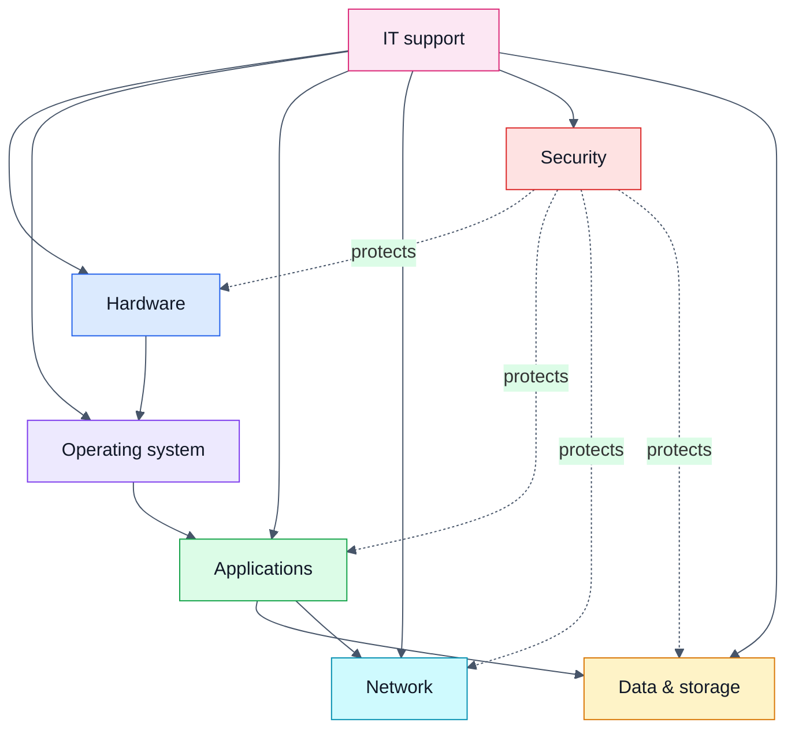

## The five ideas to retain

1. **Know the components** — CPU, memory, storage, peripherals.
2. **Understand the layers** — hardware, drivers, operating system and applications.
3. **Think diagnostically** — symptoms are not necessarily root causes.
4. **Think operationally** — backups, updates, maintenance and security protect business continuity.
5. **Think like a consultant** — technology decisions should start with business requirements.

The supplied course material describes the overall objective as developing both theoretical and practical knowledge and preparing learners for real-world IT and cloud-support scenarios. fileciteturn0file0L15-L17

---

# Final Revision Checklist

Before moving to the next chapter, make sure you can explain without looking at your notes:

- [ ] What CPU, memory and storage do.
- [ ] What peripherals are.
- [ ] What an operating system does.
- [ ] Why operating systems manage memory.
- [ ] What a process is.
- [ ] Why device drivers exist.
- [ ] What abstraction means in a computer system.
- [ ] Why system updates and patches matter.
- [ ] Why networking matters to IT support.
- [ ] Why backups are necessary.
- [ ] Why restore testing matters.
- [ ] What business software is.
- [ ] Why email security matters.
- [ ] How an IT consultant approaches requirements.
- [ ] Why security should be considered during routine support.
- [ ] How to distinguish a symptom from a root cause.
- [ ] Why evidence should be collected before applying a fix.
- [ ] How to verify that a troubleshooting solution actually worked.

---

# Source Scope

This README is based on the supplied **Chapter 1 — Introduction to the course** material.

The source explicitly covers:

- The purpose and structure of the IT/cloud support programme.
- Computer hardware fundamentals.
- Operating systems.
- CPU processes.
- Memory management.
- Device drivers.
- Hardware/software relationships.
- Security threats.
- Servers.
- Storage and backups.
- Computing environments.
- Maintenance and patching.
- Business software.
- Email applications.
- Business data storage.
- A scenario-based final project.
- Assessment preparation.
- MS-900 and AZ-900 preparation.
- Recommended learning practices.

Where the README goes beyond those introductory statements to provide technical intuition, examples, troubleshooting frameworks, diagrams, formulas or exercises, that material is **instructor expansion** intended to support learning rather than a claim that those details appeared verbatim in the supplied chapter.

---

## End of Chapter 1 Notes

**Recommended next step:** After studying this README, work through the practice questions without looking at the answers, then complete the computer-system mapping exercise before moving to the next course chapter.
