# Microsoft IT Support Specialist Professional Certificate
## Chapter 2 — Introduction to Generative AI

> Comprehensive learning notes based on the supplied Chapter 2 course material.
>
> **Source discipline:** The core concepts, examples, applications, risks, terminology and framing in these notes are grounded in the supplied chapter. Where additional explanatory detail is added to improve intuition or practical understanding, it is labelled **Instructor Expansion** rather than presented as source text.

---

## Table of Contents

- [1. Chapter Overview](#1-chapter-overview)
- [2. What Is Generative AI?](#2-what-is-generative-ai)
- [3. AI, Machine Learning and Deep Learning](#3-ai-machine-learning-and-deep-learning)
- [4. Neural Networks](#4-neural-networks)
- [5. Generative AI vs Traditional AI](#5-generative-ai-vs-traditional-ai)
- [6. Major Generative AI Capabilities](#6-major-generative-ai-capabilities)
  - [6.1 Text Generation](#61-text-generation)
  - [6.2 Image Generation](#62-image-generation)
  - [6.3 Audio Generation](#63-audio-generation)
  - [6.4 Code Generation](#64-code-generation)
  - [6.5 Data Synthesis](#65-data-synthesis)
- [7. Generative Adversarial Networks](#7-generative-adversarial-networks)
- [8. Transformers and Attention](#8-transformers-and-attention)
- [9. GPT](#9-gpt)
- [10. NLP](#10-nlp)
- [11. Tokenisation](#11-tokenisation)
- [12. Word2vec](#12-word2vec)
- [13. BERT](#13-bert)
- [14. Variational Autoencoders](#14-variational-autoencoders)
- [15. Training and Learning Approaches](#15-training-and-learning-approaches)
- [16. Data Quality and Generalisation](#16-data-quality-and-generalisation)
- [17. Generative AI in Business](#17-generative-ai-in-business)
- [18. Marketing and Customer Engagement](#18-marketing-and-customer-engagement)
- [19. Operations and Logistics](#19-operations-and-logistics)
- [20. Human Resources](#20-human-resources)
- [21. Document Management and Technical Writing](#21-document-management-and-technical-writing)
- [22. Brand Voice and Style](#22-brand-voice-and-style)
- [23. Customer Service and Automation](#23-customer-service-and-automation)
- [24. Personalisation Architecture](#24-personalisation-architecture)
- [25. Automation Infrastructure](#25-automation-infrastructure)
- [26. Innovation, Simulation and Scenario Planning](#26-innovation-simulation-and-scenario-planning)
- [27. Industry Implications](#27-industry-implications)
- [28. Workplace and Career Impact](#28-workplace-and-career-impact)
- [29. Limitations of Generative AI](#29-limitations-of-generative-ai)
- [30. Hallucination, Inaccuracy and Reliability](#30-hallucination-inaccuracy-and-reliability)
- [31. Bias and Fairness](#31-bias-and-fairness)
- [32. Privacy and Data Protection](#32-privacy-and-data-protection)
- [33. Intellectual Property](#33-intellectual-property)
- [34. Deepfakes and Misinformation](#34-deepfakes-and-misinformation)
- [35. Explainability and the Black-Box Problem](#35-explainability-and-the-black-box-problem)
- [36. Accountability](#36-accountability)
- [37. Common-Sense Reasoning](#37-common-sense-reasoning)
- [38. Human Oversight](#38-human-oversight)
- [39. Responsible AI](#39-responsible-ai)
- [40. AI Implementation in the Workplace](#40-ai-implementation-in-the-workplace)
- [41. IT Support Perspective](#41-it-support-perspective)
- [42. Chef's Table Case Study](#42-chefs-table-case-study)
- [43. Technical Mental Model](#43-technical-mental-model)
- [44. Mathematics and Technical Intuition](#44-mathematics-and-technical-intuition)
- [45. Practical Examples](#45-practical-examples)
- [46. Fun Facts](#46-fun-facts)
- [47. Practice Questions](#47-practice-questions)
- [48. Exercises](#48-exercises)
- [49. Memory Hooks](#49-memory-hooks)
- [50. Final Revision Checklist](#50-final-revision-checklist)
- [51. Chapter Summary](#51-chapter-summary)

---

# 1. Chapter Overview

Generative AI is presented in this chapter as a rapidly evolving area of artificial intelligence that can generate new content such as:

- Text
- Images
- Audio
- Video
- Code
- Synthetic data

The chapter frames generative AI as both a technical development and a business transformation. It discusses:

1. What generative AI is.
2. The technologies behind it.
3. Major content-generation capabilities.
4. Business applications.
5. Industry implications.
6. Career implications.
7. Limitations and risks.
8. Ethical considerations.
9. Responsible deployment.

The source describes generative AI as using sophisticated statistical techniques to create content and identifies GANs and transformer models as important examples of generative-model technology.

---

# 2. What Is Generative AI?

## Definition

### What

Generative artificial intelligence is a category of AI technology focused on generating new content from patterns learned from existing data.

The chapter describes generative AI as capable of creating content across areas such as:

- Text
- Images
- Audio
- Video
- Code
- Synthetic datasets

### Why it matters

Traditional software normally follows explicitly defined instructions.

Generative AI introduces a different interaction model:

```text
Traditional software
Input → Explicit rules → Output

Generative AI
Input/data → Learned patterns → Generated output
```

This makes it possible to automate or accelerate tasks involving:

- Writing
- Design
- Programming
- Customer communication
- Data creation
- Content production
- Business analysis

### How it works

At a high level:

```mermaid
%%{init: {
  "theme": "base",
  "themeVariables": {
    "primaryColor": "#dbeafe",
    "secondaryColor": "#dcfce7",
    "tertiaryColor": "#fef3c7",
    "lineColor": "#475569",
    "fontFamily": "Arial"
  }
}}%%
flowchart LR
    D["Training data"]:::data --> M["Generative model"]:::model
    M --> P["Prompt / input"]:::prompt
    P --> O["Generated output"]:::output
    O --> H["Human evaluation"]:::human

    classDef data fill:#dbeafe,stroke:#2563eb,color:#111827
    classDef model fill:#ede9fe,stroke:#7c3aed,color:#111827
    classDef prompt fill:#fef3c7,stroke:#d97706,color:#111827
    classDef output fill:#dcfce7,stroke:#16a34a,color:#111827
    classDef human fill:#fce7f3,stroke:#db2777,color:#111827
```

### When to use it

Generative AI is particularly useful when the task involves producing or transforming content, for example:

- Drafting documentation
- Creating marketing copy
- Generating code suggestions
- Creating synthetic examples
- Producing visual concepts
- Creating conversational responses

### Practical example

A clothing retailer could use generative AI to create visual concepts for new clothing designs based on customer preferences.

The chapter uses this fashion-retail scenario to illustrate how generative AI can support product design and personalisation.

---

# 3. AI, Machine Learning and Deep Learning

Understanding the relationship between AI, ML and DL is essential.

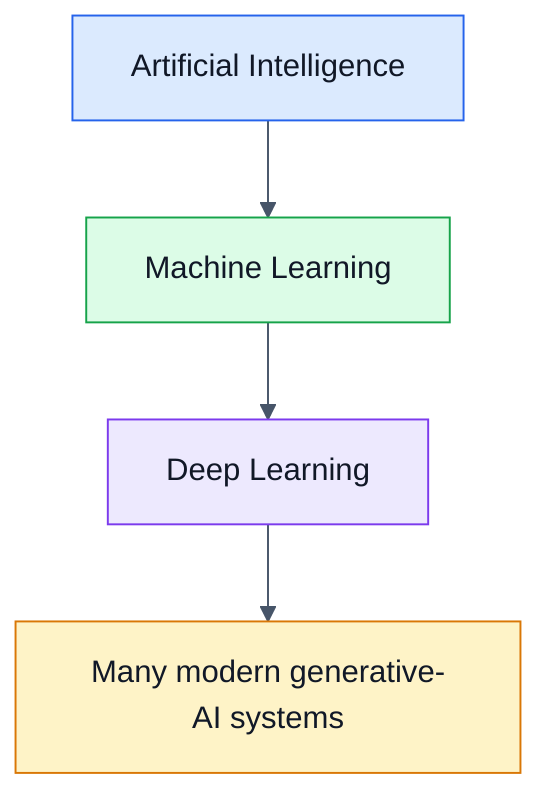

## Artificial Intelligence

### What

AI is the broader field of computing concerned with creating systems capable of tasks that typically require human intelligence.

The chapter includes examples such as:

- Reasoning
- Learning
- Problem-solving
- Perception
- Language understanding
- Movement and manipulation

### Why

AI allows computing systems to handle tasks that are difficult to solve through simple fixed rules.

### How

AI can range from:

- Rule-based systems
- Machine-learning systems
- Neural networks
- Deep-learning systems

### When

AI is useful whenever a computer system needs to perform tasks involving patterns, decisions, perception, language or learning.

---

# 4. Machine Learning

## What

Machine learning is a branch of AI in which algorithms learn patterns from data rather than relying entirely on explicit instructions.

The chapter describes ML as enabling computers to make predictions or decisions based on data.

## Why

Many real-world problems contain patterns that are difficult to encode manually.

For example:

```text
Traditional rule system:
IF condition A AND condition B THEN result C

Machine learning:
Learn patterns from examples → estimate likely result
```

## How

A simplified ML workflow:

```mermaid
%%{init: {
  "theme": "base",
  "themeVariables": {
    "primaryColor": "#dbeafe",
    "lineColor": "#64748b"
  }
}}%%
flowchart LR
    Data["Data"]:::data --> Prep["Preprocessing"]:::prep
    Prep --> Train["Training"]:::train
    Train --> Model["Learned model"]:::model
    Model --> Predict["Prediction / decision"]:::predict
    Predict --> Eval["Evaluation"]:::eval

    classDef data fill:#dbeafe,stroke:#2563eb,color:#111827
    classDef prep fill:#fef3c7,stroke:#d97706,color:#111827
    classDef train fill:#ede9fe,stroke:#7c3aed,color:#111827
    classDef model fill:#dcfce7,stroke:#16a34a,color:#111827
    classDef predict fill:#cffafe,stroke:#0891b2,color:#111827
    classDef eval fill:#fce7f3,stroke:#db2777,color:#111827
```

## Types of machine learning in the source

### Supervised learning

**What:** Learning from labelled training data.

**Why:** The model learns a mapping between inputs and known outcomes.

**How:** Training examples contain both input and expected output.

Example:

```text
Article → Known summary
Email → Known category
Image → Known label
```

**When:** Use supervised learning when reliable labelled examples exist.

---

### Unsupervised learning

**What:** Learning from data without explicit labels.

**Why:** The model can discover patterns or relationships within the data.

**How:** The algorithm analyses the structure of the data rather than comparing predictions with supplied labels.

**When:** Useful for discovering groups, relationships and patterns where labelled outcomes are unavailable.

---

### Reinforcement learning

**What:** A learning approach in which an agent learns through feedback about actions.

**Why:** It is suited to sequential decision-making.

**How:** The system takes actions and receives feedback regarding their effectiveness.

**When:** Useful for problems involving repeated decisions and feedback.

---

# 5. Deep Learning

## What

Deep learning is a branch of machine learning that uses neural networks with multiple layers.

## Why

Deep networks can learn complex patterns and representations from large datasets.

The chapter particularly highlights deep learning for:

- Image recognition
- NLP
- Speech recognition
- Generative AI

## How

A simplified deep-learning pipeline:

```text
Input
  ↓
Layer 1 — basic features
  ↓
Layer 2 — combinations of features
  ↓
Layer 3 — higher-level patterns
  ↓
Output
```

## When

Deep learning becomes particularly valuable when the data is complex or unstructured, such as:

- Images
- Speech
- Natural language
- Large-scale multimedia data

---

# 6. Neural Networks

## What

A neural network consists of interconnected computational units often referred to as neurons or nodes.

The chapter describes networks in terms of:

- Layers
- Neurons
- Weights
- Biases
- Connections

## Why

Neural networks can learn complex relationships in data.

## How

A simplified neuron can be represented as:

$$
z = \sum_{i=1}^{n} w_i x_i + b
$$

where:

- $x_i$ = input
- $w_i$ = learned weight
- $b$ = bias
- $z$ = weighted input before an activation function

An activation function then transforms this value.

> **Instructor Expansion:** This equation provides mathematical intuition for the neural-network concept. The supplied chapter explains weights and biases conceptually but does not present this equation.

### Learning

During training, the model adjusts its parameters to reduce error.

The chapter specifically mentions backpropagation as a training technique.

Conceptually:

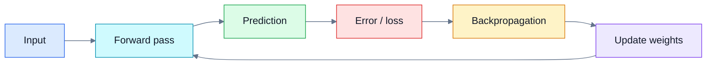

---

# 7. Generative AI vs Traditional AI

The chapter makes an important conceptual distinction.

## Traditional AI

Traditional AI often focuses on:

- Analysis
- Classification
- Prediction
- Decision support

## Generative AI

Generative AI focuses on:

- Creating text
- Creating images
- Creating audio
- Creating code
- Generating synthetic data

A useful mental model:

```text
Traditional AI:
"What category does this belong to?"

Generative AI:
"What new content can I create from what I have learned?"
```

### Important nuance

Generative AI can still analyse information. The distinction is about its primary capability and output, not a strict boundary between two completely separate types of technology.

---

# 8. Major Generative AI Capabilities

The chapter identifies several important capabilities:

| Capability | Example output | Business use |
|---|---|---|
| Text generation | Articles, emails, responses | Content and customer support |
| Image generation | Product concepts | Design and marketing |
| Audio generation | Speech, music, effects | Advertising and media |
| Code generation | Code snippets/programs | Software development |
| Data synthesis | Synthetic datasets | Research and model training |

---

# 9. Text Generation

## What

Generative AI can produce natural-language text from prompts or other input.

## Why

Text creation is common across almost every business function.

## How

Language models use learned statistical patterns and context to generate sequences of tokens.

## When

Examples include:

- Essays
- Creative writing
- Product descriptions
- Social media posts
- Customer-service responses
- Documentation
- Summaries

### Practical IT-support example

A support team could use generative AI to create a first draft of:

> "Steps to reconnect a Windows workstation to the corporate network."

A human support professional should still review the instructions before publication.

---

# 10. Image Generation

## What

Image-generation systems create visual content from textual or other inputs.

## Why

They can reduce the time required to produce visual concepts.

## How

The model learns patterns associated with visual data and generates an output based on the provided request.

## When

The chapter identifies applications in:

- Graphic design
- Video games
- Film
- Marketing
- Branding
- Fashion

### Practical example

A retailer could describe:

> "A minimalist summer clothing collection using neutral colours."

The system could generate visual concepts for the creative team.

---

# 11. Audio Generation

## What

Generative AI can produce or transform audio.

The chapter specifically mentions:

- Speech synthesis
- Music composition
- Sound effects

## Why

Audio generation can accelerate advertising and content production.

## When

Useful for:

- Advertising
- Marketing campaigns
- Media production
- Accessibility-oriented speech generation
- Prototyping

---

# 12. Code Generation

## What

Generative AI can assist with software development by producing or modifying code.

## Why

It can accelerate repetitive programming activities.

## How

The model uses patterns learned from code and natural language to suggest:

- Code completions
- Improvements
- Functions
- Programs

## When

Useful for:

- Prototyping
- Boilerplate
- Debugging assistance
- Documentation
- Learning

### Important support principle

Generated code should be reviewed, tested and secured before production use.

---

# 13. Data Synthesis

## What

Synthetic data is artificially generated data designed to reproduce useful characteristics of real data.

## Why

The chapter highlights synthetic data as useful when real data is:

- Restricted
- Sensitive
- Difficult to access
- Unethical to use directly

## How

A generative model attempts to learn patterns from source data and create new samples that preserve relevant statistical characteristics.

Conceptually:


## Important caution

Synthetic data is not automatically private or unbiased. It must still be evaluated for privacy leakage and representational bias.

> **Instructor Expansion:** This caution follows from the chapter's emphasis on privacy, bias and responsible AI.

---

# 14. Generative Adversarial Networks (GANs)

## What

A GAN contains two neural networks:

1. Generator
2. Discriminator

## Why

The adversarial setup encourages the generator to create increasingly realistic outputs.

## How

The chapter uses a chef and food critic analogy:

- Generator = chef
- Discriminator = food critic

The generator creates a sample.

The discriminator evaluates whether it resembles real data.

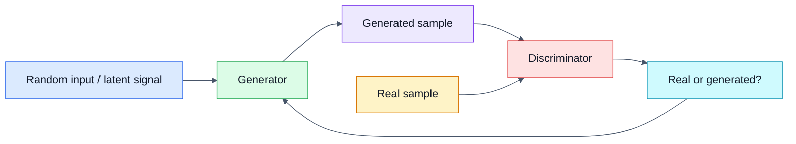

### Training intuition

The generator tries to produce convincing outputs.

The discriminator tries to distinguish:

```text
Real data
   vs
Generated data
```

As training progresses, the generator attempts to become better at producing realistic samples.

## Applications

The chapter highlights GAN applications including:

- Image generation
- Video creation
- Voice synthesis

---

# 15. Transformers and Attention

## What

Transformers are a deep-learning architecture particularly important in NLP.

The source associates transformers with the 2017 paper **"Attention is All You Need"**.

## Why

Transformers provide an efficient way to model relationships between tokens in a sequence.

## How

The key idea is **self-attention**.

Instead of treating every word as isolated, the model can assess how strongly different tokens relate to one another.

Example:

> "The technician replaced the drive because it was failing."

The model needs context to interpret what "it" refers to.

Self-attention helps the architecture model relationships among tokens.

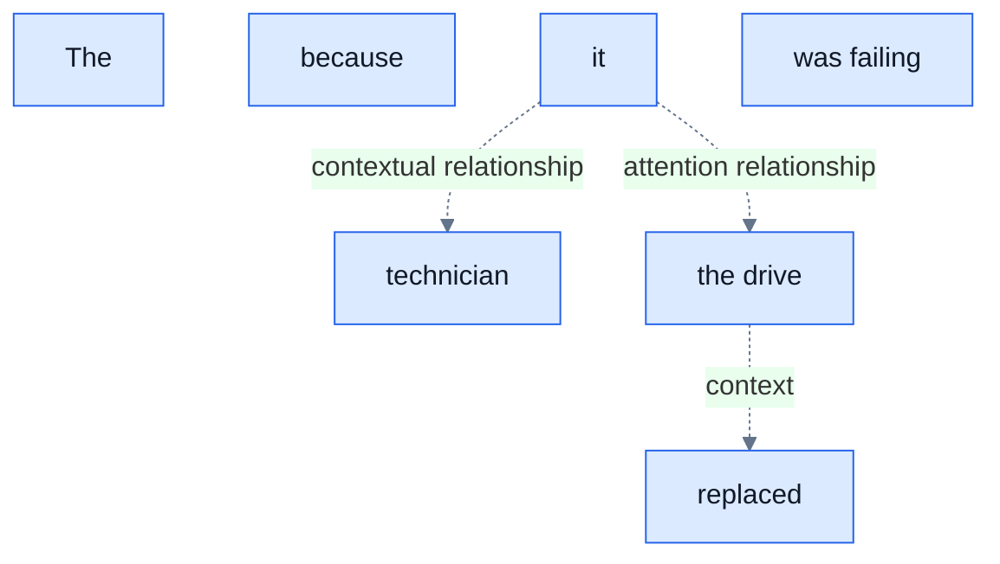

## Why attention matters

The chapter explains that attention mechanisms allow the model to focus selectively on different parts of the input and maintain context.

## Parallel processing

The source contrasts transformers with earlier sequential approaches and explains that transformers can process tokens in parallel, improving efficiency and scalability.

---

# 16. Attention — Intuition

A useful mental model:

> **Attention asks: "Which parts of the input are most relevant to what I am processing right now?"**

For example:

```text
Input:
"The customer could not access the booking system
because their account was locked."

Relevant context for "locked":
customer → account → access → booking system
```

The model can assign different levels of attention to different tokens.

> **Instructor Expansion:** This is a conceptual explanation rather than a complete mathematical description of transformer attention.

---

# 17. NLP — Natural Language Processing

## What

NLP is the area of AI concerned with interaction between computers and human language.

## Why

Human communication is complex, ambiguous and contextual.

## How

The chapter mentions techniques such as:

- Syntax-tree parsing
- Entity recognition
- Sentiment analysis

## When

NLP is used in:

- Chatbots
- Translation
- Email filtering
- Voice-activated GPS systems
- Question answering
- Text analysis

---

# 18. GPT — Generative Pre-trained Transformers

## What

GPT refers to generative pre-trained transformer language models.

The chapter describes GPT as using transformer architecture for language understanding and generation.

## Why

Pre-training allows a language model to learn broad patterns of language before being adapted to particular tasks.

## How

The chapter describes a simplified process:

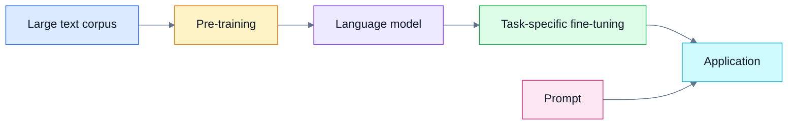

The supplied reading describes pre-training using prediction of the next word/token without human-labelled corrections and notes that models can subsequently be fine-tuned for tasks such as:

- Translation
- Question answering
- Summarisation

## Important source note

The supplied chapter contains historical model-size information about GPT-4. Model specifications evolve rapidly, so such version-specific claims should not be treated as current technical specifications without verification.

---

# 19. Tokenisation

## What

Tokenisation converts text into smaller units called tokens.

A token can be:

- A word
- A subword
- A character

depending on the tokenisation method.

## Why

Neural language models operate on numerical representations rather than raw human-readable text.

## How

A simplified example:

```text
"Hello world!"

Possible conceptual tokens:
["Hello", " world", "!"]
```

The exact tokens depend on the tokenizer.

The tokens are then mapped into numerical representations.

## When

Tokenisation is relevant to:

- Language-model input
- Context limits
- Prompt processing
- Text-generation cost
- NLP pipelines

---

# 20. Word2vec

## What

Word2vec is a technique for representing words as numerical vectors.

## Why

Machines require numerical representations to process language computationally.

Word2vec helps encode semantic relationships between words.

## How

Words are represented in a vector space.

Conceptually:

```text
king  ─────┐
           │ similar semantic region
queen ─────┤
           │
prince ────┘
```

Words with related usage patterns tend to have related vector representations.

## When

Word embeddings are useful for:

- Semantic similarity
- Search
- NLP analysis
- Recommendation
- Language representation

The chapter describes Word2vec as using shallow neural networks and learning from linguistic context.

---

# 21. BERT

## What

BERT stands for **Bidirectional Encoder Representations from Transformers**.

## Why

Language meaning depends heavily on context.

## How

BERT uses transformer architecture and considers context from both directions around a word.

For example:

```text
"The bank approved the loan."

"The river bank was flooded."
```

The word "bank" has different meanings depending on context.

BERT's bidirectional contextual approach helps models distinguish such meanings.

## When

The chapter highlights BERT for tasks such as:

- Question answering
- Sentiment analysis

---

# 22. GPT vs BERT — Conceptual Comparison

| Concept | GPT | BERT |
|---|---|---|
| Full name | Generative Pre-trained Transformer | Bidirectional Encoder Representations from Transformers |
| Architecture family | Transformer | Transformer |
| Chapter emphasis | Generation and language tasks | Contextual language representation |
| Directional intuition | Strongly associated with generative next-token prediction | Bidirectional contextual representation |
| Example tasks in source | Translation, Q&A, summarisation, generation | Q&A, sentiment analysis |

> **Instructor Expansion:** This table is a conceptual learning aid. Transformer-based models can be adapted for many tasks, so the distinction should not be reduced to "GPT generates, BERT does not".

---

# 23. Variational Autoencoders (VAEs)

## What

A VAE is a generative architecture that learns a compressed representation of data and can reconstruct or generate samples from that learned representation.

## Why

It provides a structured way to learn a latent representation of data and generate new samples.

## How

The chapter describes two conceptual components:

```text
Input
  ↓
Encoder
  ↓
Compressed representation
  ↓
Decoder
  ↓
Reconstructed / generated output
```

The encoder and decoder are trained so that the reconstructed output resembles the input.

## When

VAEs can be useful for:

- Representation learning
- Data generation
- Reconstruction
- Exploring latent spaces

---

# 24. Training and Learning Approaches

The chapter introduces several learning paradigms.

## Supervised learning

```text
Input + Label → Model learns relationship
```

Example:

```text
Article + Human-written summary
→ Learn summarisation relationship
```

## Unsupervised learning

```text
Input without labels → Model discovers patterns
```

## Semi-supervised learning

A combination of labelled and unlabelled data.

## Reinforcement learning

```text
State → Action → Feedback → Improved behaviour
```

The source's glossary describes supervised, unsupervised and reinforcement learning, while its deep-learning section also identifies semi-supervised learning.

---

# 25. Data Quality and Generalisation

## What

Generalisation means a model's ability to perform effectively on information it did not simply memorise from its training examples.

## Why

A model that performs well only on training data is not necessarily useful in the real world.

## How

Performance depends on factors including:

- Training-data quality
- Training-data variety
- Model design
- Evaluation methodology
- Distribution of new inputs

The chapter specifically states that the quality and variety of training data affect model performance and the ability to generalise without reproducing biases.

## When

Generalisation matters whenever a model is deployed against real-world data.

---

# 26. Data Preprocessing and Evaluation

The machine-learning glossary in the source highlights preprocessing activities such as:

- Normalisation
- Handling missing values
- Feature selection

It also identifies evaluation metrics including:

- Accuracy
- Precision
- Recall
- Area under the ROC curve

## Example: Precision and recall

For binary classification:

$$
\text{Precision} =
\frac{TP}{TP+FP}
$$

$$
\text{Recall} =
\frac{TP}{TP+FN}
$$

where:

- $TP$ = true positives
- $FP$ = false positives
- $FN$ = false negatives

> **Instructor Expansion:** These equations are provided to make the source's terminology concrete. The chapter itself names the metrics but does not derive the formulas.

---

# 27. Generative AI in Business

The chapter presents generative AI as a technology that can:

- Automate repetitive work
- Improve productivity
- Personalise interactions
- Support decision-making
- Improve operational efficiency
- Enable innovation

A useful business framework is:

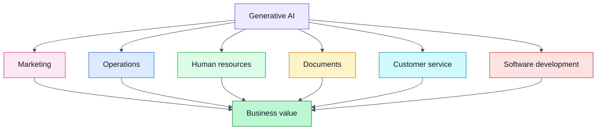

---

# 28. Marketing and Customer Engagement

## What

Generative AI can create personalised content at scale.

## Why

Manual personalisation becomes expensive when the number of customers is large.

## How

A conceptual pipeline:

```text
Customer data
   ↓
Analyse preferences
   ↓
Personalisation model
   ↓
Generate tailored content
   ↓
Deliver through business platform
```

The source gives examples such as:

- Email campaigns
- Dynamic web content
- Personalised communications

## When

Use cases include:

- Product recommendations
- Marketing messages
- Customer communications
- Personalised content

### Practical example

A retailer could create different product descriptions for different customer segments while maintaining a consistent brand voice.

---

# 29. Operations and Logistics

The source describes generative AI and related AI systems as useful for:

- Forecasting demand
- Simulating supply-chain scenarios
- Recommending adjustments
- Reducing costs
- Improving service delivery

## Practical example

A restaurant could estimate expected demand and adjust ingredient purchasing.

The chapter's Chef's Table analogy uses this scenario.

---

# 30. Human Resources

The source identifies applications such as:

- Analysing job descriptions
- Analysing applicant data
- Generating job descriptions
- Creating training scenarios
- Supporting personalised learning

## Why

HR processes often contain repetitive text-heavy tasks.

## Important risk

AI can also reproduce or amplify biases in recruitment data.

Therefore:

```text
AI-assisted HR
      ↓
Efficiency
      +
Human review
      +
Bias testing
      +
Privacy controls
```

---

# 31. Document Management and Technical Writing

## What

Generative AI can process large collections of documents and generate text that follows learned formatting, style and technical language patterns.

## Why

Technical documentation is often repetitive and time-consuming.

## Examples from the source

- Legal documents
- Contracts
- Medical clinical-trial reports
- Technical documents
- Business documentation

## When

Useful for:

- Drafting
- Reformatting
- Summarisation
- Style adaptation
- Document classification
- Technical writing assistance

### Critical principle

AI-generated legal or medical text requires appropriate professional review. Generating text that sounds authoritative does not guarantee that the content is correct or legally/clinically appropriate.

---

# 32. Brand Voice and Style

## What

Generative AI can produce content designed to match a specified communication style.

## Why

Organisations often want consistency across:

- Email
- Advertising
- Websites
- Social media
- Customer service

## How

A system can use examples or historical communication data as part of the information used to guide generation.

## When

Useful for:

- Marketing
- Customer communication
- Content creation
- Brand consistency

### Practical example

A company could ask an AI system to rewrite a product announcement so that it matches an established professional brand voice.

Human review remains important.

---

# 33. Customer Service and Automation

The source identifies AI-driven chatbots as an example of generative AI in customer service.

## Benefits

- Real-time responses
- Handling repetitive questions
- Increased scalability
- Potential productivity improvements

## Risk

A chatbot can produce an incorrect or inappropriate answer.

Therefore, a responsible support architecture should include:

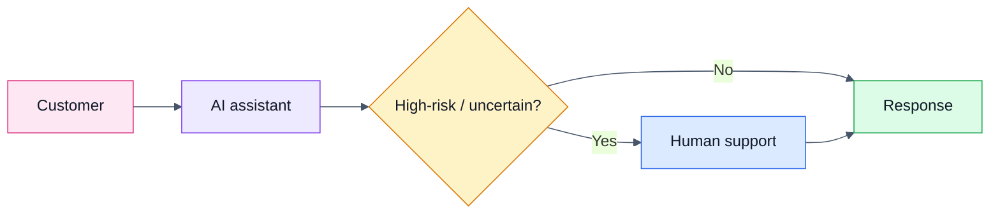

> **Instructor Expansion:** This escalation pattern is a practical implementation of the chapter's emphasis on human oversight and responsible AI.

---

# 34. Personalisation Architecture

The source describes a technical architecture involving:

- User data from websites, apps and social media
- Data pipelines
- Apache Kafka or Google Cloud Dataflow
- Apache Spark Streaming or AWS Kinesis
- Personalisation engines
- APIs
- Edge computing technologies such as AWS Greengrass or Azure IoT Edge

A simplified architecture is:


## IT-support relevance

A support professional should recognise that an AI application may depend on an entire chain of systems.

A user-facing failure may originate from:

- Data ingestion
- Streaming infrastructure
- Analytics
- Model service
- API
- Identity
- Network
- Edge device

This is an important systems-support mindset.

---

# 35. Automation Infrastructure

The chapter mentions:

- Robotic process automation (RPA)
- AI-powered software
- Cloud services
- Scalability
- Continuous learning/adaptation

## RPA

### What

Robotic process automation automates repetitive digital tasks.

### Why

It can reduce manual effort for predictable workflows.

### Example

```text
Receive form
   ↓
Extract information
   ↓
Validate fields
   ↓
Enter data into system
   ↓
Generate confirmation
```

AI can complement RPA where decisions or language processing are required.

---

# 36. Innovation, Simulation and Scenario Planning

The chapter describes AI-supported innovation through:

- Predictive analytics
- Scenario planning
- Risk assessment
- Regression analysis
- Time-series forecasting
- Monte Carlo simulations
- Bayesian networks
- Stress testing
- Digital twins
- Optimisation algorithms

## What

These approaches help organisations explore possible future outcomes.

## Why

Businesses often need to make decisions before the future is known.

## How

A simplified scenario-analysis workflow:

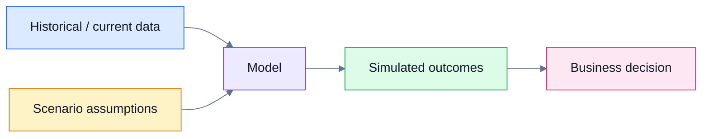

---

# 37. Industry Implications

The chapter identifies major implications across industries.

## Healthcare

Potential applications mentioned include:

- Patient-outcome prediction
- Personalised treatment planning
- Administrative automation

## Finance

Potential applications include:

- Risk assessment
- Automated trading
- Personalised banking services

## Creative industries

Generative AI is described as contributing to:

- Art
- Music
- Literature
- Creative experimentation

## Workforce

The chapter argues that AI knowledge will increasingly matter across roles, including jobs that traditionally involved less technology.

---

# 38. Workplace and Career Impact

The chapter highlights two simultaneous effects:

### Automation

AI can take over repetitive or time-consuming activities.

### Augmentation

AI can assist people so that they can focus on more strategic work.

A useful model:

```text
Human
  +
AI assistance
  =
Human + machine capability
```

The chapter specifically describes AI supporting:

- Content creation
- Software development
- Customer service
- HR
- Documentation

---

# 39. Generative AI Limitations

The chapter strongly emphasises that generative AI is not infallible.

Key limitations include:

- Inaccurate outputs
- Inconsistent quality
- Bias
- Privacy risks
- Intellectual-property concerns
- Misuse
- Limited transparency
- Accountability challenges
- Lack of common-sense reasoning
- Integration challenges
- Cost and training requirements
- Resistance to organisational change

---

# 40. Hallucination, Inaccuracy and Reliability

## What

Generative AI can produce content that appears plausible but is incorrect.

The supplied chapter describes inaccuracies occurring particularly when systems encounter requests or information outside their effective training scope.

## Why it matters

A fluent answer is not proof of correctness.

## How to mitigate

A responsible workflow is:


### IT-support example

If an AI suggests a PowerShell command:

1. Understand what the command does.
2. Check its syntax.
3. Confirm the target system.
4. Consider permissions and security impact.
5. Test safely.
6. Verify the result.

Do not blindly execute generated commands on production systems.

---

# 41. Bias and Fairness

## What

Bias occurs when systematic patterns in data or system design contribute to unfair or discriminatory outcomes.

## Why

AI systems learn from data. If training data contains problematic patterns, those patterns may influence outputs.

The source gives HR resume screening and job recommendations as examples where biased data can create discriminatory outcomes.

## How

A simplified chain:

```text
Historical data
     ↓
Existing patterns
     ↓
Model learns patterns
     ↓
Model output
     ↓
Potentially repeated bias
```

## When

Bias assessment is important in:

- Recruitment
- Lending
- Healthcare
- Customer segmentation
- Recommendations
- Automated decisions

---

# 42. Privacy and Data Protection

## What

Privacy concerns arise when AI systems process personal or sensitive information.

## Why

Improper handling can expose confidential information.

## How

Responsible systems should consider:

- What data is collected.
- Why it is collected.
- Where it is processed.
- Who can access it.
- How long it is retained.
- Whether it is appropriate to send to the AI system.

## When

Privacy must be considered whenever AI interacts with personal or confidential business data.

### Practical IT-support example

A user wants to paste a customer's complete account record into a public AI tool to summarise it.

Before doing so, a support professional should check:

- Organisational policy
- Data classification
- Approved AI tools
- Privacy requirements
- Access controls

---

# 43. Intellectual Property

The chapter identifies intellectual property as an ethical concern.

## What

Intellectual property concerns ownership and permitted use of creative or technical works.

## Why

AI-generated content can involve questions about:

- Ownership
- Copyright
- Training data
- Reuse
- Attribution
- Organisational policy

## When

Consider IP before using generated content commercially or publishing it externally.

---

# 44. Deepfakes and Misinformation

## What

Generative AI can produce convincing synthetic media.

Examples can include:

- Synthetic images
- Synthetic audio
- Synthetic video

## Why

Convincing false media can contribute to:

- Misinformation
- Fraud
- Reputation damage
- Manipulation

## IT-support relevance

Support professionals may encounter users reporting suspicious AI-generated content or account compromise involving synthetic media.

---

# 45. Explainability and the Black-Box Problem

## What

A black-box system is one whose internal decision process is difficult for users to interpret.

The chapter identifies lack of transparency as a reliability challenge.

## Why

In high-stakes contexts, organisations may need to understand:

- Why a decision occurred.
- What information influenced it.
- Whether the system is behaving consistently.
- Who should investigate an error.

## When

Explainability is particularly important in:

- Healthcare
- Finance
- HR
- Security
- Compliance-sensitive applications

---

# 46. Accountability

## What

Accountability concerns who is responsible when an AI system produces an incorrect or harmful result.

## Why

An AI system cannot simply become the organisation's substitute for responsibility.

Possible stakeholders include:

- AI developers
- System owners
- Business users
- Managers
- Data owners
- Security teams
- Compliance teams

## Practical principle

```text
AI output
   ↓
Human responsibility
   ↓
Review + governance + escalation
```

---

# 47. Common-Sense Reasoning

The chapter identifies limited common-sense reasoning as a generative-AI limitation.

## What

Common sense involves practical judgement about everyday situations.

## Why

A model can generate something linguistically plausible without understanding the real-world consequences.

## Example

An AI might produce a technically formatted procedure that is operationally unsafe.

Therefore:

> **Plausible does not mean practical.**

---

# 48. Human Oversight

The source's examples demonstrate why human oversight is important, especially for sensitive tasks.

The chapter describes a historical example involving GPT-3-generated mental-health advice in which a simulated user received harmful guidance. The example is used to demonstrate the danger of relying on AI for sensitive tasks without robust safeguards.

## Lesson

For high-risk scenarios:

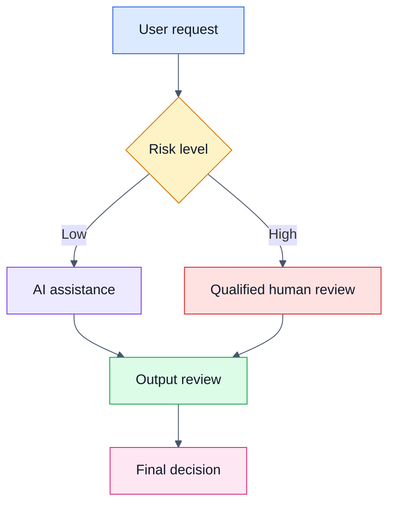

---

# 49. Responsible AI

The chapter identifies responsible-AI principles associated with major technology organisations, including Microsoft.

The source specifically emphasises:

- Fairness
- Reliability
- Privacy
- Inclusiveness
- Accountability
- Transparency

The chapter's supplementary material also refers to principles including:

- Innovation
- Safety
- Security

## Responsible-AI framework

| Principle | Core question |
|---|---|
| Fairness | Could the system produce unfair outcomes? |
| Reliability | Does it behave consistently and as intended? |
| Privacy | Is personal data protected? |
| Inclusiveness | Can different users benefit appropriately? |
| Accountability | Who owns the decision and outcome? |
| Transparency | Can users understand important aspects of the system? |
| Safety | Could the system cause harm? |
| Security | Can the system and its data be protected? |

---

# 50. Testing and Auditing

The chapter recommends rigorous testing and auditing to:

- Identify bias
- Correct bias
- Protect privacy
- Verify intended performance
- Ensure ethical operation

A practical AI lifecycle is:

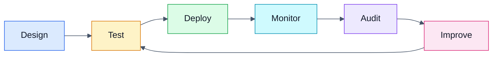

---

# 51. AI Implementation in the Workplace

The source identifies several implementation hurdles.

## Technical integration

AI systems must work with existing:

- Applications
- APIs
- Data pipelines
- Infrastructure
- Identity systems
- Security controls

## Investment

Organisations may need investment in:

- Technology
- Infrastructure
- Training
- People
- Governance

## Maintenance

AI systems may need ongoing:

- Monitoring
- Updates
- Evaluation
- Data management
- Model maintenance

## Organisational change

Even technically strong systems can fail to deliver value if employees:

- Do not trust them.
- Do not understand them.
- Do not know how to use them.
- Resist changing existing processes.

---

# 52. Chef's Table Case Study

The chapter uses a fictional restaurant, Chef's Table, to explain generative AI.

Chef Andre treats generative AI like a sous-chef.

## What the AI assists with

- Recipe development
- Presentation ideas
- Workflow optimisation
- Customer engagement
- Demand forecasting
- Training
- Documentation

## Why the analogy works

A sous-chef:

- Supports the chef.
- Handles tasks.
- Provides assistance.
- Does not replace the chef's responsibility.

Likewise, the chapter presents generative AI as a tool that complements human creativity and decision-making.

---

# 53. End-to-End Generative AI Mental Model

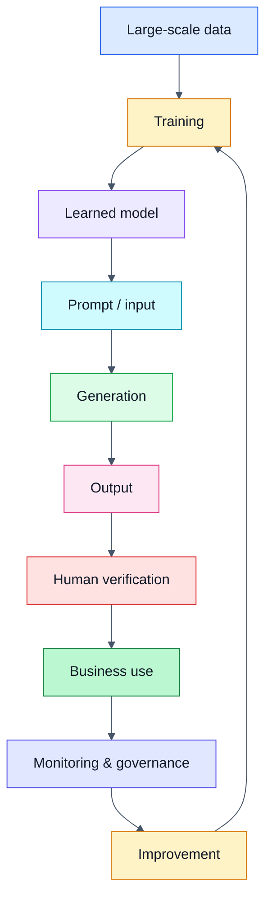

---

# 54. Generative AI from an IT Support Perspective

This chapter is especially relevant to IT support because AI applications introduce new systems that support teams may need to maintain.

## A support engineer should understand

### 1. The model

What AI model or service is being used?

### 2. The interface

How do users interact with it?

Examples:

- Web application
- API
- Chatbot
- Embedded business application

### 3. The data

What information does the system receive?

### 4. The infrastructure

Where does processing occur?

### 5. Identity

Who is allowed to access it?

### 6. Security

How is the system protected?

### 7. Reliability

How do we detect failures?

### 8. Governance

What should users be allowed to do?

---

# 55. Example: Supporting an Internal AI Assistant

Imagine a company deploys an internal AI assistant for employees.

A user reports:

> "The assistant gives different answers to the same question."

A support investigation might examine:

```text
User
 ↓
Application
 ↓
Authentication
 ↓
API
 ↓
Model service
 ↓
Knowledge/data source
 ↓
Generated response
```

Possible causes could include:

- Different prompts
- Different conversation context
- Retrieval differences
- Model configuration
- Data-source changes
- Service errors
- Access differences

This illustrates why AI support requires systems thinking.

---

# 56. Code Generation and IT Support

The chapter identifies code generation as an important generative-AI capability.

A support professional may use AI to explain or draft code.

For example:

```powershell
# Example for learning only.
# Get-Service retrieves information about Windows services.
Get-Service

# Filter services whose status is currently stopped.
# Where-Object evaluates each service and keeps only stopped services.
Get-Service | Where-Object {
    $_.Status -eq "Stopped"
}
```

### How to use generated code safely

1. Understand the command.
2. Check syntax.
3. Check permissions.
4. Consider security impact.
5. Test in a safe environment.
6. Verify the result.
7. Document the change.

---

# 57. Mathematical Intuition

Generative AI is fundamentally statistical.

A simplified language-generation perspective is:

$$
P(x_1,x_2,\ldots,x_n)
=
\prod_{t=1}^{n}P(x_t\mid x_1,\ldots,x_{t-1})
$$

This expresses the idea that a sequence can be modelled through conditional probabilities.

For next-token generation:

$$
x_{t} \sim P(x_t \mid x_1,\ldots,x_{t-1})
$$

The model estimates probabilities for possible next tokens and selects or samples according to the generation strategy.

> **Instructor Expansion:** These equations provide mathematical intuition for the source's discussion of next-word prediction and language generation. They are not presented as equations in the supplied chapter.

---

# 58. Model Parameters

The chapter refers to neural-network weights and biases and to the scale of modern language models.

A useful distinction is:

- **Parameter:** A learned numerical value inside a model.
- **Hyperparameter:** A configuration chosen for training or inference rather than learned directly in the same way.

Examples of model parameters include:

- Weights
- Biases

> **Instructor Expansion:** Hyperparameters are included here as supporting terminology; the supplied chapter primarily discusses parameters, weights and biases.

---

# 59. Generation vs Verification

One of the most important practical lessons from this chapter is:

> **Generation is not verification.**

AI can generate:

- A paragraph
- A program
- An image
- A recommendation
- A business document

But the generated output may still require:

- Fact checking
- Security review
- Human judgement
- Bias evaluation
- Privacy review
- Testing

Use this workflow:

```text
Generate
   ↓
Inspect
   ↓
Verify
   ↓
Test
   ↓
Approve
   ↓
Use
```

---

# 60. Practical Examples

## Example 1 — IT knowledge-base article

### Task

Create a draft article explaining how to reset a business application's password.

### AI role

Generate a first draft.

### Human role

Verify:

- Correct application name
- Correct procedure
- Security requirements
- Escalation process
- Screenshots
- Access permissions

---

## Example 2 — Incident summary

### Task

Summarise a long incident timeline.

### AI role

Condense the information.

### Human role

Check:

- Dates
- Times
- Root cause
- Customer impact
- Corrective actions

---

## Example 3 — Code assistance

### Task

Generate a PowerShell command to find a service.

### AI role

Draft the command.

### Human role

Understand and test it before execution.

---

## Example 4 — Customer communication

### Task

Draft an explanation of a service outage.

### AI role

Produce a clear first draft.

### Human role

Ensure:

- Accuracy
- Appropriate tone
- No confidential information
- No unsupported claims

---

# 61. Common Misconceptions

## Misconception 1: "AI understands everything like a human."

Not necessarily.

The chapter emphasises limitations in:

- Common-sense reasoning
- Context
- Reliability
- Ethical judgement

---

## Misconception 2: "If AI sounds confident, it must be correct."

False.

Fluency is not evidence of correctness.

---

## Misconception 3: "Generative AI only creates text."

False.

The chapter covers:

- Text
- Images
- Audio
- Video
- Code
- Synthetic data

---

## Misconception 4: "AI removes the need for people."

The chapter instead presents AI as a technology that can complement human work while also potentially changing or automating some job functions.

---

## Misconception 5: "More training data automatically means a better model."

Not necessarily.

The chapter explicitly emphasises the quality and variety of training data and the risk of inherited bias.

---

# 62. Fun Facts

## Fun Fact 1 — "Attention" changed NLP

The transformer architecture introduced a major shift towards attention-based processing rather than relying on sequential recurrence.

---

## Fun Fact 2 — GANs are adversarial by design

A GAN's generator and discriminator have opposing objectives.

One tries to create convincing data.

The other tries to identify generated data.

---

## Fun Fact 3 — Words can be represented geometrically

Word2vec represents words as vectors.

This means relationships between words can be analysed mathematically as relationships between points in a high-dimensional space.

---

## Fun Fact 4 — "Generative" describes the output

A useful way to remember the term:

> **Generative AI generates.**

It is not limited to recognising or classifying existing information.

---

## Fun Fact 5 — A chatbot is an application, not the whole AI stack

Behind a conversational interface there may be:

- Front-end application
- Authentication
- APIs
- Model service
- Data sources
- Monitoring
- Security controls

This is particularly important for IT support.

---

# 63. Practice Questions

## Multiple-choice questions

### Q1. What is the primary characteristic of generative AI?

A. Only classifying data  
B. Generating new content  
C. Only storing data  
D. Replacing operating systems

**Answer:** B.

---

### Q2. Which two networks form a GAN?

A. Encoder and decoder  
B. Generator and discriminator  
C. Client and server  
D. Tokeniser and database

**Answer:** B.

---

### Q3. What mechanism is central to transformers?

A. File compression  
B. Self-attention  
C. Disk partitioning  
D. Packet switching

**Answer:** B.

---

### Q4. What does NLP stand for?

A. Network Learning Protocol  
B. Natural Language Processing  
C. Neural Logic Platform  
D. Network Language Processor

**Answer:** B.

---

### Q5. What does tokenisation do?

A. Encrypts a hard drive  
B. Splits text into tokens  
C. Converts images to audio  
D. Creates a backup

**Answer:** B.

---

### Q6. Which technology represents words as numerical vectors?

A. Word2vec  
B. RPA  
C. GAN  
D. VPN

**Answer:** A.

---

### Q7. Which model is specifically described as using bidirectional contextual information?

A. BERT  
B. RPA  
C. GAN discriminator  
D. Kafka

**Answer:** A.

---

### Q8. What is a major risk of biased training data?

A. Faster storage  
B. Discriminatory outputs  
C. Better network performance  
D. Lower CPU usage

**Answer:** B.

---

### Q9. Why is human oversight important?

A. AI cannot generate content.
B. AI outputs can be inaccurate or inappropriate.
C. AI never uses data.
D. AI does not require infrastructure.

**Answer:** B.

---

### Q10. Which principle concerns responsibility for AI outcomes?

A. Accountability  
B. Tokenisation  
C. Compression  
D. Rendering

**Answer:** A.

---

# 64. Short-answer Questions

1. Define generative AI.
2. Explain the difference between AI, ML and DL.
3. What is a neural network?
4. What are weights and biases?
5. What is backpropagation?
6. Explain supervised learning.
7. Explain unsupervised learning.
8. What is a GAN?
9. What are the generator and discriminator?
10. What is self-attention?
11. Why are transformers important?
12. What does GPT stand for?
13. What is tokenisation?
14. What is Word2vec?
15. What does BERT stand for?
16. Why is training-data quality important?
17. Give five business applications of generative AI.
18. What are three risks associated with generative AI?
19. Why is privacy important when using AI?
20. What does responsible AI mean?
21. Why can AI outputs be unreliable?
22. What is the black-box problem?
23. Why does accountability matter?
24. Why should AI-generated code be tested?
25. Why is human oversight particularly important in high-stakes environments?

---

# 65. Scenario-Based Questions

## Scenario 1 — AI-generated troubleshooting command

An AI assistant gives you a PowerShell command that modifies Windows services.

### Questions

1. Would you run it immediately?
2. What would you verify first?
3. What permissions might be required?
4. How could you test it safely?
5. How would you verify the outcome?

### Expected approach

**No — do not execute blindly.**

Understand → verify → test → execute → validate → document.

---

## Scenario 2 — Biased recruitment model

An organisation's AI recruitment system consistently ranks candidates from one demographic group lower.

### Questions

1. What could be causing this?
2. Which responsible-AI principle is involved?
3. What data should be investigated?
4. What testing should be performed?
5. Should the organisation continue using the system without investigation?

**Key concepts:** bias, fairness, auditing, accountability.

---

## Scenario 3 — Confidential information

An employee wants to paste customer records into an external AI chatbot.

### Questions

1. What risks exist?
2. What policy should be checked?
3. What type of information should be classified?
4. Is the AI service approved?
5. What safer alternative could be used?

**Key concepts:** privacy, security, governance and data handling.

---

## Scenario 4 — Incorrect AI chatbot answer

A customer-service chatbot gives a customer an incorrect policy explanation.

### Questions

1. Is this a model problem, data problem, application problem or process problem?
2. What evidence should support collect?
3. Should a human correct the customer?
4. How could the system be monitored?
5. How could recurrence be reduced?

---

# 66. Exercises

## Exercise 1 — AI terminology map

Create a diagram connecting:

```text
AI
├── Machine learning
│   └── Deep learning
│       └── Neural networks
│           ├── GANs
│           └── Transformer-based models
├── NLP
├── GPT
├── BERT
├── Word2vec
└── VAEs
```

Then write one sentence explaining each connection.

---

## Exercise 2 — GAN simulation

Use paper cards or a simple programming exercise.

Create:

- A "generator" that creates sample values.
- A "discriminator" that classifies them as real/fake.

Discuss:

- What happens when the discriminator improves?
- What happens when the generator improves?
- Why is the competition useful?

---

## Exercise 3 — Tokenisation experiment

Take the sentence:

> "The IT support engineer fixed the network problem."

Manually split it into:

- Words
- Smaller conceptual subwords
- Individual characters

Then discuss why different tokenisation strategies produce different token counts.

---

## Exercise 4 — AI output verification

Ask an AI system to generate a technical explanation of a Windows troubleshooting procedure.

Create a table:

| AI claim | Verified? | Evidence | Correction required |
|---|---|---|---|
| Claim 1 | Yes/No | Documentation/test | Yes/No |
| Claim 2 | Yes/No | Documentation/test | Yes/No |

Goal: learn that generation and verification are different activities.

---

## Exercise 5 — Responsible-AI risk assessment

Choose an AI use case:

- Recruitment
- Customer support
- Healthcare
- Finance
- IT support

Score the use case against:

| Principle | Low risk | Medium risk | High risk |
|---|---|---|---|
| Fairness | | | |
| Reliability | | | |
| Privacy | | | |
| Security | | | |
| Inclusiveness | | | |
| Accountability | | | |
| Transparency | | | |

Then explain your reasoning.

---

## Exercise 6 — Internal IT AI assistant

Design a high-level architecture for an internal IT support chatbot.

Include:

- Users
- Authentication
- Application
- API
- AI model
- Knowledge base
- Logging
- Monitoring
- Human escalation
- Security

Draw the architecture using Mermaid.

---

## Exercise 7 — Business case

Choose a business and identify five processes that could benefit from generative AI.

For each process, document:

1. Current workflow.
2. AI opportunity.
3. Expected benefit.
4. Data required.
5. Risk.
6. Human-review requirement.
7. Success metric.

---

# 67. Memory Hooks

## AI → "Artificial Intelligence"

Think:

> **AI = the big field**

---

## ML → "Learn from data"

Think:

> **ML = Machine learns patterns from examples.**

---

## DL → "Deep layers"

Think:

> **DL = Many neural-network layers.**

---

## GAN → "Generator vs Judge"

Remember:

> **G = Generator creates**  
> **D = Discriminator detects**

---

## Transformer → "Attention"

Remember:

> **Transformer = Attention + context**

---

## GPT

Remember:

> **G = Generative**  
> **P = Pre-trained**  
> **T = Transformer**

---

## BERT

Remember:

> **B = Bidirectional**  
> **E = Encoder**  
> **R = Representations**  
> **T = Transformers**

---

## NLP

Remember:

> **N = Natural**  
> **L = Language**  
> **P = Processing**

---

## VAE

Remember:

> **Encode → Represent → Decode**

---

## Tokenisation

Remember:

> **Text → Tokens → Numbers → Model**

---

## Word2vec

Remember:

> **Words → Vectors**

---

## Responsible AI

Use:

**F-R-P-I-A-T**

- **F** — Fairness
- **R** — Reliability
- **P** — Privacy
- **I** — Inclusiveness
- **A** — Accountability
- **T** — Transparency

Add:

- **Safety**
- **Security**

when assessing a production system.

---

## AI verification

Remember:

> **G-V-T-A**

**Generate → Verify → Test → Approve**

---

## AI risk

Remember:

> **B-P-I-A**

- **B**ias
- **P**rivacy
- **I**naccuracy
- **A**ccountability

---

# 68. Final Revision Checklist

Before moving on, you should be able to explain:

### Foundations

- [ ] What AI is.
- [ ] What machine learning is.
- [ ] What deep learning is.
- [ ] What neural networks are.
- [ ] What weights and biases are.
- [ ] What backpropagation does.

### Generative AI

- [ ] What generative AI is.
- [ ] How generative AI differs conceptually from traditional AI.
- [ ] Text generation.
- [ ] Image generation.
- [ ] Audio generation.
- [ ] Code generation.
- [ ] Synthetic data generation.

### Models and architectures

- [ ] GANs.
- [ ] Generator.
- [ ] Discriminator.
- [ ] Transformers.
- [ ] Attention.
- [ ] Self-attention.
- [ ] GPT.
- [ ] BERT.
- [ ] VAEs.
- [ ] Word2vec.

### NLP

- [ ] Natural language processing.
- [ ] Tokenisation.
- [ ] Embeddings/vector representations.
- [ ] Context.
- [ ] Question answering.
- [ ] Sentiment analysis.

### Business applications

- [ ] Marketing.
- [ ] Personalisation.
- [ ] Operations.
- [ ] Logistics.
- [ ] HR.
- [ ] Technical writing.
- [ ] Customer service.
- [ ] Software development.
- [ ] Innovation and simulation.

### Risks

- [ ] Inaccuracy.
- [ ] Bias.
- [ ] Privacy.
- [ ] Intellectual property.
- [ ] Deepfakes.
- [ ] Misinformation.
- [ ] Black-box behaviour.
- [ ] Accountability.
- [ ] Lack of common-sense reasoning.
- [ ] Integration and maintenance challenges.

### Responsible AI

- [ ] Fairness.
- [ ] Reliability.
- [ ] Privacy.
- [ ] Inclusiveness.
- [ ] Accountability.
- [ ] Transparency.
- [ ] Safety.
- [ ] Security.
- [ ] Human oversight.
- [ ] Testing and auditing.

---

# 69. Chapter Summary

The central message of this chapter is that generative AI is both a technical capability and an organisational transformation.

The conceptual hierarchy is:

```text
Artificial Intelligence
        ↓
Machine Learning
        ↓
Deep Learning
        ↓
Neural Networks
        ↓
Generative architectures
        ↓
GANs / VAEs / Transformers
        ↓
Applications
        ↓
Business value
        ↓
Governance + human oversight
```

The most important lessons are:

1. **Generative AI creates new content.**
2. **Machine learning enables systems to learn patterns from data.**
3. **Deep learning uses multi-layer neural networks to learn complex representations.**
4. **GANs use a generator and discriminator in an adversarial process.**
5. **Transformers use attention mechanisms to model context and relationships between tokens.**
6. **GPT is a transformer-based generative language-model family.**
7. **BERT uses bidirectional contextual representations.**
8. **Tokenisation converts language into model-processable units.**
9. **Word2vec represents words as numerical vectors.**
10. **Generative AI can support text, image, audio, code and synthetic-data workflows.**
11. **Business applications include marketing, operations, HR, documentation, customer service and software development.**
12. **AI output is not automatically accurate.**
13. **Bias, privacy, IP, misinformation and accountability are major concerns.**
14. **High-stakes AI requires human oversight.**
15. **Responsible AI requires fairness, reliability, privacy, inclusiveness, accountability and transparency.**
16. **AI implementation requires technical integration, training, maintenance, monitoring and organisational change.**
17. **For IT support, AI should be treated as a complete technology stack rather than simply a chatbot.**

The most important operational rule to remember is:

> **AI can generate the answer; people remain responsible for deciding whether the answer is safe, accurate and appropriate to use.**

---

# 70. Source Scope and Accuracy Notes

These notes are based on the supplied **Chapter 2 — Introduction to Generative AI** material.

The source covers:

- Generative AI definitions and capabilities
- GANs
- Transformers
- Attention and self-attention
- GPT
- BERT
- NLP
- Machine learning
- Deep learning
- Neural networks
- Word2vec
- Tokenisation
- VAEs
- Business applications
- Personalisation
- Automation
- Innovation
- Industry implications
- Workforce changes
- AI limitations
- Bias
- Privacy
- Intellectual property
- Deepfakes
- Misinformation
- Reliability
- Accountability
- Common-sense limitations
- Responsible AI
- Testing and auditing
- Workplace implementation challenges

### Important source-quality note

Some terminology and version-specific claims in the supplied educational material reflect the time in which the material was written. AI systems, model versions, parameter counts and industry practices evolve rapidly.

Therefore, distinguish between:

- **Conceptual knowledge** — generally useful for learning.
- **Historical examples** — useful for understanding the course.
- **Current product/model specifications** — should be verified against current official documentation before being used operationally.

---

# End of Chapter 2 Notes

## Recommended study sequence

1. Read Sections 2–6 to establish the AI/ML/DL hierarchy.
2. Study GANs, transformers and attention.
3. Learn GPT, BERT, tokenisation and Word2vec.
4. Map each business application to a real-world workflow.
5. Study the limitations and responsible-AI principles carefully.
6. Complete the scenario questions.
7. Complete at least one hands-on AI-support exercise.
8. Use the final checklist as a self-test.

**Core mental model:**

> **Learn the model → understand the application → identify the risks → verify the output → apply human judgement.**
