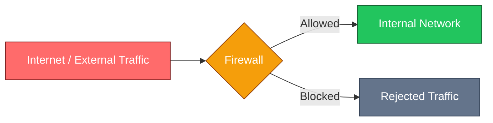
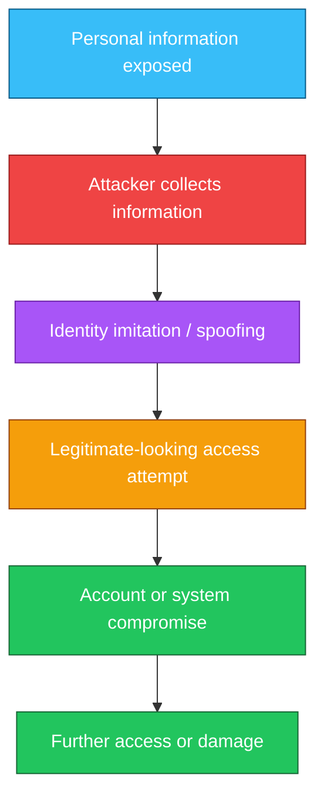
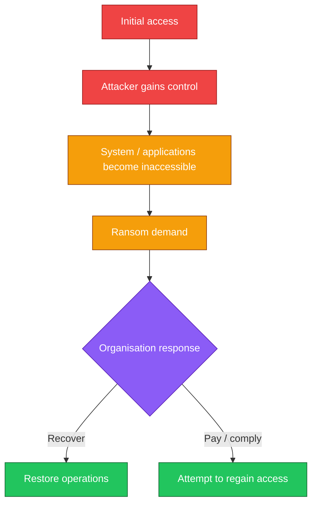
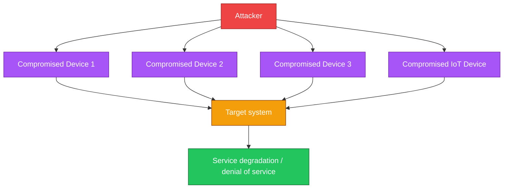
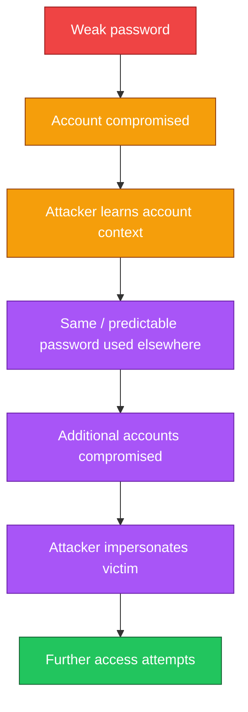
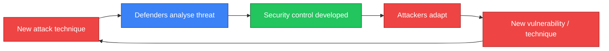
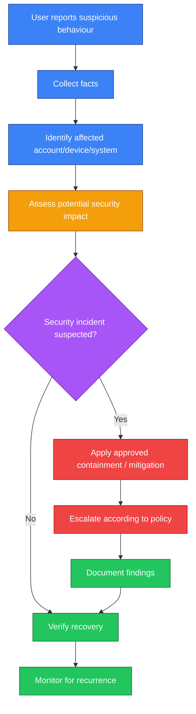

# Microsoft IT Support Specialist Professional Certificate
## Chapter 3 — Decoding the Threat Landscape: An IT Perspective

> Comprehensive study notes based primarily on the supplied Microsoft IT Support Specialist Professional Certificate Chapter 3 material.
>
> **Scope note:** These notes preserve the source's terminology, examples, sequence, and instructional framing. Where additional instructor explanation is provided to make a concept easier to understand, it is explicitly labelled **Instructor Expansion** rather than presented as if it came directly from the source.

---

## Table of Contents

1. [Chapter Overview](#chapter-overview)
2. [Learning Objectives](#learning-objectives)
3. [The Threat Landscape](#the-threat-landscape)
4. [The Three Components of a Threat Landscape](#the-three-components-of-a-threat-landscape)
5. [How the Threat Landscape Evolved](#how-the-threat-landscape-evolved)
6. [Intranet, Internet, and Firewalls](#intranet-internet-and-firewalls)
7. [Major Threats Introduced](#major-threats-introduced)
8. [Remote Work and BYOD](#remote-work-and-byod)
9. [Identity-Based Attacks and Linked Threats](#identity-based-attacks-and-linked-threats)
10. [Modern Cybercrime](#modern-cybercrime)
11. [Adware and Browser Hijackers](#adware-and-browser-hijackers)
12. [Trojan Attacks](#trojan-attacks)
13. [Ransomware Attacks](#ransomware-attacks)
14. [Botnet Attacks](#botnet-attacks)
15. [Denial of Service](#denial-of-service)
16. [Malware](#malware)
17. [Passwords and Linked Threats](#passwords-and-linked-threats)
18. [Security Breaches](#security-breaches)
19. [Brute Force Attacks](#brute-force-attacks)
20. [Cyber Hygiene](#cyber-hygiene)
21. [Software Updates and Patching](#software-updates-and-patching)
22. [Threat → Risk → Attack → Mitigation](#threat--risk--attack--mitigation)
23. [Sam's Scoops Case Study](#sams-scoops-case-study)
24. [Building a Threat Report](#building-a-threat-report)
25. [Threat #1: Poor Password Protection](#threat-1-poor-password-protection)
26. [Threat #2: Malware and Poor Cyber Hygiene](#threat-2-malware-and-poor-cyber-hygiene)
27. [Threat #3: Outdated Software](#threat-3-outdated-software)
28. [Security as a Continuous Process](#security-as-a-continuous-process)
29. [IT Support Perspective](#it-support-perspective)
30. [Practical Troubleshooting and Response Workflow](#practical-troubleshooting-and-response-workflow)
31. [Defensive Mindset](#defensive-mindset)
32. [Common Misconceptions](#common-misconceptions)
33. [Real-World IT Support Examples](#real-world-it-support-examples)
34. [Fun Facts and Trivia](#fun-facts-and-trivia)
35. [Quick Reference Tables](#quick-reference-tables)
36. [Practice Questions](#practice-questions)
37. [Scenario-Based Exercises](#scenario-based-exercises)
38. [Memory Hooks](#memory-hooks)
39. [Final Revision Checklist](#final-revision-checklist)
40. [Exam-Oriented Summary](#exam-oriented-summary)

---

# Chapter Overview

Cybersecurity starts with a deceptively simple question:

> **What are we trying to protect, from whom, and how might they get in?**

The chapter introduces the concept of the **threat landscape** and explains why effective security begins with understanding threats before selecting defensive controls.

The course uses **Sam's Scoops**, a growing ice cream business, as a recurring case study. Sam wants to move more business activity online but is concerned about the security implications.

The chapter moves from:

**physical security → network security → malware and attacks → remote access → identity-based threats → practical mitigation**

The central lesson is that cybersecurity is not static. As organisations change how they access systems, attackers change their techniques as well.

---

# Learning Objectives

After studying this chapter, you should be able to:

- Explain what the **threat landscape** means.
- Identify the three major components of a threat landscape.
- Explain how cyber threats have evolved as businesses have moved online.
- Describe the role of a **firewall**.
- Explain why remote work and **Bring Your Own Device (BYOD)** expand the attack surface.
- Recognise common attack types such as:
  - Trojans
  - ransomware
  - botnets
  - denial of service
  - malware
  - brute-force attacks
- Explain how weak or reused passwords create **linked threats**.
- Explain the importance of cyber hygiene.
- Explain why software updates and security patches matter.
- Distinguish between:
  - vulnerability
  - risk
  - attack
  - mitigation
- Create a simple threat report for a small business.
- Think about cybersecurity from an **IT-support perspective**.

---

# 1. The Threat Landscape

## What is a threat landscape?

The source describes the **threat landscape** as an all-encompassing term covering three major areas:

1. **Potential vulnerabilities of an application or system**
2. **Attackers who may target those vulnerabilities**
3. **The attacks used against the target**

In simple terms:

> The threat landscape describes **what can be attacked, who may attack it, and how the attack may happen**.

The source uses the analogy of securing a home. Before choosing stronger locks, a gate, or cameras, you first need to understand what threats you are likely to face.

The same principle applies to cybersecurity.

### Why does this matter?

A security control is only useful if it addresses a realistic threat.

For example:

- If stolen passwords are the main concern, password controls and authentication become important.
- If malicious software is the concern, endpoint protection and safe user behaviour become important.
- If excessive network requests are the concern, network monitoring and traffic controls become important.

### How does an IT professional use this concept?

An IT professional can ask:

```text
What are we protecting?
        ↓
What could go wrong?
        ↓
Who could cause it?
        ↓
How could they gain access?
        ↓
What would the impact be?
        ↓
What controls reduce the risk?
```

---

# 2. The Three Components of a Threat Landscape

The chapter explicitly identifies three components:

| Component | Meaning | Example |
|---|---|---|
| Vulnerable areas | Things that can potentially be attacked | An online account |
| Potential attackers | People or actors who may attempt an attack | A cybercriminal |
| Attack types | Methods used to compromise or disrupt the target | Malware or ransomware |

### Instructor Expansion

A useful security vocabulary model is:

**Asset → Vulnerability → Threat → Attack → Impact → Mitigation**

For example:

```text
Asset
  ↓
Sam's Scoops email account
  ↓
Vulnerability
  ↓
Weak password
  ↓
Threat
  ↓
Attacker
  ↓
Attack
  ↓
Password guessing
  ↓
Impact
  ↓
Unauthorised access / data theft
  ↓
Mitigation
  ↓
Strong password + access controls
```

---

# 3. How the Threat Landscape Evolved

Cybersecurity threats changed as organisations changed the way they worked.

## Earlier environment

Traditionally, businesses were concerned with threats such as:

- physical intruders
- theft of physical items
- unauthorised access to buildings
- physical damage

Digital security was comparatively easier to conceptualise because important resources were often inside a clearly defined organisational boundary.

## Increasing digital activity

As more business activity moved online, organisations needed to protect:

- information
- user accounts
- applications
- networks
- digital infrastructure
- access to business systems

The boundary between "inside" and "outside" became increasingly complicated.

---

# 4. Intranet, Internet, and Firewalls

## Intranet

An **intranet** is an organisation's internal communications/network environment.

Think:

> **Inside the organisation**

Examples may include:

- internal applications
- internal communications
- internal resources
- employee-facing systems

## Internet

The **Internet** is the worldwide connected network through which systems and people communicate.

Think:

> **Outside / globally connected environment**

---

# 5. Firewalls

## What is a firewall?

The source describes a firewall as a **block or filter that prevents some external items from entering a system**.

The chapter compares a firewall to a security guard at the gate of a building.



## Why is a firewall important?

A firewall can reduce exposure by controlling what traffic is allowed to enter or pass through a network boundary.

## How does the analogy work?

| Physical security | Cybersecurity |
|---|---|
| Building | Network/system |
| Gate | Network boundary |
| Security guard | Firewall |
| Visitor | Network connection/request |
| Entry rules | Firewall rules |
| Denied visitor | Blocked traffic |

### Important limitation

A firewall is not a complete cybersecurity strategy.

The chapter explains that traditional firewall strategies relied on a limited number of entry points. Modern work environments have expanded those entry points.

---

# 6. Major Threats Introduced

The chapter introduces several important threat categories:

- Malware
- Ransomware
- Denial of service
- Spam-related activity
- Trojan attacks
- Botnet attacks
- Password-related attacks
- Identity spoofing
- Unauthorised access

These threats do not necessarily operate independently. One compromised account or device can become the starting point for additional attacks.

---

# 7. Remote Work and BYOD

The threat landscape became more complex as more people began working remotely.

## Remote access

Remote access tools allow workers to access organisational resources from outside the organisation's physical network.

This is useful because employees can work from different locations.

However:

> More legitimate entry points can also create more opportunities for attackers.

## Bring Your Own Device (BYOD)

**BYOD** means employees use their own devices for work-related activities.

Examples:

- personal laptop
- personal smartphone
- personal tablet

### Why does BYOD increase complexity?

An organisation may have less control over:

- device configuration
- software versions
- security settings
- user behaviour
- installed applications
- network environment

### Security principle

```text
More access
    +
More devices
    +
More locations
    =
Larger attack surface
```

### Instructor Expansion

The **attack surface** is the collection of possible points through which an attacker might attempt to gain access or cause harm.

---

# 8. Identity-Based Attacks and Linked Threats

One of the most important ideas in this chapter is that an attacker does not always need to exploit a technical vulnerability directly.

The chapter explains that attackers may:

1. Harvest personal information.
2. Use the information to imitate or spoof someone's identity.
3. Attempt to access systems through legitimate channels.

This is significant because the attacker may appear to be a legitimate user.



---

# 9. Modern Cybercrime

The supplied reading examines data from **Cisco Umbrella Cloud Architecture** and uses November 2021 activity as a snapshot of the types of attacks occurring at scale.

The source identifies **adware** as a prominent category and then focuses on three major attack types:

1. **Trojan**
2. **Ransomware**
3. **Botnet**

The source states that botnet attacks represented **13%** of the documented attacks in the referenced chart.

---

# 10. Adware and Browser Hijackers

## Adware

The source describes **adware** as software that frequently shows advertisements to a user and is typically installed through deceit or without consent.

Potential problems include:

- unwanted advertising
- unwanted software installation
- degraded user experience
- possible exposure to additional malicious content

## Browser hijacker

A **browser hijacker** is software that alters a user's web browser without permission, often to direct the user toward a particular website.

### Key distinction

| Threat | Main behaviour described |
|---|---|
| Adware | Displays unwanted advertisements |
| Browser hijacker | Alters browser behaviour or redirects the user |

---

# 11. Trojan Attacks

## What is a Trojan?

A **Trojan** is an umbrella term for several types of malicious attacks where a user inadvertently introduces malicious code into an organisation and triggers it behind the defensive boundary.

The name comes from the historical story of the **Trojan Horse**.

The attacker effectively attempts to get the victim to bring the malicious element inside.

---

## Types of Trojans Mentioned

The chapter lists:

- **Exploit Trojans**
- **Downloader Trojans**
- **Ransom Trojans**
- **Backdoor Trojans**

The source presents these as different forms within the broader Trojan category.

---

## How a Trojan attack works

A simplified flow:

```mermaid
flowchart LR
    A[Attacker prepares malicious content]
    B[User receives link / attachment / software]
    C[User interacts with it]
    D[Malicious code enters system]
    E[Code executes]
    F[System or data affected]

    A --> B --> C --> D --> E --> F

    classDef attacker fill:#ef4444,stroke:#991b1b,color:#fff;
    classDef user fill:#3b82f6,stroke:#1e3a8a,color:#fff;
    classDef code fill:#f59e0b,stroke:#92400e,color:#fff;
    classDef impact fill:#22c55e,stroke:#166534,color:#fff;

    class A attacker;
    class B,C user;
    class D,E code;
    class F impact;
```



## Why are Trojans dangerous?

The user may unintentionally become the mechanism that introduces malicious code.

This is why **user awareness** is an important security control.

---

## Trojan Mitigation

The chapter recommends vigilant Internet usage, including:

- Do not click unsolicited emails with unexpected attachments.
- Examine domain names carefully.
- Check links before clicking.
- Watch for suspicious misspellings.
- Be cautious of deceptive domains.

### Example

An attacker might use a visually confusing domain name in an attempt to make it resemble a legitimate domain.

The lesson is:

> **Do not trust a link simply because it looks familiar.**

---

# 12. Ransomware Attacks

## What is ransomware?

The source describes ransomware as an approach to cybercrime designed to cause disruption to services.

The methodology described is:

1. Gain access to a system.
2. Prevent the legitimate owner from accessing it.
3. Demand something in exchange for restoring access.



## Examples mentioned in the source

The chapter references:

- Ireland's Health Service Executive (HSE) in 2021
- Critical Ukrainian infrastructure in 2022
- Costa Rica, where 30 government institutions were held to ransom

These examples demonstrate that ransomware can affect organisations and infrastructure at a national scale.

---

## Ransomware Mitigation

The source recommends:

### 1. Use strong passwords

A strong password should be difficult to guess and typically include:

- a mixture of characters
- numbers
- symbols

### 2. Keep systems up to date

Install current security patches.

### 3. Restrict access

Ensure that only authorised people can use the system.

---

# 13. Botnet Attacks

## What is a bot?

The chapter defines a **bot** as an online software programme that performs automated and repetitive tasks.

A collection of compromised devices can be coordinated to perform malicious activity.

## What is a botnet?

A **botnet** is a network of compromised devices that can be controlled or coordinated to perform actions for an attacker.

The chapter states that botnet attacks represented **13%** of the documented attacks in the referenced chart.

---

# 14. How Botnet Attacks Work

Botnet attacks can generate enormous numbers of requests against a target.



The requests can originate from capable Internet-connected devices, including **Internet of Things (IoT)** devices with IP addresses.

---

# 15. Botnets and IoT

## What is IoT?

**Internet of Things (IoT)** refers to devices connected to the Internet.

Examples include:

- smart cameras
- connected appliances
- sensors
- smart home devices
- other network-connected equipment

The source highlights that IoT devices can potentially participate in attacks when compromised.

### Instructor Expansion

The security implication is important:

> Every connected device can become part of an organisation's broader security environment.

---

# 16. Botnets and Combined Attacks

The chapter explains that botnet activity can be coupled with a Trojan attack.

For example:

1. Malicious code is introduced into one system.
2. The compromised system is used to make requests.
3. The attacker uses someone else's digital resources.
4. The requests contribute to disruption of another target.

This demonstrates an important security concept:

> **One compromised system can become an attack platform against another system.**

---

# 17. Mitigating Botnet Attacks

The source recommends monitoring network traffic for suspicious activity.

If a particular source repeatedly makes calls that negatively affect system operations, the address can potentially be blocked.

However, the source also points out that this becomes more difficult when many compromised systems are involved.

### Security monitoring flow

```text
Network traffic
      ↓
Monitor activity
      ↓
Identify unusual patterns
      ↓
Investigate source
      ↓
Block / contain suspicious source
      ↓
Continue monitoring
```

---

# 18. Malware

## What is malware?

The source defines **malware** as software intended to cause harm or discord.

Malware is a broad category rather than a single specific attack.

It can be used to:

- steal information
- disrupt services
- alter system behaviour
- enable ransomware
- introduce other malicious activity

---

# 19. Passwords and Linked Threats

One of the most practical sections of the chapter concerns password reuse.

The chapter presents Sam as an example.

Sam:

- has multiple social media accounts
- has personal email
- has work email
- uses easy-to-remember passwords
- bases passwords on personal information
- changes passwords by adding incremental numbers

At first glance, this appears convenient.

From a security perspective, however, it creates a chain of weaknesses.

---

# 20. Why Personal Information Can Weaken Passwords

If a password is based on information that is publicly available, attackers may have clues that help them guess it.

Examples of potentially exposed personal information include:

- favourite places
- birthdays
- pet names
- frequently discussed interests

The chapter specifically demonstrates how information shared on social media can make password guessing easier.

---

# 21. Predictable Password Patterns

Suppose someone uses:

```text
Password1
Password2
Password3
```

Changing the final number does not necessarily create three meaningfully independent credentials.

An attacker who identifies the pattern may attempt predictable variations.

### Better principle

> **A password should not be predictable from another password.**

---

# 22. Password Reuse and Linked Threats

Password reuse creates a particularly dangerous chain:



This is the chapter's idea of a **linked threat**: compromise of one account can create opportunities to compromise other accounts.

---

# 23. Security Breaches

The chapter defines a **security breach** as an attack that results in someone gaining unauthorised access to devices, services, or networks.

A useful analogy:

> A security breach is like an intruder successfully entering a building.

Digital equivalent:

| Physical world | Digital world |
|---|---|
| Building | Online account/system |
| Intruder | Attacker |
| Broken/obtained key | Compromised credential |
| Unauthorised entry | Unauthorised access |
| Stolen property | Compromised information |

---

# 24. Account Takeover, Data Compromise, and Identity Theft

The source highlights several consequences of weak or reused passwords:

- account takeover
- data compromise
- identity theft

The severity increases when a compromised account is connected to a larger organisational environment.

For a business, a single compromised account could potentially become an entry point to additional systems.

---

# 25. Strong Password Policy

The chapter gives an example of a strong password policy requiring:

- uppercase letters
- lowercase letters
- numbers
- special characters
- at least 12 characters

The important lesson is broader than one exact password recipe:

> **Use strong, unique credentials and avoid reusing passwords across accounts.**

### Instructor Expansion

In modern enterprise environments, password policy is usually only one part of identity security. Organisations may additionally use:

- multi-factor authentication (MFA)
- conditional access
- single sign-on (SSO)
- privileged access controls
- password managers

These additional mechanisms are **instructor expansion**, not requirements stated by the supplied chapter.

---

# 26. Cyber Hygiene

## What is cyber hygiene?

The chapter describes **cyber hygiene** as the practice of maintaining the health and security of a system.

Examples include:

- regularly updating software
- scanning for malware
- checking suspicious elements
- practising safe online behaviour

Think of cyber hygiene as:

> **Routine maintenance that reduces avoidable security weaknesses.**

---

# 27. Why Cyber Hygiene Matters

Poor cyber hygiene can create opportunities for attackers.

Examples:

| Poor practice | Potential consequence |
|---|---|
| Ignoring updates | Known software flaws remain exposed |
| Clicking suspicious links | Malware may execute |
| Using weak passwords | Accounts become easier to compromise |
| Reusing passwords | One breach can affect multiple accounts |
| Ignoring suspicious activity | Attacks may remain undetected |

---

# 28. Software Updates and Patching

## What is a software patch?

A **patch** is an update released to fix or improve software.

The chapter explains that newly released software can contain bugs or flaws that were not previously identified. Once discovered, a patch may be released to close or fix the issue.

## Why patching matters

If software remains outdated:

```text
Software flaw discovered
        ↓
Patch released
        ↓
Organisation does not install patch
        ↓
Known weakness remains
        ↓
Attacker may exploit weakness
```

---

# 29. Automatic Updates

The chapter recommends:

- enabling automatic updates where available, or
- regularly checking for updates and installing them

This is one of the simplest operational controls an IT support professional can encourage.

---

# 30. Vulnerability vs Risk vs Attack

These terms are related but not interchangeable.

| Term | Meaning |
|---|---|
| Vulnerability | A weakness that can potentially be exploited |
| Risk | The possibility and consequence of something harmful occurring |
| Attack | An attempt to exploit a weakness or cause harm |
| Mitigation | A measure used to reduce risk |
| Impact | The resulting harm or consequence |

### Example

```text
Vulnerability:
Weak password

Risk:
Unauthorised access

Attack:
Password guessing / brute force

Impact:
Account takeover and data compromise

Mitigation:
Strong unique password
```

---

# 31. Threat → Risk → Attack → Mitigation

This is one of the most important frameworks to memorise for this chapter.

```mermaid
flowchart LR
    A[Threat / Vulnerability] --> B[Risk]
    B --> C[Attack]
    C --> D[Impact]
    D --> E[Mitigation]
    E --> F[Reduced Exposure]

    classDef threat fill:#ef4444,stroke:#991b1b,color:#fff;
    classDef risk fill:#f59e0b,stroke:#92400e,color:#fff;
    classDef attack fill:#a855f7,stroke:#6b21a8,color:#fff;
    classDef impact fill:#dc2626,stroke:#7f1d1d,color:#fff;
    classDef mitigation fill:#22c55e,stroke:#166534,color:#fff;
    classDef reduced fill:#14b8a6,stroke:#115e59,color:#fff;

    class A threat;
    class B risk;
    class C attack;
    class D impact;
    class E mitigation;
    class F reduced;
```



---

# 32. Sam's Scoops Case Study

Sam's Scoops is a small, growing ice cream business.

The business:

- has increasing popularity
- receives phone and email orders
- wants to use business software
- wants to establish an online presence
- has limited cybersecurity knowledge

The case study is important because it demonstrates that cybersecurity is not only an enterprise problem.

Small businesses also need to understand:

- passwords
- malware
- software updates
- network security
- user behaviour
- online threats

---

# 33. Building a Threat Report

The exercise asks the learner to create a report for Sam's Scoops.

The source's required process is:

### Step 1 — Identify plausible online threats

Identify three potential threats relevant to a small business establishing an online presence.

The source suggests considering:

- malware
- phishing
- network security issues

### Step 2 — Identify the risks

Explain how each threat could put the company at risk.

### Step 3 — Identify the attack and its effects

Explain:

- how an attacker could exploit the vulnerability
- what could happen to the organisation

### Step 4 — Identify preventative measures

Recommend actions that reduce vulnerabilities and protect the business.

### Step 5 — Present the findings

Write the results in language appropriate for an audience with limited cybersecurity knowledge.

---

# 34. Threat Report Template

Use this structure:

```text
Threat #1

Vulnerability:
What weakness exists?

Risk:
What could happen because of that weakness?

Attack:
How might an attacker exploit it?

Impact:
What damage could result?

Mitigation:
What can the organisation do to reduce the risk?
```

This format is excellent for IT-support interviews because it demonstrates structured security thinking.

---

# 35. Threat #1: Poor Password Protection

## Vulnerability

**Poor password**

A simplified password creates a significant risk because passwords provide a legitimate method for authorised users to access systems.

## Risk

**Brute-force attack**

A brute-force attack involves trying a list of common passwords in an attempt to guess the correct password.

## Attack

**Ransomware**

The source uses ransomware as an example of what could happen after an external party gains access.

An attacker may make internal changes that prevent the legitimate owner from accessing the system.

## Mitigation

- Choose strong passwords.
- Do not reuse passwords across applications.

---

# 36. Brute Force Attacks

## What is brute force?

A **brute-force attack** systematically attempts possible passwords until a successful credential is found.

Conceptually:

$$
\text{Attempts} = \text{Number of candidate passwords tested}
$$

The larger the password search space, the more possibilities an attacker must potentially test.

### Instructor Expansion

For a simplified password space:

$$
N = A^L
$$

where:

- $N$ = number of possible passwords
- $A$ = number of available characters
- $L$ = password length

This is a mathematical illustration of why longer and less predictable passwords can increase the search space.

> This formula is an instructor expansion for conceptual understanding; the supplied chapter does not provide this equation.

---

# 37. Threat #2: Malware and Poor Cyber Hygiene

## Vulnerability

**Poor cyber hygiene**

Poor cyber hygiene can include:

- failing to update software
- failing to scan for malware
- clicking suspicious links
- ignoring suspicious emails

## Risk

**Trojans**

The source describes Trojans as an umbrella term for several attacks that can be executed when a user unsuspectingly clicks a malicious link.

## Attack

**Malware**

Malware may:

- steal information
- disrupt services
- apply ransomware
- cause other harmful system effects

## Mitigation

Practise good cyber hygiene:

- Be careful with external links.
- Check email addresses.
- Verify the source.
- Watch for poor grammar and spelling.
- Avoid suspicious attachments.

---

# 38. Phishing and Suspicious Emails

The chapter points learners toward phishing as an important area for external research.

A suspicious email may contain:

- an unexpected attachment
- a suspicious link
- unusual language
- poor spelling or grammar
- a deceptive sender address
- urgency or pressure

### IT-support response

When a user reports a suspicious email:

1. Do not click the link.
2. Do not open unexpected attachments.
3. Verify the sender.
4. Report it according to organisational procedure.
5. If the user interacted with it, escalate the incident appropriately.

---

# 39. Threat #3: Outdated Software

## Vulnerability

**Outdated software**

The source explains that software can contain bugs or flaws that are discovered after release.

## Risk

**Virus / malicious activity**

Older software may become increasingly risky as vulnerabilities are discovered.

## Attack

**Exploiting a software bug**

An attacker may use a software flaw as an opening through which malicious activity can occur.

## Mitigation

- Enable automatic updates where available.
- Regularly check for updates.
- Install security patches promptly.

---

# 40. Why Patching Is an IT Support Responsibility

Patch management is relevant to IT support because support teams frequently encounter:

- outdated operating systems
- unsupported applications
- missing updates
- vulnerable software
- users who postpone updates

A basic support workflow is:

```text
Identify device/software
        ↓
Check version
        ↓
Determine whether updates exist
        ↓
Install approved update
        ↓
Restart if required
        ↓
Verify functionality
        ↓
Document outcome
```

---

# 41. Security as a Continuous Process

The chapter's broader message is that security is a continuous competition between:

- defensive actors
- offensive actors

As defenders develop new controls, attackers adapt.



### Key principle

> **Security controls must evolve because the threat landscape evolves.**

---

# 42. IT Support Perspective

Cybersecurity is not only the responsibility of a dedicated security team.

IT support professionals can become an important defensive layer.

## Typical support activities

An IT support professional may:

- help users recognise suspicious activity
- enforce or support password policies
- install updates
- troubleshoot endpoint security issues
- monitor or investigate unusual behaviour
- control access
- escalate security incidents
- document incidents
- support secure remote access

---

# 43. A Security-Minded Support Technician

A technically strong support professional should not simply ask:

> "How do I fix this?"

They should also ask:

> "Why did this happen, and could it indicate a security problem?"

For example:

### User reports

> "My account suddenly logged me out and I received a password reset message I didn't request."

A basic support response might focus only on restoring access.

A security-minded response considers:

- Was the password compromised?
- Is the reset request legitimate?
- Is another account affected?
- Is there evidence of unauthorised access?
- Should the incident be escalated?

---

# 44. Practical Troubleshooting and Response Workflow

Use this general workflow:



> **Instructor Expansion:** Actual incident-response actions must follow the organisation's security policy and escalation procedures. A support technician should not improvise high-impact containment actions without authorisation.

---

# 45. Defensive Mindset

A strong defensive mindset includes:

### 1. Assume users can make mistakes

Users may:

- click links
- reuse passwords
- install software
- ignore updates
- share credentials

Security controls should reduce the consequences of predictable mistakes.

### 2. Minimise unnecessary access

If access is not required, it should not automatically be granted.

### 3. Keep systems current

Patching reduces exposure to known software weaknesses.

### 4. Monitor for unusual behaviour

Suspicious activity may provide an early warning.

### 5. Think in chains

A single weakness can lead to multiple downstream consequences.

---

# 46. Common Misconceptions

## Misconception 1: "A firewall makes us secure."

**Reality:** A firewall is one defensive control. It does not eliminate all threats.

---

## Misconception 2: "Changing the last digit makes every password different enough."

**Reality:** Predictable patterns can still be guessed.

---

## Misconception 3: "Only large organisations are targeted."

**Reality:** The chapter's Sam's Scoops case demonstrates that small businesses also need to understand cybersecurity.

---

## Misconception 4: "Remote access is automatically unsafe."

**Reality:** Remote access is useful and often necessary. The security challenge is controlling and securing that access.

---

## Misconception 5: "If software works, it does not need an update."

**Reality:** Updates may address security vulnerabilities even when the software appears to work normally.

---

## Misconception 6: "Cybersecurity is only the security team's job."

**Reality:** IT support, employees, managers, and system administrators can all contribute to an organisation's security posture.

---

# 47. Real-World IT Support Examples

## Example 1 — Suspicious email

**Situation:**  
An employee receives an unexpected invoice attachment.

**Potential threat:**  
Malware / Trojan.

**Risk:**  
Malicious code could be introduced into the organisation.

**Support action:**

- Do not open the attachment.
- Verify the sender.
- Report the message.
- Follow security procedures.

---

## Example 2 — Reused password

**Situation:**  
A user uses the same password for social media and work systems.

**Potential threat:**  
Linked account compromise.

**Risk:**  
A breach outside the organisation may expose a work credential.

**Mitigation:**

- Use unique credentials.
- Follow organisational authentication requirements.
- Escalate suspected compromise.

---

## Example 3 — Outdated application

**Situation:**  
A business application has not been updated for months.

**Potential vulnerability:**  
Known software flaws.

**Risk:**  
An attacker may exploit the weakness.

**Mitigation:**

- Check approved update status.
- Apply patches.
- Verify the application after updating.

---

## Example 4 — Unusual network traffic

**Situation:**  
A device repeatedly generates abnormal network requests.

**Potential concern:**  
Compromise or botnet participation.

**Support response:**

- Investigate according to policy.
- Review network activity.
- Identify the device/source.
- Escalate suspicious activity.
- Apply approved containment.

---

# 48. Quick Reference: Major Threats

| Threat | Core idea | Example mitigation |
|---|---|---|
| Malware | Software intended to cause harm | Good cyber hygiene |
| Trojan | Malicious code introduced by deception | Avoid suspicious links/attachments |
| Ransomware | Blocks access and demands something in return | Strong access controls and patching |
| Botnet | Compromised devices used together | Network monitoring |
| DoS | Excessive requests disrupt service | Traffic controls and monitoring |
| Brute force | Repeated password guessing | Strong, unique passwords |
| Identity spoofing | Imitating a legitimate user | Protect personal information and credentials |
| Browser hijacker | Unauthorised browser modification | Avoid untrusted software |
| Adware | Unwanted advertising software | Safe installation practices |

---

# 49. Quick Reference: Security Vocabulary

| Term | Remember it as |
|---|---|
| Threat landscape | What can be attacked, who may attack, and how |
| Vulnerability | Weakness |
| Threat | Potential source of harm |
| Attack | Attempt to cause harm or exploit weakness |
| Risk | Potential for loss/harm |
| Mitigation | Risk-reduction measure |
| Malware | Malicious software |
| Trojan | Malicious code disguised/deceptively introduced |
| Ransomware | Access disruption for ransom |
| Bot | Automated software |
| Botnet | Network of compromised devices |
| Firewall | Traffic control/filter |
| Cyber hygiene | Routine security maintenance |
| Security breach | Unauthorised access |
| Brute force | Systematic password guessing |
| Patch | Software fix/update |

---

# 50. Fun Facts and Trivia

## Fun Fact 1 — Why "Trojan"?

The term refers to the historical story of the **Trojan Horse**, in which attackers allegedly concealed soldiers inside a wooden horse presented to Troy.

The cybersecurity analogy is straightforward:

> The malicious element appears acceptable or is brought inside by the victim.

---

## Fun Fact 2 — Cybersecurity resembles physical security

Many cybersecurity concepts have useful physical analogies:

- firewall → security guard
- password → key
- authentication → identity check
- malware → malicious object
- breach → break-in
- network boundary → building perimeter

These analogies help beginners understand abstract security concepts.

---

## Fun Fact 3 — The attack surface changes with work practices

Remote work and BYOD did not simply create "more computers".

They changed:

- where users connect from
- what devices are used
- how systems are accessed
- how security boundaries are defined

---

# 51. Practice Questions

## Section A — Basic Knowledge

### Q1. What is a threat landscape?

### Q2. What are the three components of a threat landscape?

### Q3. What is a firewall?

### Q4. What is malware?

### Q5. What is ransomware?

### Q6. What is a botnet?

### Q7. What is cyber hygiene?

### Q8. What is a security breach?

### Q9. Why can password reuse be dangerous?

### Q10. Why should software be updated regularly?

---

# 52. Practice Questions — Intermediate

### Q11. Explain how remote work changes the threat landscape.

### Q12. Why does BYOD create additional security complexity?

### Q13. Explain how a Trojan can introduce malicious code into an organisation.

### Q14. How can a botnet cause denial of service?

### Q15. Explain how one compromised account can lead to additional compromises.

### Q16. Distinguish between a vulnerability and an attack.

### Q17. Explain the relationship between poor cyber hygiene and malware.

### Q18. Why can a firewall not be considered a complete security solution?

### Q19. How can attackers use personal information?

### Q20. Why is patching an important IT support activity?

---

# 53. Practice Questions — Advanced

### Q21. Explain how the threat landscape has evolved from physical security to modern digital security.

### Q22. Explain the following chain:

```text
Weak password
→ Account compromise
→ Linked account compromise
→ Impersonation
→ Organisational risk
```

### Q23. Compare Trojan, ransomware, and botnet attacks.

### Q24. Explain why a compromised IoT device can become part of a larger attack.

### Q25. Design a basic cybersecurity plan for Sam's Scoops.

### Q26. A user reports a suspicious password reset email. Describe your IT-support response.

### Q27. A business has remote workers using personal laptops. What questions should an IT-support professional ask before assessing the risk?

### Q28. A user says, "My computer works perfectly, so I don't need the update." How would you explain the security reason for updating?

---

# 54. Scenario-Based Exercises

## Exercise 1 — Sam's Scoops

Identify three vulnerabilities for Sam's Scoops.

For each vulnerability, document:

| Field | Your answer |
|---|---|
| Vulnerability | |
| Risk | |
| Attack | |
| Potential impact | |
| Mitigation | |

---

## Exercise 2 — Suspicious Email

You receive:

> "URGENT: Your business account will be closed today. Click this link immediately."

Identify:

1. Warning signs.
2. Potential threat.
3. Possible attack.
4. Appropriate user action.
5. Appropriate IT-support action.

---

## Exercise 3 — Password Incident

A user tells you:

> "I use the same password for my personal email and work account."

Write a short security assessment.

Include:

- vulnerability
- risk
- potential attack
- potential impact
- recommended mitigation

---

## Exercise 4 — Botnet Investigation

A device on the network is generating unusually high numbers of requests.

Develop a high-level investigation:

```text
Observation
    ↓
Evidence collection
    ↓
Identify affected device
    ↓
Assess suspicious activity
    ↓
Escalate / contain according to policy
    ↓
Recover
    ↓
Monitor
```

---

## Exercise 5 — Patch Management

A critical workstation is running outdated software.

Create a support checklist:

- Identify software version.
- Determine approved update.
- Back up or follow organisational recovery procedure where required.
- Install the update.
- Verify application functionality.
- Document the change.
- Confirm security status.

---

# 55. Mini Project — Create a Threat Landscape Report

Create a one-page report for a fictional small business.

## Required sections

### 1. Business context

Describe the business and its online activities.

### 2. Vulnerabilities

Identify three weaknesses.

### 3. Risks

Explain what could happen.

### 4. Attacks

Explain how an attacker could exploit each weakness.

### 5. Impact

Describe possible business consequences.

### 6. Mitigations

Recommend practical safeguards.

### 7. Priority

Rank each risk:

```text
High
Medium
Low
```

> **Instructor Expansion:** A real enterprise risk assessment would normally consider likelihood, impact, existing controls, residual risk, asset criticality, and organisational risk appetite. These are beyond the explicit scope of the supplied chapter.

---

# 56. Memory Hooks

## Threat Landscape

**V-A-A**

> **Vulnerability → Attacker → Attack**

---

## Security Chain

**V-R-A-I-M**

> **Vulnerability → Risk → Attack → Impact → Mitigation**

---

## Trojan

Think:

> **"The attacker gets the victim to bring the horse inside."**

---

## Ransomware

Think:

> **"Access is blocked until the attacker makes a demand."**

---

## Botnet

Think:

> **"Many compromised devices act together."**

---

## Cyber Hygiene

Think:

> **"Security maintenance."**

---

## Patch

Think:

> **"Known weakness → fix → reduced exposure."**

---

## Password Reuse

Think:

> **"One key should not open every door."**

---

# 57. Exam-Oriented Summary

Before the assessment, make sure you can explain these without looking at your notes:

### Threat landscape

- Definition
- Three components
- Evolution over time

### Network security

- Intranet
- Internet
- Firewall
- External access

### Modern working environment

- Remote access
- BYOD
- Expanded attack surface

### Threats

- Malware
- Trojan
- Ransomware
- Botnet
- Denial of service
- Adware
- Browser hijacking

### Identity

- Weak passwords
- Reused passwords
- Predictable patterns
- Identity spoofing
- Account takeover
- Security breach

### Cyber hygiene

- Safe browsing
- Suspicious email awareness
- Malware scanning
- Software updates
- Security patches

### Risk analysis

- Vulnerability
- Risk
- Attack
- Impact
- Mitigation

### IT support

- Recognise suspicious behaviour
- Protect accounts
- Keep software current
- Monitor unusual activity
- Escalate security incidents
- Follow organisational policies

---

# 58. Final Revision Checklist

Use this as your final checklist.

- [ ] I can define the threat landscape.
- [ ] I know its three components.
- [ ] I understand how digital business changed the threat landscape.
- [ ] I can explain an intranet.
- [ ] I can explain the Internet.
- [ ] I can explain a firewall.
- [ ] I understand why remote access expands exposure.
- [ ] I understand why BYOD increases complexity.
- [ ] I can explain malware.
- [ ] I can explain Trojans.
- [ ] I know the Trojan categories mentioned in the chapter.
- [ ] I can explain ransomware.
- [ ] I can explain botnets.
- [ ] I can explain denial of service.
- [ ] I understand the role of IoT in botnet activity.
- [ ] I understand linked threats.
- [ ] I understand password reuse risk.
- [ ] I can define a security breach.
- [ ] I can explain brute-force attacks.
- [ ] I understand cyber hygiene.
- [ ] I understand why patching matters.
- [ ] I can distinguish vulnerability, risk, attack, impact, and mitigation.
- [ ] I can analyse a security scenario using the chapter's framework.
- [ ] I can produce a simple threat report for a small business.
- [ ] I understand the IT-support role in cybersecurity.

---

# 59. One-Page Mental Model

If you remember only one framework from this chapter, remember this:

```text
                    THREAT LANDSCAPE
                           │
          ┌────────────────┼────────────────┐
          │                │                │
   Vulnerable areas    Potential       Attack types
                       attackers
          │                │                │
          └────────────────┼────────────────┘
                           ↓
                         RISK
                           ↓
                         ATTACK
                           ↓
                         IMPACT
                           ↓
                       MITIGATION
                           ↓
                  REDUCED EXPOSURE
                           ↓
                   CONTINUOUS MONITORING
                           ↺
                    THREATS EVOLVE
```

The chapter's deepest lesson is:

> **You cannot choose effective cybersecurity controls without first understanding the threats those controls are intended to address.**

And from an IT-support perspective:

> **Good support is not only about restoring functionality; it is also about recognising when a technical problem may represent a security risk.**

---

# 60. Recommended Study Sequence

For efficient preparation, study this chapter in five passes:

### Pass 1 — Understand

Read:

- Threat landscape
- Firewall
- Remote work/BYOD
- Trojans
- Ransomware
- Botnets
- Password threats
- Cyber hygiene

### Pass 2 — Build vocabulary

Memorise:

```text
Threat
Vulnerability
Risk
Attack
Impact
Mitigation
Malware
Trojan
Ransomware
Botnet
Firewall
Security breach
Cyber hygiene
```

### Pass 3 — Apply

Work through:

- Sam's Scoops
- suspicious email
- password compromise
- outdated software
- unusual network traffic

### Pass 4 — Explain

Try to explain each concept aloud in your own words.

If you cannot explain it without reading the definition, revisit it.

### Pass 5 — Test

Complete the practice questions and scenario exercises.

---

# Source Scope and Accuracy Note

These notes are grounded in the supplied **Chapter 3: Decoding the Threat Landscape — An IT Perspective** material.

The source includes:

- threat landscape overview
- threat statistics reading
- linked threats
- exercise: explaining the threat landscape
- exemplar threat report
- knowledge-check preparation
- additional cybersecurity resources

The source itself explicitly frames the threat landscape around:

1. vulnerable areas,
2. people who may attack, and
3. types of attacks used.

It also uses the Sam's Scoops case study to connect cybersecurity concepts with practical small-business risks.

Where this README goes beyond the supplied wording—for example, by introducing the attack-surface concept, additional identity-security terminology, mathematical password-space intuition, or a general IT-support incident workflow—those sections are marked **Instructor Expansion** so that source-derived material remains distinguishable from explanatory teaching material.

---

# End of Chapter 3 Notes

## Final takeaway

Cybersecurity begins with understanding the environment you are defending.

You should be able to answer:

> **What is vulnerable?**

> **Who might attack it?**

> **How could they attack it?**

> **What would happen if they succeeded?**

> **What can we do to reduce the risk?**

That mindset is the foundation for progressing from basic IT support into systems administration, networking, cybersecurity, cloud support, and security engineering.
