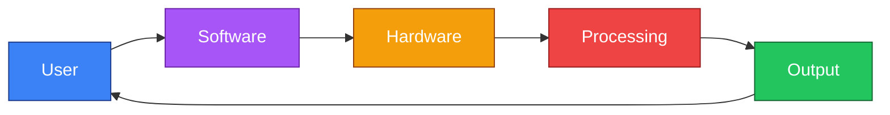
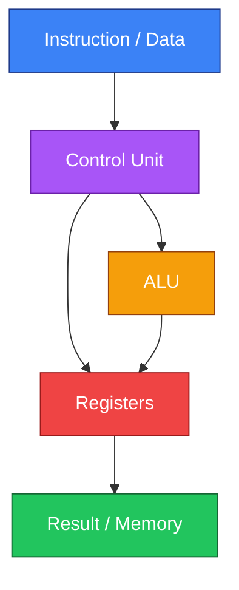
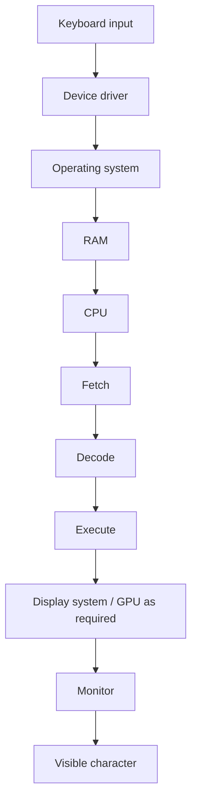
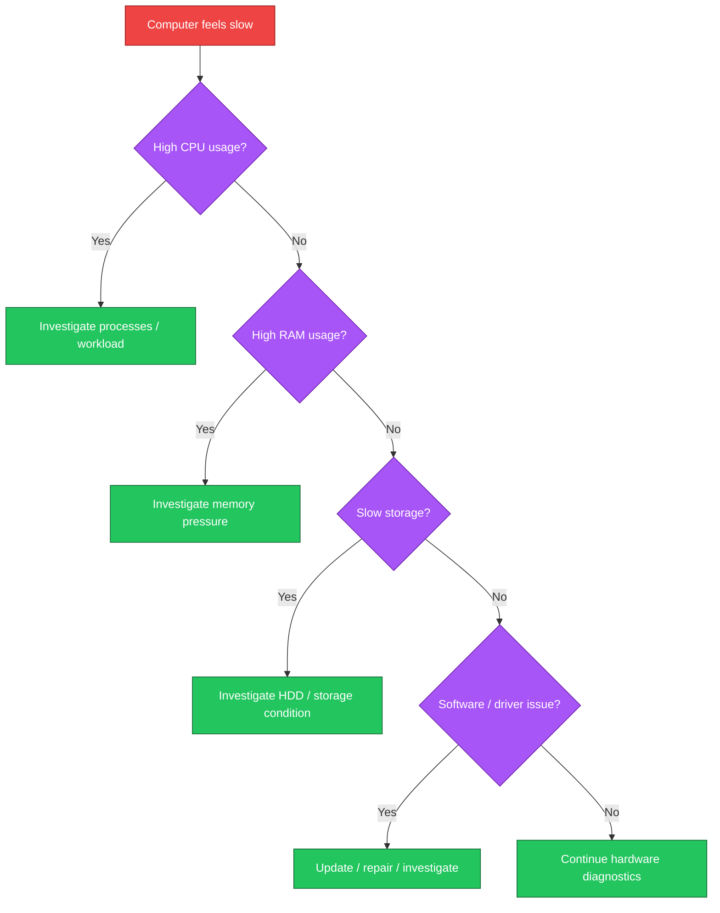

# Microsoft IT Support Specialist Professional Certificate
## Chapter 4 — Introduction to Computing Devices

> Comprehensive study notes based on the supplied Microsoft IT Support Specialist Professional Certificate Chapter 4 material.
>
> **Source-grounding note:** These notes preserve the chapter's terminology, examples, and instructional framing. Additional explanations are explicitly marked **Instructor Expansion** so they are not confused with source-derived claims.

---

## Table of Contents

1. [Chapter Overview](#chapter-overview)
2. [Learning Objectives](#learning-objectives)
3. [What Is a Computer?](#what-is-a-computer)
4. [Hardware and Software](#hardware-and-software)
5. [The Motherboard](#the-motherboard)
6. [CPU — Central Processing Unit](#cpu--central-processing-unit)
7. [Clock Speed and GHz](#clock-speed-and-ghz)
8. [Multicore Processors](#multicore-processors)
9. [RAM — Random Access Memory](#ram--random-access-memory)
10. [Storage and Long-Term Memory](#storage-and-long-term-memory)
11. [HDD vs SSD](#hdd-vs-ssd)
12. [SATA](#sata)
13. [Power Supply](#power-supply)
14. [Hardware vs Software](#hardware-vs-software)
15. [Application Software](#application-software)
16. [System Software](#system-software)
17. [Device Drivers](#device-drivers)
18. [Hardware and Software Interdependence](#hardware-and-software-interdependence)
19. [Input, Storage, Processing, Output](#input-storage-processing-output)
20. [Input Devices](#input-devices)
21. [Binary Representation](#binary-representation)
22. [Volatile vs Non-Volatile Memory](#volatile-vs-non-volatile-memory)
23. [CPU Components](#cpu-components)
24. [Control Unit](#control-unit)
25. [Arithmetic and Logic Unit](#arithmetic-and-logic-unit)
26. [CPU Registers](#cpu-registers)
27. [The Fetch–Decode–Execute Cycle](#the-fetchdecodeexecute-cycle)
28. [The System Bus](#the-system-bus)
29. [Output](#output)
30. [Computer Operation — End-to-End](#computer-operation--end-to-end)
31. [Monitors](#monitors)
32. [LCD and LED Displays](#lcd-and-led-displays)
33. [Resolution](#resolution)
34. [Colour Depth](#colour-depth)
35. [Refresh Rate](#refresh-rate)
36. [Graphics Processing Units (GPUs)](#graphics-processing-units-gpus)
37. [Parallel Processing](#parallel-processing)
38. [GPU Rendering Pipeline](#gpu-rendering-pipeline)
39. [Integrated vs Discrete GPUs](#integrated-vs-discrete-gpus)
40. [Cloud GPUs](#cloud-gpus)
41. [Matching Hardware to the Workload](#matching-hardware-to-the-workload)
42. [Sam's Scoops Case Study](#sams-scoops-case-study)
43. [IT Support Perspective](#it-support-perspective)
44. [Troubleshooting Hardware and Software](#troubleshooting-hardware-and-software)
45. [Practical Examples](#practical-examples)
46. [Common Misconceptions](#common-misconceptions)
47. [Fun Facts and Trivia](#fun-facts-and-trivia)
48. [Quick Reference Tables](#quick-reference-tables)
49. [Practice Questions](#practice-questions)
50. [Scenario-Based Exercises](#scenario-based-exercises)
51. [Memory Hooks](#memory-hooks)
52. [Final Revision Checklist](#final-revision-checklist)
53. [Exam-Oriented Summary](#exam-oriented-summary)

---

# Chapter Overview

A computer is fundamentally a system that:

1. **Accepts input**
2. **Stores information**
3. **Processes information**
4. **Produces output**

The chapter introduces the physical components that make this possible and then explains how software interacts with those components.

The major hardware concepts are:

- motherboard
- CPU
- RAM
- storage
- power supply
- monitors
- graphics processing units (GPUs)

The major software concepts are:

- application software
- system software
- operating systems
- device drivers

The chapter then connects these concepts to the way a computer actually operates through the **fetch–decode–execute cycle**.

---

# Learning Objectives

By the end of this chapter, you should be able to:

- Define a computer in terms of input, storage, processing, and output.
- Distinguish between hardware and software.
- Identify the major components of a computer.
- Explain the role of a motherboard.
- Explain the function of a CPU.
- Explain clock speed and GHz.
- Explain multicore processors.
- Explain RAM and why it matters.
- Distinguish temporary memory from permanent storage.
- Compare HDD and SSD storage.
- Explain SATA at a high level.
- Explain the role of a power source.
- Distinguish application software from system software.
- Explain device drivers.
- Describe how input becomes computer-readable data.
- Explain volatile and non-volatile memory.
- Describe the control unit, arithmetic/logic unit, and registers.
- Explain the fetch–decode–execute cycle.
- Explain the role of a bus.
- Explain monitor resolution, colour depth, and refresh rate.
- Explain what a GPU does.
- Explain GPU parallel processing.
- Distinguish integrated, discrete, and cloud GPUs.
- Apply these concepts to practical IT-support situations.

---

# 1. What Is a Computer?

## What?

A computer is a device that receives data, stores it, processes it, and produces an output.

The source emphasises that computers can take many forms:

- desktop computers
- laptops
- tablets
- smartphones

Despite their differences, they fundamentally perform the same kinds of operations.

## Why?

Computers allow users to:

- work
- communicate
- consume entertainment
- interact with online services
- process information
- store data

## How?

At a high level:

```text
Input
  ↓
Storage / Memory
  ↓
Processing
  ↓
Output
```

## When?

Every time you:

- type a message
- open an application
- watch a video
- edit a document
- calculate a value
- interact with a website

your device is performing some version of this process.

---

# 2. Hardware and Software

A computer consists of two overarching parts:

> **Hardware + Software**

## Hardware

Hardware is the physical equipment that makes up a computer.

Examples:

- motherboard
- CPU
- RAM
- storage drive
- keyboard
- mouse
- monitor
- graphics card

## Software

Software provides instructions telling hardware:

- what to do
- how to do it

Examples:

- operating systems
- Microsoft Word
- Microsoft Excel
- web browsers
- device drivers



---

# 3. The Motherboard

## What?

The **motherboard** is the central circuit board that provides slots and connections for the components required to build a computer.

On Apple devices, the equivalent term commonly used is **logic board**.

## Why?

The motherboard allows major components to connect and communicate.

It provides the physical foundation on which components are installed.

## How?

Components such as:

- CPU
- RAM
- storage interfaces
- expansion hardware

connect to or communicate through the motherboard.

## When does it matter?

Whenever you:

- upgrade RAM
- install certain expansion hardware
- troubleshoot hardware
- build a desktop computer
- diagnose component compatibility

you need to understand the motherboard.

---

# 4. CPU — Central Processing Unit

## What?

The **CPU (Central Processing Unit)** is the primary processor responsible for carrying out instructions and processing data.

The chapter describes the CPU as the computer's **reasoning centre** or "brain".

## Why?

Without a processor, software instructions cannot be executed.

## How?

At a simplified level:

```text
Instruction
    ↓
CPU receives it
    ↓
CPU interprets it
    ↓
CPU performs operation
    ↓
Result is stored / used
```

## When?

The CPU is involved in essentially every computational task performed by the computer.

---

# 5. Clock Speed and GHz

## What is clock speed?

The source describes CPU capacity in terms of **clock speed**, measured in **gigahertz (GHz)**.

GHz indicates the frequency at which the processor's clock operates.

### Example

A processor operating at:

```text
3 GHz
```

has a clock frequency of approximately:

$$
3 \times 10^9
$$

cycles per second.

> **Instructor Expansion:** Clock speed alone does not determine real-world CPU performance. Architecture, core count, workload, cache, power limits, and other factors also matter. The chapter focuses on clock speed as a basic measure of CPU capacity.

---

# 6. Multicore Processors

## What?

A **multicore processor** contains multiple processing cores that can work on tasks in parallel.

The source uses **quad-core** as an example.

"Quad" means four.

## Why?

Multiple cores can allow a processor to work on multiple operations concurrently, depending on the workload and software.

## How?

Conceptually:

```text
Single core:

Task → CPU Core → Result


Multiple cores:

Task A → Core 1 ─┐
Task B → Core 2 ─┤
Task C → Core 3 ─┤→ Results
Task D → Core 4 ─┘
```

> **Instructor Expansion:** Modern CPUs use "cores" rather than literally being multiple independent CPUs. The chapter uses simplified language when describing multicore processors.

---

# 7. RAM — Random Access Memory

## What?

**RAM** stands for **Random Access Memory**.

It is temporary working memory used while the computer is operating.

The chapter compares RAM with human short-term memory.

## Why does RAM matter?

RAM affects how much information and how many active tasks a computer can hold readily available for processing.

The chapter notes examples such as:

- 8 GB as a starting point for some small desktops/PCs
- 16 GB for many standard operations
- up to 64 GB for high-end gaming
- approximately 2–16 GB for tablets in the source's examples

These are course examples rather than universal purchasing requirements.

## How?

When applications are running, data required for active processing can be held in RAM.

```text
Storage
   ↓
RAM
   ↓
CPU
   ↓
RAM
   ↓
Storage / Output
```

## When is RAM important?

RAM matters when:

- running multiple applications
- editing large files
- working with large datasets
- gaming
- using virtual machines
- performing memory-intensive workloads

---

# 8. Storage and Long-Term Memory

The chapter compares RAM to short-term memory and hard drives to long-term memory.

## What is storage?

Storage retains data even when the computer is powered off.

Examples:

- HDD
- SSD
- external drive
- USB storage

## Why?

Storage provides persistent space for:

- operating systems
- applications
- documents
- photos
- videos
- datasets

## Key distinction

```text
RAM
= temporary working memory

Storage
= persistent data storage
```

---

# 9. HDD vs SSD

The source identifies two common forms of hard-drive storage:

- **HDD — Hard Disk Drive**
- **SSD — Solid State Drive**

## HDD

A traditional HDD is an older storage technology.

## SSD

An SSD uses solid-state storage and provides faster lookup/access performance than traditional HDD storage.

The source gives a flash drive as an example of SSD technology.

### Comparison

| Feature | HDD | SSD |
|---|---|---|
| Technology | Traditional disk-based storage | Solid-state storage |
| Speed | Generally slower | Generally faster |
| Moving mechanical components | Yes | No |
| Typical role | Persistent storage | Persistent storage |
| Source framing | Older technology | Faster lookup speeds |

> **Instructor Expansion:** SSDs are also generally more resistant to physical shock because they have no spinning magnetic platters. Exact performance and endurance vary by device.

---

# 10. SATA

**SATA** stands for:

> **Serial Advanced Technology Attachment**

The chapter describes SATA cables as adapters used to connect hard drives to the motherboard.

At a high level:

```text
Storage drive
     │
     │ SATA connection
     ↓
Motherboard
     │
     ↓
CPU / system
```

> **Instructor Expansion:** Modern systems may use other storage interfaces such as NVMe over PCIe. Those are outside the supplied chapter's scope.

---

# 11. Power Supply

A computer requires an appropriate power source.

The chapter highlights that larger computers generally require considerably more power than mobile devices.

Examples given in the source include:

- approximately **500–1,000 watts** for some computers
- approximately **2–6 watts** for a mobile phone

These are illustrative course figures rather than universal power requirements.

## Why does power matter?

Insufficient or unstable power can prevent components from operating correctly.

For desktop PCs, the **power supply unit (PSU)** converts incoming electrical power into the voltages required by computer components.

---

# 12. Hardware vs Software

The chapter uses a film-production analogy:

- hardware = actors, directors, staff, cameras and equipment
- software = the script/instructions

The analogy illustrates that:

> **Hardware provides the physical capability; software provides instructions.**

---

# 13. Application Software

## What?

Application software is designed to perform specific user tasks.

Examples from the chapter include:

- Microsoft Word
- Microsoft Excel
- Internet browsers

## Why?

Application software enables users to accomplish specific goals.

Examples:

| Application | Purpose |
|---|---|
| Word processor | Create documents |
| Spreadsheet | Analyse and calculate data |
| Browser | Access web content |

---

# 14. System Software

## What?

System software supports the operation of the computer itself.

The chapter includes:

- operating systems
- device drivers

Examples of operating systems mentioned include:

- Windows
- Mac

## Why?

System software provides the environment in which applications can run and hardware can operate.

```text
User
  ↓
Application software
  ↓
Operating system / system software
  ↓
Hardware
```

---

# 15. Device Drivers

## What?

A **device driver** is software that enables the operating system/software environment to communicate with a hardware device.

The chapter specifically states that devices communicate with software by means of a device driver.

## Why?

Hardware and software need a mechanism for understanding each other's operations.

## Example

Suppose you connect a printer.

```text
Application
    ↓
Operating system
    ↓
Printer driver
    ↓
Printer hardware
    ↓
Printed output
```

If the correct driver is missing or malfunctioning, the operating system may not be able to use the device properly.

## IT-support relevance

Driver issues can cause:

- printer failures
- audio problems
- display issues
- network adapter problems
- peripheral detection problems

---

# 16. Hardware and Software Interdependence

Hardware and software depend on each other.

The chapter makes two important points:

### Hardware without software

Physical components alone cannot provide a useful user interface or execute application instructions.

### Software without hardware

Software needs physical or virtual computing resources on which to run.

Therefore:

```text
Hardware ←→ Software
```

The relationship is interdependent.

---

# 17. Hardware Lifespan vs Software Updates

The source contrasts hardware and software in terms of change.

## Hardware

Hardware generally:

- remains relatively stable after purchase
- can sometimes be upgraded
- physically ages
- eventually reaches the end of its useful life

Examples:

- add RAM
- install an SSD
- replace a monitor
- replace a keyboard

## Software

Software:

- changes regularly
- receives patches
- receives updates
- may have bugs discovered after release
- may receive security fixes

The source notes that many updates relate to security issues.

---

# 18. Software Rollback

The chapter states that if a software upgrade is not working well, a possible solution is to restore an older, functional version.

This is commonly known as **rollback**.

```text
Working version
      ↓
Upgrade
      ↓
Problem detected
      ↓
Rollback
      ↓
Previous working version
```

> **Instructor Expansion:** In enterprise environments, rollback should follow change-management procedures and should not be performed blindly.

---

# 19. Input, Storage, Processing, Output

The chapter identifies four basic computer tasks:

1. **Input**
2. **Storage**
3. **Processing**
4. **Output**

This is one of the most important frameworks in the chapter.


---

# 20. Input Devices

Input devices allow users or external systems to provide data.

The source mentions:

- keyboard
- mouse
- camera
- microphone

Other common examples include:

- touchscreen
- scanner
- barcode reader
- game controller

> **Instructor Expansion:** The additional examples above are general computing examples and are not specifically listed in the supplied chapter.

---

# 21. Binary Representation

The chapter uses a keyboard example.

When a key is pressed, the input is converted into a digital representation consisting of **zeros and ones**.

This illustrates the fundamental binary nature of digital computing.

Conceptually:

```text
Physical key press
       ↓
Electrical/digital signal
       ↓
Binary representation
       ↓
Computer processing
```

> **Instructor Expansion:** A real keyboard-to-application path involves several layers of hardware, firmware, operating-system input handling, and character encoding. The chapter intentionally presents this at a high level.

---

# 22. Volatile vs Non-Volatile Memory

This distinction is essential.

## Volatile memory

Volatile memory loses its contents when power is removed.

The chapter gives **RAM** as the example.

```text
Power ON  → data retained
Power OFF → data lost
```

## Non-volatile memory

Non-volatile storage retains information when the computer is powered off.

Examples in the chapter include:

- hard drives
- external hard drives
- USB drives

```text
Power ON  → data retained
Power OFF → data retained
```

### Quick comparison

| Property | Volatile | Non-volatile |
|---|---|---|
| Example | RAM | HDD/SSD |
| Requires power to retain active data? | Yes | No |
| Persistent? | No | Yes |
| Primary role | Working memory | Long-term storage |

---

# 23. CPU Components

The chapter identifies important CPU components:

- **Control Unit (CU)**
- **Arithmetic/Logic Unit (ALU)**
- **Registers**

These work together during processing.



---

# 24. Control Unit

## What?

The **Control Unit** receives instructions, interprets them, and issues signals that coordinate the required operations.

## Why?

A computer needs to know:

- which instruction is being executed
- what operation needs to occur
- where relevant data should go

## How?

The chapter describes the control unit as:

1. receiving an instruction
2. decoding the instruction
3. issuing signals based on the decoded result

---

# 25. Arithmetic and Logic Unit

The **Arithmetic and Logic Unit (ALU)** performs computational and logical operations.

Conceptually, this can include:

- arithmetic
- comparisons
- logical decisions

For example:

$$
5 + 3 = 8
$$

or:

$$
5 > 3 = \text{True}
$$

> **Instructor Expansion:** Modern CPUs are considerably more complex than this simplified CU/ALU model, but the model is useful for understanding the fundamentals.

---

# 26. CPU Registers

A **register** is a very small, very fast memory location associated with the CPU.

The chapter describes registers as a form of short-term memory.

A useful conceptual hierarchy is:

```text
CPU Registers
     ↓
RAM
     ↓
SSD / HDD
```

Generally, moving downward means:

- more capacity
- greater access latency
- greater persistence

> **Instructor Expansion:** This hierarchy is simplified; real processors also use multiple levels of cache between registers and RAM.

---

# 27. The Fetch–Decode–Execute Cycle

This is one of the most important technical concepts in the chapter.

The CPU follows three steps:

1. **Fetch**
2. **Decode**
3. **Execute**

---

## Step 1 — Fetch

The CPU retrieves the required instruction/data from memory.

```text
Memory → CPU
```

---

## Step 2 — Decode

The CPU interprets the instruction.

It determines what operation the instruction represents.

---

## Step 3 — Execute

The CPU performs the required operation.

The result is then returned to the appropriate location.

---

## Complete cycle


---

# 28. The System Bus

## What?

The chapter describes a **bus** as a set of physical components that connects and transfers data between memory and the CPU.

## Why?

The CPU needs a way to communicate with memory and other system components.

## How?

Conceptually:

```text
Memory
  ↕
Bus
  ↕
CPU
```

The chapter highlights that data is continually transferred between memory and the CPU during program execution.

---

# 29. Output

After processing, the computer produces an output.

Examples include:

- displaying an image
- displaying text
- streaming video
- executing a program
- showing a status indicator

The output depends on the type of device and task.

### Example: tollbooth

The chapter uses a tollbooth example:

> A green light can indicate that payment has been accepted.

This is a simple example of a system transforming input into an output.

---

# 30. Computer Operation — End-to-End

Let's combine everything.

Suppose you type a letter into a text editor.



This is simplified, but it gives you the correct conceptual model.

---

# 31. Monitors

## What?

A monitor is an **output device** that presents processed visual data to the user.

## Why?

The monitor provides a visual interface through which users see the results of computing operations.

## Important monitor specifications

The chapter focuses on:

- size
- resolution
- colour depth
- refresh rate
- display technology

---

# 32. LCD and LED Displays

## LCD

**LCD** stands for:

> Liquid Crystal Display

LCD technology uses liquid crystals to control light transmission.

## LED

**LED** stands for:

> Light Emitting Diode

The source explains that modern LCD monitors are LED-backlit, while the term LED monitor can refer to LED-backlit LCD displays with local dimming technology.

### Practical takeaway

When comparing monitors, do not focus only on the word "LED". Look at the actual specifications and display technology.

---

# 33. Resolution

## What?

**Resolution** refers to the number of pixels horizontally and vertically on a display.

Examples from the chapter:

- **1920 × 1080** — Full HD
- **3840 × 2160** — 4K Ultra HD

## How many pixels?

For 1920 × 1080:

$$
1920 \times 1080 = 2,073,600
$$

For 3840 × 2160:

$$
3840 \times 2160 = 8,294,400
$$

Therefore, 4K UHD contains approximately four times as many pixels as Full HD.

### Why does resolution matter?

Higher resolution can provide:

- greater image detail
- sharper text
- more workspace
- better visual clarity

---

# 34. Colour Depth

## What?

**Colour depth** refers to the number of colours a monitor can represent.

The chapter mentions:

- 8-bit
- 10-bit

Higher colour depth allows a broader range of colours and more accurate colour reproduction.

## Example

An 8-bit channel can represent:

$$
2^8 = 256
$$

levels per channel.

A 10-bit channel can represent:

$$
2^{10} = 1024
$$

levels per channel.

> **Instructor Expansion:** These calculations refer to levels per colour channel under a simplified RGB model. Actual display pipelines involve additional factors.

---

# 35. Refresh Rate

## What?

Refresh rate is the frequency at which a display refreshes, measured in **Hertz (Hz)**.

Examples:

- 60 Hz
- 144 Hz
- 240 Hz

## Why does it matter?

Higher refresh rates can produce:

- smoother motion
- improved responsiveness
- reduced perceived motion blur

This is particularly relevant to:

- gaming
- animation
- fast-moving visual content

### Conceptual comparison

```text
60 Hz
→ display refreshes 60 times per second

144 Hz
→ display refreshes 144 times per second

240 Hz
→ display refreshes 240 times per second
```

---

# 36. Graphics Processing Units (GPUs)

## What is a GPU?

A **Graphics Processing Unit (GPU)** is a specialised processor designed to accelerate graphics workloads.

The chapter explains that GPUs were originally developed for:

- 2D rendering
- 3D rendering
- animation
- video processing

Their applications have since expanded substantially.

---

# 37. Why GPUs Are Important

Modern GPUs can be used for:

- gaming
- creative content production
- video editing
- high-performance computing (HPC)
- artificial intelligence
- machine learning
- deep learning
- data analysis
- financial risk management
- medical imaging
- 3D rendering

This is especially important for anyone studying AI/ML because GPU architecture enables large amounts of parallel computation.

---

# 38. Parallel Processing

One of the most important GPU characteristics is **parallel processing**.

## What?

GPUs contain many processing resources that can handle different parts of a workload simultaneously.

Conceptually:

```text
Large workload
      ↓
┌─────┬─────┬─────┬─────┐
│Part1│Part2│Part3│Part4│
└─────┴─────┴─────┴─────┘
   ↓     ↓     ↓     ↓
 GPU processing units
   ↓     ↓     ↓     ↓
└─────┬─────┬─────┬─────┘
      ↓
Combined result
```

## CPU vs GPU — conceptual model

| CPU | GPU |
|---|---|
| General-purpose processing | Specialised parallel processing |
| Fewer powerful cores in typical designs | Many processing elements |
| Good for sequential/branch-heavy tasks | Excellent for highly parallel workloads |
| General computing | Graphics, AI, HPC and parallel workloads |

> **Instructor Expansion:** This is a conceptual comparison, not a rule that CPUs cannot perform parallel workloads or GPUs cannot execute general-purpose code.

---

# 39. GPU Rendering Pipeline

The chapter identifies three stages for transforming raw data into pixels:

1. Geometry processing
2. Rasterization
3. Pixel shading


---

## 39.1 Geometry Processing

Geometry processing transforms 3D models into representations that can be displayed in two dimensions.

---

## 39.2 Rasterization

Rasterization converts the representations into pixels.

Think:

> **Geometry → pixel grid**

---

## 39.3 Pixel Shading

Pixel shading determines the colour and appearance of individual pixels based on factors such as:

- lighting
- textures
- visual effects

---

# 40. Integrated vs Discrete GPUs

The chapter identifies two main GPU configurations.

## Integrated GPU

An **integrated GPU** is built into the computer's motherboard or integrated with the CPU.

### Advantages

- smaller
- lighter
- lower power consumption
- lower overall device cost

### Limitation

The chapter notes that integrated GPUs are not easily upgradeable.

---

## Discrete GPU

A **discrete GPU** is an independent graphics card.

### Advantages

- higher graphics processing capability
- suitable for resource-intensive applications
- can be upgraded depending on the system

### Disadvantages

- higher energy consumption
- more heat
- may require dedicated cooling

---

# 41. Integrated vs Discrete — Quick Comparison

| Characteristic | Integrated GPU | Discrete GPU |
|---|---|---|
| Location | Integrated with CPU/system board | Separate graphics card |
| Power | Generally lower | Generally higher |
| Heat | Generally lower | Generally higher |
| Cost | Generally lower | Generally higher |
| Upgradeability | Limited | More upgradeable |
| Suitable for | General use | Graphics-intensive workloads |
| Example workload | Office work | 3D gaming / heavy visual workloads |

---

# 42. Cloud GPUs

## What?

The chapter introduces **cloud GPUs** as virtual GPU services provided by cloud service providers.

They allow users to access GPU computing without necessarily owning local GPU hardware.

## Why?

Cloud GPUs can provide:

- scalability
- on-demand computing
- reduced need for local hardware
- access to different GPU types
- flexibility for organisations with variable workloads

## How?

Conceptually:

```text
User / Application
       ↓
Cloud provider
       ↓
Virtual GPU resources
       ↓
Compute workload
       ↓
Results
```

## Applications mentioned in the chapter

Cloud GPUs can be used for:

- data analysis
- generative AI
- financial risk management
- gaming
- medical imaging
- 3D rendering
- high-performance computing

---

# 43. Local GPU vs Cloud GPU

| Factor | Local GPU | Cloud GPU |
|---|---|---|
| Hardware ownership | Organisation/user owns hardware | Provider owns infrastructure |
| Initial hardware purchase | Required | Not necessarily |
| Scalability | Limited by installed hardware | Can scale according to available services |
| Maintenance | User/organisation responsibility | Provider manages underlying infrastructure |
| Access | Local | Network/cloud |
| Cost model | Hardware investment + operation | Usage/service-based |
| Best fit | Predictable local workloads | Flexible or burst workloads |

> **Instructor Expansion:** Actual cloud GPU pricing, availability, networking performance, and data-transfer costs vary significantly by provider and workload.

---

# 44. Matching Hardware to the Workload

One of the chapter's practical lessons is that the best computer is not simply the computer with the biggest specifications.

You should match hardware to the workload.

## Example: Student laptop

Likely priorities:

- sufficient RAM
- SSD storage
- good battery life
- suitable display
- portability

## Example: Gamer

Likely priorities:

- high-performance GPU
- adequate CPU
- sufficient RAM
- high-refresh-rate monitor
- effective cooling

## Example: Image editor

Likely priorities:

- high-resolution display
- accurate colour reproduction
- sufficient RAM
- capable GPU depending on workload

## Example: AI/ML practitioner

Likely priorities:

- capable CPU
- substantial RAM
- GPU acceleration where required
- fast storage
- potentially cloud GPU access

---

# 45. Sam's Scoops Case Study

Sam is running her growing ice cream business from a single personal laptop.

The business is growing and she plans to open a storefront.

This creates new technology requirements.

She needs to understand:

- hardware requirements
- software requirements
- security requirements
- how technology can support employees
- how technology can support customers

The case study demonstrates why understanding computer components is useful even for non-technical business owners.

---

# 46. Sam's Scoops — Hardware Questions

As Sam expands, she should consider:

### Number of devices

How many employees require computers?

### Workload

Will devices be used for:

- order management
- email
- spreadsheets
- customer management
- web applications
- accounting

### Storage

How much local storage is required?

### RAM

How many applications need to run simultaneously?

### Display

Would standard Full HD be sufficient, or is higher resolution useful?

### Graphics

Does the workload require an integrated GPU or a discrete GPU?

### Power

Are the devices suitable for the available power environment?

---

# 47. IT Support Perspective

Understanding hardware is fundamental to IT support.

When a user says:

> "My computer is slow."

An IT support professional should not immediately assume that the CPU is the problem.

Possible areas to investigate include:

- RAM utilisation
- storage capacity
- storage performance
- CPU utilisation
- background applications
- software problems
- drivers
- operating-system issues
- thermal conditions

---

# 48. Hardware Troubleshooting Framework

Use:

```text
User symptom
     ↓
Reproduce / clarify issue
     ↓
Identify affected component
     ↓
Check software and drivers
     ↓
Check hardware condition
     ↓
Test likely cause
     ↓
Apply fix
     ↓
Verify
     ↓
Document
```

---

# 49. Example: Computer Running Slowly

## Symptom

> "My laptop takes five minutes to start."

## Investigation

Ask:

1. How much RAM is installed?
2. How much RAM is currently being used?
3. Is the storage an HDD or SSD?
4. How much free storage remains?
5. Are many applications starting automatically?
6. Are updates pending?
7. Are there unusual background processes?
8. Is the device overheating?

## Possible causes

| Observation | Possible direction |
|---|---|
| HDD | Storage performance limitation |
| Very low free space | Storage pressure |
| High RAM usage | Memory pressure |
| High CPU usage | Processing workload |
| Many startup applications | Software/startup issue |
| Outdated drivers | Driver/software issue |

---

# 50. Example: No Sound

Possible layers:

```text
Application
   ↓
Operating system
   ↓
Audio driver
   ↓
Audio hardware
   ↓
Speaker / headphones
```

The IT-support technician should troubleshoot from the software layer toward the hardware layer rather than replacing hardware immediately.

---

# 51. Example: External Monitor Not Working

Investigate:

- cable connection
- display input selection
- operating-system display settings
- graphics driver
- GPU capability
- monitor power
- monitor resolution/refresh compatibility

This illustrates why understanding the relationship between hardware, drivers, software, and displays matters.

---

# 52. Common Misconceptions

## Misconception 1: "More GHz always means a faster computer."

**Reality:** Clock speed is only one factor in performance.

---

## Misconception 2: "RAM and storage are the same thing."

**Reality:**

```text
RAM → temporary working memory
Storage → persistent data
```

---

## Misconception 3: "Turning off a computer deletes everything."

**Reality:** Data in volatile RAM is lost, but data stored on non-volatile storage remains.

---

## Misconception 4: "An SSD is just a faster HDD."

**Reality:** Both provide persistent storage, but they use fundamentally different storage technologies.

---

## Misconception 5: "A GPU is only for gaming."

**Reality:** GPUs are also used for:

- AI
- machine learning
- video processing
- HPC
- 3D rendering
- data analysis
- medical imaging

---

## Misconception 6: "Cloud GPU means the GPU is not real."

**Reality:** Cloud GPUs provide GPU computing resources remotely through cloud infrastructure.

---

# 53. Fun Facts and Trivia

## Fun Fact 1 — The "brain" analogy

The chapter repeatedly compares the CPU to a human brain because both:

- receive information
- interpret information
- perform operations
- produce results

It is an analogy rather than a literal equivalence.

---

## Fun Fact 2 — 4K has about four times the pixels of Full HD

Full HD:

$$
1920 \times 1080 = 2.07\text{ million pixels}
$$

4K UHD:

$$
3840 \times 2160 = 8.29\text{ million pixels}
$$

Ratio:

$$
\frac{8,294,400}{2,073,600}=4
$$

---

## Fun Fact 3 — GPUs moved far beyond graphics

The same parallel-processing capability that makes GPUs useful for rendering also makes them valuable for:

- neural-network training
- machine learning
- scientific computing
- large-scale numerical workloads

---

# 54. Quick Reference — Computer Components

| Component | Main function |
|---|---|
| Motherboard | Connects and supports major components |
| CPU | Executes instructions and processes data |
| RAM | Temporary working memory |
| HDD | Persistent storage |
| SSD | Persistent solid-state storage |
| PSU / power source | Supplies electrical power |
| Monitor | Visual output |
| GPU | Accelerates graphics and parallel workloads |
| Device driver | Enables software/OS communication with hardware |
| Operating system | Manages hardware and provides software environment |

---

# 55. Quick Reference — Memory

| Type | Volatile? | Persistent? | Example |
|---|---:|---:|---|
| RAM | Yes | No | DDR memory |
| CPU register | Yes | No | Processor register |
| HDD | No | Yes | Hard disk |
| SSD | No | Yes | Solid-state drive |
| USB drive | No | Yes | Flash storage |

---

# 56. Quick Reference — Display Specifications

| Specification | Meaning | Why it matters |
|---|---|---|
| Resolution | Number of horizontal × vertical pixels | Image detail |
| Colour depth | Number of colour levels | Colour accuracy/range |
| Refresh rate | Refreshes per second | Motion smoothness |
| Size | Physical display dimensions | Viewing/workspace |
| Display technology | How the panel produces/controls light | Image characteristics |

---

# 57. Quick Reference — GPU Types

| GPU type | Key characteristic |
|---|---|
| Integrated | Built into CPU/system |
| Discrete | Separate graphics card |
| Cloud | Remote GPU service |

---

# 58. Practice Questions — Basic

### Q1. What are the two overarching parts of a computer?

### Q2. What is hardware?

### Q3. What is software?

### Q4. What is the purpose of a motherboard?

### Q5. What does CPU stand for?

### Q6. What does RAM stand for?

### Q7. What is the difference between RAM and storage?

### Q8. What does HDD stand for?

### Q9. What does SSD stand for?

### Q10. What does SATA stand for?

### Q11. What is a device driver?

### Q12. What are the four basic computer operations?

### Q13. What is volatile memory?

### Q14. What is non-volatile memory?

### Q15. What is a GPU?

---

# 59. Practice Questions — Intermediate

### Q16. Explain the relationship between hardware and software.

### Q17. Why does a computer need RAM?

### Q18. Why does a computer need persistent storage?

### Q19. Explain the difference between HDD and SSD.

### Q20. What is the role of a device driver?

### Q21. Explain the difference between application software and system software.

### Q22. Describe the fetch–decode–execute cycle.

### Q23. What is the function of the control unit?

### Q24. What is the function of the ALU?

### Q25. What is a CPU register?

### Q26. What is a bus?

### Q27. What does monitor resolution mean?

### Q28. What is refresh rate?

### Q29. What is colour depth?

### Q30. Why are GPUs useful for AI?

---

# 60. Practice Questions — Advanced

### Q31. Explain the complete journey of a keyboard input from physical key press to visible text.

### Q32. Explain why a computer can have a powerful CPU but still feel slow.

### Q33. Compare integrated and discrete GPUs.

### Q34. Explain why cloud GPUs can be useful to a company.

### Q35. Design a suitable computer for:
- a student
- a gamer
- a video editor
- an AI/ML developer

### Q36. A user's laptop has 16 GB RAM but still runs slowly. What would you investigate?

### Q37. A monitor displays an image but the image is blurry. Which specifications or components would you investigate?

### Q38. A printer is physically connected but does not work. Explain why the device driver should be investigated.

---

# 61. Scenario-Based Exercises

## Exercise 1 — Hardware Identification

For each item, identify whether it is hardware or software:

| Item | Hardware / Software |
|---|---|
| CPU | |
| Windows | |
| RAM | |
| Microsoft Excel | |
| SSD | |
| Device driver | |
| Monitor | |
| Web browser | |
| Motherboard | |
| GPU | |

---

## Exercise 2 — Memory Classification

Classify each as volatile or non-volatile:

| Component | Type |
|---|---|
| RAM | |
| SSD | |
| HDD | |
| CPU register | |
| USB flash storage | |

---

## Exercise 3 — Fetch–Decode–Execute

Explain what happens when the CPU receives an instruction.

Use:

```text
FETCH
↓
DECODE
↓
EXECUTE
↓
RESULT
```

---

## Exercise 4 — GPU Selection

Sam's Scoops wants two devices:

### Device A
Used for:

- email
- spreadsheets
- browser
- point-of-sale software

### Device B
Used for:

- 3D product visualisation
- video editing
- AI experiments

Recommend:

- integrated or discrete GPU
- suitable display priorities
- reasoning

---

# 62. Mini Project — Design Sam's Scoops IT Setup

Create a basic technology plan.

## Requirements

Assume Sam needs:

- employee computers
- customer/order management
- email
- documents
- web access
- secure storage
- displays
- backups

For each requirement, recommend:

```text
Hardware:
Software:
Storage:
Memory:
Display:
Security consideration:
Reason:
```

The purpose is not to select a specific brand but to demonstrate that you can match technology to business requirements.

---

# 63. Practical Exercise — Diagnose "Slow Computer"

Create a troubleshooting decision tree.



---

# 64. Memory Hooks

## Computer

Remember:

> **I-S-P-O**

**Input → Storage → Processing → Output**

---

## Hardware vs Software

Remember:

> **Hardware = physical; Software = instructions**

---

## RAM vs Storage

Remember:

> **RAM = working desk; Storage = filing cabinet**

---

## CPU Cycle

Remember:

> **F-D-E**

**Fetch → Decode → Execute**

---

## CPU Components

Remember:

> **Control → Calculate → Remember**

- Control Unit
- ALU
- Registers

---

## GPU

Remember:

> **GPU = parallel processing powerhouse**

---

## Display

Remember:

> **R-C-R**

- Resolution
- Colour depth
- Refresh rate

---

# 65. Final Revision Checklist

- [ ] I can define a computer.
- [ ] I know the difference between hardware and software.
- [ ] I can identify a motherboard.
- [ ] I understand the CPU's role.
- [ ] I understand clock speed and GHz.
- [ ] I understand multicore processors.
- [ ] I can explain RAM.
- [ ] I can distinguish RAM from storage.
- [ ] I can distinguish HDD from SSD.
- [ ] I know what SATA means.
- [ ] I understand why a computer requires a power source.
- [ ] I can distinguish application software from system software.
- [ ] I understand device drivers.
- [ ] I understand hardware/software interdependence.
- [ ] I know the four computer operations: input, storage, processing, output.
- [ ] I understand binary input at a high level.
- [ ] I can distinguish volatile and non-volatile memory.
- [ ] I know the CPU's control unit.
- [ ] I know the ALU.
- [ ] I understand registers.
- [ ] I can explain fetch–decode–execute.
- [ ] I understand the role of a bus.
- [ ] I understand monitor resolution.
- [ ] I understand colour depth.
- [ ] I understand refresh rate.
- [ ] I understand what a GPU does.
- [ ] I understand parallel processing.
- [ ] I know the three GPU rendering stages.
- [ ] I can distinguish integrated and discrete GPUs.
- [ ] I understand cloud GPUs.
- [ ] I can match hardware to workload.
- [ ] I can troubleshoot basic hardware/software problems.

---

# 66. Exam-Oriented Summary

If you are preparing for a knowledge check or interview, prioritise these concepts.

## Tier 1 — Must Know

### Hardware

- motherboard
- CPU
- RAM
- HDD
- SSD
- monitor
- GPU
- power source

### Software

- application software
- system software
- operating system
- device driver

### Computer operation

```text
Input
→ Storage
→ Processing
→ Output
```

### CPU

```text
Fetch
→ Decode
→ Execute
```

### Memory

```text
Volatile
→ RAM

Non-volatile
→ HDD / SSD
```

---

## Tier 2 — Understand Well

- clock speed
- multicore processors
- CPU control unit
- ALU
- registers
- bus
- resolution
- colour depth
- refresh rate
- integrated GPU
- discrete GPU
- cloud GPU

---

## Tier 3 — Be Able to Apply

You should be able to:

- troubleshoot a slow computer
- diagnose a driver problem
- select suitable RAM/storage
- choose an appropriate GPU
- explain why an SSD differs from an HDD
- recommend a monitor for a specific workload
- explain why cloud GPU resources may be useful
- design a basic computing setup for Sam's Scoops

---

# 67. One-Page Mental Model

```text
                         COMPUTER
                            │
              ┌─────────────┴─────────────┐
              │                           │
           HARDWARE                    SOFTWARE
              │                           │
      ┌───────┼────────┐          ┌───────┴────────┐
      │       │        │          │                │
   CPU      RAM     Storage    System          Application
      │       │        │       Software          Software
      │       │        │          │
      └───────┴────────┴──────────┘
                    │
                    ↓
              INPUT → PROCESS → OUTPUT
                    │
                    ↓
              FETCH → DECODE → EXECUTE
                    │
                    ↓
             DISPLAY / RESULT
                    │
                    ↓
                  USER
```

For visual workloads:

```text
CPU
 ↓
GPU
 ↓
Geometry Processing
 ↓
Rasterization
 ↓
Pixel Shading
 ↓
Monitor
 ↓
Pixels
```

---

# 68. Final Takeaway

The most important concept in this chapter is not memorising component names individually.

It is understanding how the components work together.

A computer is a coordinated system:

> **Hardware provides the physical computing resources.**

> **Software provides the instructions.**

> **The CPU executes instructions.**

> **RAM holds active working information.**

> **Storage preserves information.**

> **Device drivers allow software to communicate with hardware.**

> **The monitor presents visual output.**

> **The GPU accelerates graphics and highly parallel workloads.**

> **Cloud GPUs provide remotely accessible GPU computing resources.**

And the fundamental processing model is:

$$
\boxed{\text{Input} \rightarrow \text{Storage} \rightarrow \text{Processing} \rightarrow \text{Output}}
$$

while the CPU's instruction cycle is:

$$
\boxed{\text{Fetch} \rightarrow \text{Decode} \rightarrow \text{Execute}}
$$

Once these two models are clear, the rest of the chapter becomes much easier to understand.

---

# Source Scope and Accuracy Note

These notes are based on the supplied **Chapter 4: Introduction to computing devices** material.

The source explicitly covers:

- computer hardware
- computer software
- motherboard
- CPU
- clock speed
- multicore processors
- RAM
- HDD and SSD storage
- SATA
- power requirements
- application software
- system software
- device drivers
- input, storage, processing, and output
- volatile and non-volatile memory
- CPU control unit
- ALU
- registers
- fetch–decode–execute
- buses
- monitors
- LCD and LED technologies
- resolution
- colour depth
- refresh rate
- GPUs
- parallel processing
- geometry processing
- rasterization
- pixel shading
- integrated GPUs
- discrete GPUs
- cloud GPUs
- Sam's Scoops business scenario

The source also provides additional resources concerning drivers, RAM management in the cloud, and CPU analysis.

Where this README introduces broader concepts such as cache hierarchy, NVMe, detailed CPU architecture, incident-style troubleshooting workflows, or expanded hardware-selection guidance, those sections are marked **Instructor Expansion** and should be treated as explanatory context rather than direct claims from the supplied chapter.

---

# End of Chapter 4 Notes

## Final memory sequence

If you remember only one sequence, remember:

> **Hardware + Software → Input → Memory → CPU → Output**

And for CPU instructions:

> **Fetch → Decode → Execute**

And for memory:

> **RAM = temporary**

> **SSD/HDD = persistent**

And for graphics:

> **GPU = specialised parallel processing**

These four mental models provide the foundation for understanding the operating-systems chapter that follows.
