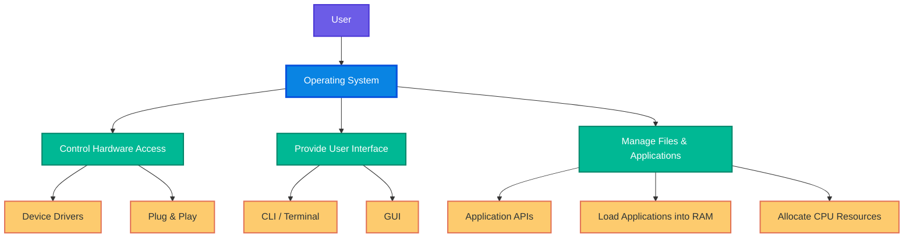
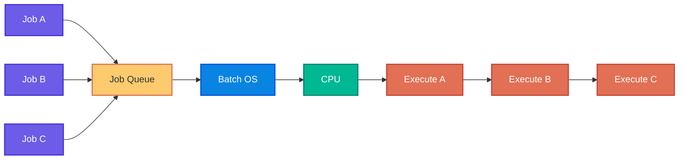
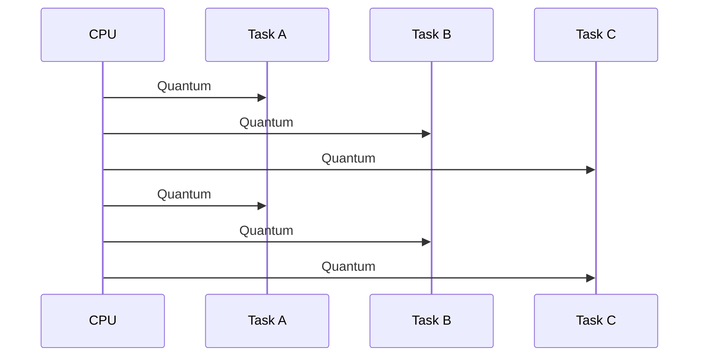
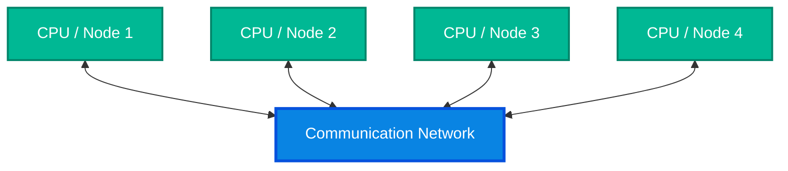
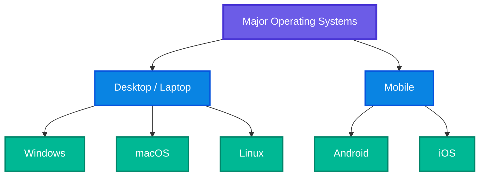
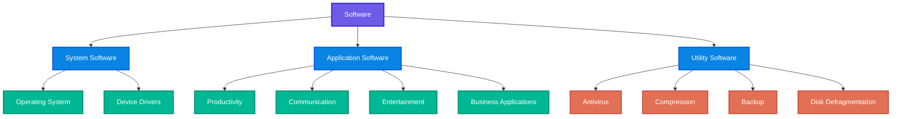
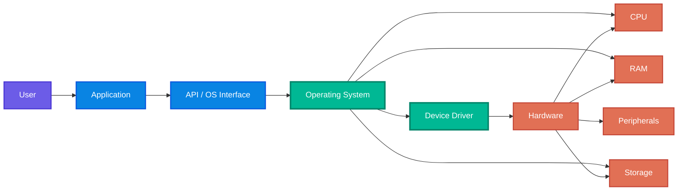
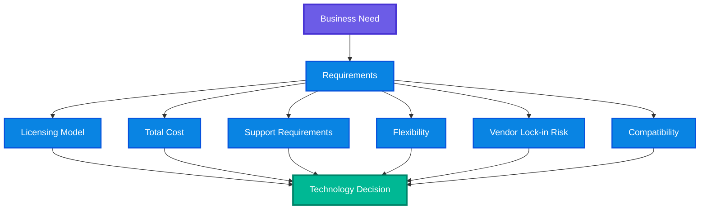

# Chapter 5 — Operating Systems

> Comprehensive study notes for the **Microsoft IT Support Specialist Professional Certificate — Introduction to Computers and Operating Systems**

---

## Table of Contents

1. [Chapter Overview](#chapter-overview)
2. [Learning Objectives](#learning-objectives)
3. [1. What Is an Operating System?](#1-what-is-an-operating-system)
4. [2. The Three Core Responsibilities of an OS](#2-the-three-core-responsibilities-of-an-os)
5. [3. Operating Systems and Hardware Access](#3-operating-systems-and-hardware-access)
6. [4. Device Drivers](#4-device-drivers)
7. [5. Plug and Play](#5-plug-and-play)
8. [6. User Interfaces — CLI and GUI](#6-user-interfaces--cli-and-gui)
9. [7. File and Application Management](#7-file-and-application-management)
10. [8. APIs and Application Compatibility](#8-apis-and-application-compatibility)
11. [9. RAM, CPU and Resource Allocation](#9-ram-cpu-and-resource-allocation)
12. [10. Types of Operating Systems](#10-types-of-operating-systems)
13. [11. Batch Operating Systems](#11-batch-operating-systems)
14. [12. Time-Sharing Operating Systems](#12-time-sharing-operating-systems)
15. [13. Distributed Operating Systems](#13-distributed-operating-systems)
16. [14. Network Operating Systems](#14-network-operating-systems)
17. [15. Real-Time Operating Systems](#15-real-time-operating-systems)
18. [16. Comparing OS Types](#16-comparing-os-types)
19. [17. Popular Modern Operating Systems](#17-popular-modern-operating-systems)
20. [18. Microsoft Windows](#18-microsoft-windows)
21. [19. Apple macOS](#19-apple-macos)
22. [20. Android](#20-android)
23. [21. Apple iOS](#21-apple-ios)
24. [22. Linux](#22-linux)
25. [23. Desktop vs Mobile Operating Systems](#23-desktop-vs-mobile-operating-systems)
26. [24. Open-Source vs Proprietary Software](#24-open-source-vs-proprietary-software)
27. [25. Open-Source Software — Advantages and Trade-offs](#25-open-source-software--advantages-and-trade-offs)
28. [26. Proprietary Software — Advantages and Trade-offs](#26-proprietary-software--advantages-and-trade-offs)
29. [27. Vendor Lock-In](#27-vendor-lock-in)
30. [28. Types of Software](#28-types-of-software)
31. [29. System Software](#29-system-software)
32. [30. Application Software](#30-application-software)
33. [31. Utility Software](#31-utility-software)
34. [32. How the Pieces Work Together](#32-how-the-pieces-work-together)
35. [33. Practical IT Support Scenarios](#33-practical-it-support-scenarios)
36. [34. Troubleshooting OS Problems](#34-troubleshooting-os-problems)
37. [35. Software Selection for a Business](#35-software-selection-for-a-business)
38. [36. Windows-Specific Support Concepts](#36-windows-specific-support-concepts)
39. [37. Instructor Expansion](#37-instructor-expansion)
40. [38. Common Misconceptions](#38-common-misconceptions)
41. [39. Fun Facts](#39-fun-facts)
42. [40. Quick Reference Tables](#40-quick-reference-tables)
43. [41. Practice Questions](#41-practice-questions)
44. [42. Scenario-Based Exercises](#42-scenario-based-exercises)
45. [43. Memory Hooks](#43-memory-hooks)
46. [44. Final Revision Checklist](#44-final-revision-checklist)
47. [45. Exam-Oriented Summary](#45-exam-oriented-summary)
48. [46. One-Page Mental Model](#46-one-page-mental-model)
49. [47. Source Scope and Accuracy Note](#47-source-scope-and-accuracy-note)

---

# Chapter Overview

An **operating system (OS)** is the foundational software layer that coordinates hardware, software, and the human user.

The course introduces the OS using the example of a business such as Sam's Scoops. Employees may have different responsibilities, but their work still needs coordination so that people do not interfere with one another or compete for the same limited resources.

A computer works in a similar way:

- The CPU is a limited resource.
- RAM is a limited resource.
- Storage is a finite resource.
- Hardware devices need controlled access.
- Applications compete for CPU and memory.
- Users need a consistent way to interact with the computer.
- Files and applications must be organised and managed.

The operating system provides this coordination.

The course simplifies OS responsibilities into three broad categories:

1. **Controlling hardware access**
2. **Providing a user interface**
3. **Managing files and applications**

The chapter then expands into:

- Types of operating systems
- Major desktop and mobile operating systems
- Open-source vs proprietary software
- System, application and utility software
- Business-oriented software selection
- Windows-specific concepts such as the Registry and startup behaviour

---

# Learning Objectives

By the end of this chapter, you should be able to:

- Define an operating system.
- Explain why an OS is necessary.
- Explain how an OS interacts with hardware.
- Explain the purpose of device drivers.
- Describe plug and play.
- Distinguish between CLI and GUI.
- Explain how an OS manages applications and resources.
- Explain the role of APIs in application compatibility.
- Distinguish between batch, time-sharing, distributed, network and real-time operating systems.
- Identify the major desktop and mobile operating systems discussed in the course.
- Compare Windows, macOS, Android, iOS and Linux at a high level.
- Explain the difference between open-source and proprietary software.
- Understand vendor lock-in.
- Distinguish system, application and utility software.
- Apply OS/software concepts to IT-support scenarios.
- Reason about software selection according to business requirements.

---

# 1. What Is an Operating System?

## Definition

An **Operating System (OS)** is software that:

- Oversees interactions between hardware and software.
- Provides a mechanism for humans to interact with the computer.
- Coordinates system resources.
- Provides a platform for applications.
- Manages hardware access.
- Manages files and applications.

A useful mental model is:

```text
                 USER
                   |
                   v
        +----------------------+
        |    USER INTERFACE    |
        |      CLI / GUI       |
        +----------+-----------+
                   |
                   v
        +----------------------+
        |  OPERATING SYSTEM    |
        |                      |
        | Resource Management  |
        | File Management      |
        | Application Mgmt     |
        | Hardware Access      |
        +----------+-----------+
                   |
          +--------+--------+
          |        |        |
          v        v        v
        CPU       RAM     Devices
                         / Storage
```

## What does the OS do?

Think of the OS as the **coordinator** between:

- Human users
- Applications
- Hardware

Without this coordination, every application would need to know exactly how to communicate with every hardware component.

That would create an enormous compatibility problem.

## Why is an OS necessary?

Imagine running a word processor.

The word processor needs to:

1. Receive keyboard input.
2. Display text.
3. Read and write files.
4. Use RAM.
5. Request CPU processing.
6. Communicate with storage.
7. Potentially print a document.

The application should not need to independently implement every hardware-specific mechanism.

The OS provides a common layer through which these operations can be coordinated.

---

# 2. The Three Core Responsibilities of an OS

The course groups OS responsibilities into three major areas.



## Responsibility 1 — Controlling Hardware Access

The OS communicates with hardware through device drivers.

Examples:

- Printer
- Keyboard
- Mouse
- Graphics hardware
- Storage devices
- Bluetooth devices
- Other connected devices

### Why?

Different hardware devices require different communication mechanisms.

### How?

The OS uses a **device driver** to translate operating-system instructions into commands that the hardware can understand.

---

## Responsibility 2 — Providing a User Interface

The OS gives users a way to interact with the computer.

Two major interface forms covered by the course are:

- **Command Line Interface (CLI)**
- **Graphical User Interface (GUI)**

### CLI

The user enters commands into a terminal.

Example:

```text
user -> command -> operating system -> action
```

### GUI

The user interacts with:

- Windows
- Menus
- Buttons
- Icons
- Dialog boxes
- Pointer devices

---

## Responsibility 3 — Managing Files and Applications

The OS:

- Manages files.
- Loads applications.
- Allocates resources.
- Coordinates applications.
- Determines how much CPU and memory resources an application receives.

For example:

A lightweight text editor may require relatively few resources, while a high-resolution game can require substantial CPU and graphics resources.

---

# 3. Operating Systems and Hardware Access

## What?

Hardware consists of physical components.

Examples:

- CPU
- RAM
- Storage
- Keyboard
- Mouse
- Printer
- Display
- Graphics hardware

The operating system provides controlled access to those components.

## Why?

Hardware cannot simply be treated as an unlimited shared resource.

Multiple applications may want to use the same resources simultaneously.

For example:

```text
Browser ----\
             \
Video Call ---> CPU / RAM
             /
Word Processor
```

The OS must coordinate those requests.

## How?

A simplified flow is:

```text
Application
    |
    | requests an operation
    v
Operating System
    |
    | communicates through driver
    v
Device Driver
    |
    v
Hardware
```

## Real-world IT-support example

A user says:

> "My printer is connected, but Windows cannot print to it."

Possible OS-level causes include:

- Driver problem
- Device recognition issue
- Incorrect printer configuration
- Spooler/service issue
- Network connectivity problem
- Application-specific problem

The OS is part of the chain connecting the application to the physical printer.

---

# 4. Device Drivers

## What is a device driver?

A **device driver** is software that enables the operating system and hardware device to communicate.

The course describes drivers as small pieces of code written by device manufacturers that allow messages and instructions to pass between hardware and software.

## Why are drivers needed?

Hardware manufacturers can design devices differently.

A printer from one manufacturer may communicate differently from a graphics device made by another manufacturer.

The OS therefore needs a compatible software layer.

## Conceptual model


## IT-support importance

Driver problems can cause:

- Hardware not being detected
- Device malfunction
- Poor performance
- Compatibility problems
- Missing functionality

### Troubleshooting principle

When hardware suddenly stops working after:

- OS updates
- driver updates
- device replacement

consider driver compatibility as one possible cause.

---

# 5. Plug and Play

## What?

**Plug and Play** is a mechanism through which a device connects to a computer and communicates its presence to the operating system.

The OS can then install or use the appropriate driver so the device can operate.

## Traditional example

A user connects a physical printer.

```text
Printer connected
      |
      v
OS detects device
      |
      v
Driver identified/installed
      |
      v
Device becomes available
```

## Modern examples

The course notes that plug and play is not limited to physically connected devices.

Examples include devices communicating digitally through technologies such as:

- Bluetooth
- Network connectivity
- Internet of Things devices

## IT-support example

A Bluetooth mouse is not appearing in the operating system.

Check:

1. Is Bluetooth enabled?
2. Is the device powered on?
3. Is the device discoverable?
4. Has the OS detected it?
5. Is the required driver available?
6. Is another device already paired?
7. Does the device work on another computer?

---

# 6. User Interfaces — CLI and GUI

The OS provides a way for users to communicate with the computer.

The chapter identifies two major interface forms.

---

## 6.1 Command Line Interface (CLI)

A **CLI** allows a user to enter commands.

Example:

```text
User -> command -> OS -> operation
```

### Advantages

- Precise
- Powerful
- Scriptable
- Efficient for repetitive tasks
- Useful for remote administration
- Often useful for troubleshooting

### Disadvantages

- Requires knowledge of commands
- Less discoverable for beginners
- Errors may occur if commands are entered incorrectly

### Example

```powershell
# List files and directories in the current PowerShell location.
Get-ChildItem

# Display the current working directory.
Get-Location
```

> **Instructor Expansion:** The course introduces CLI conceptually. The PowerShell commands above are practical examples added to connect the concept with real IT-support work.

---

## 6.2 Graphical User Interface (GUI)

A GUI uses visual elements such as:

- Windows
- Icons
- Menus
- Buttons
- Dialog boxes
- Pointers

A typical Windows desktop is an example of a GUI.

### Advantages

- Beginner-friendly
- Visual
- Easy to discover
- Convenient for everyday tasks

### Disadvantages

- Repetitive operations can be slower.
- Some advanced functions are easier through CLI.
- GUI automation may be more complex than command-line automation.

---

## CLI vs GUI

| Feature | CLI | GUI |
|---|---|---|
| Interaction | Commands | Visual controls |
| Learning curve | Higher | Lower |
| Automation | Excellent | Usually less direct |
| Precision | High | High, but action-oriented |
| Everyday users | Less common | Very common |
| IT administration | Very useful | Very useful |
| Course examples | Terminal | Windows-style desktop |

### Memory hook

> **CLI = type it. GUI = click it.**

---

# 7. File and Application Management

The OS does more than provide an interface.

It also manages applications and files.

## Application loading

When an application is launched, the OS loads the program from storage into RAM so that it can execute.

Simplified flow:

```text
Storage
   |
   | application program
   v
Operating System
   |
   | loads required program/data
   v
RAM
   |
   v
CPU executes instructions
```

## Why RAM?

RAM provides the immediate working area for programs and data currently in use.

The OS manages the allocation of available resources.

---

# 8. APIs and Application Compatibility

## What is an API?

**API** stands for **Application Programming Interface**.

The course describes an API as a set of rules for interacting with a program.

An API helps applications interact with a software environment in a defined way.

## Why do APIs matter?

Suppose an application needs to request an operating-system function.

Instead of directly manipulating every internal component, the application can use an interface defined for that purpose.

Conceptually:

```text
Application
     |
     v
    API
     |
     v
Operating System
     |
     v
Hardware / System Resource
```

## Application compatibility

A program must be designed to work with the target operating system and its interfaces.

For example:

- A Windows application may rely on Windows-specific APIs.
- A mobile application targets the relevant mobile platform.
- A Linux application may depend on Linux-compatible libraries or system interfaces.

> **Instructor Expansion:** In modern software engineering, APIs can exist at many levels: operating-system APIs, library APIs, web APIs, SDK interfaces and service APIs. The course is introducing the general idea rather than teaching API development in depth.

---

# 9. RAM, CPU and Resource Allocation

Applications compete for computer resources.

Common resources include:

- CPU processing time
- RAM
- Storage
- Network access
- Graphics resources
- Peripheral access

The operating system helps allocate those resources.

## Example

Imagine the following applications are running:

```text
Chrome
Microsoft Word
Teams
File Explorer
Background services
```

Each may need different resources.

A video call can require substantially more processing and network resources than a simple text editor.

## Why allocation matters

If one application consumes all available resources:

- Other applications may slow down.
- The system may become unresponsive.
- Users may experience application failures.

The OS therefore acts as a resource coordinator.

---

# 10. Types of Operating Systems

The course introduces five OS categories:

1. **Batch Operating Systems**
2. **Time-Sharing Operating Systems**
3. **Distributed Operating Systems**
4. **Network Operating Systems**
5. **Real-Time Operating Systems**

The important principle is:

> There is no single "best" operating-system approach for every workload.

Different systems are designed around different processing and coordination requirements.

---

# 11. Batch Operating Systems

## What?

A **Batch Operating System (BOS)** allows multiple users or jobs to work in sequence by compartmentalising tasks.

Only one user/task has control at a given time, and control passes to the next after completion.

## Why?

Large projects can be divided into smaller manageable jobs rather than requiring everything to be loaded into memory simultaneously.

Similar jobs can also be grouped together.

## How?



## Advantages

- Large projects can be broken into manageable jobs.
- Similar jobs can be grouped.
- Shared resource loading overhead can be reduced.

## Disadvantages

- Tasks may spend substantial time waiting.
- Coordination can become difficult.
- Resource availability can delay execution.

## Memory hook

> **Batch = queue the work and process it in groups.**

---

# 12. Time-Sharing Operating Systems

## What?

A **Time-Sharing Operating System (TOS)**, also described in the course as a multitasking system, allows many tasks to execute by giving each task a unit of CPU time.

This unit is called a **quantum**.

## How?

Imagine three tasks:

```text
Task A -> quantum -> Task B -> quantum -> Task C -> quantum -> Task A
```

The CPU rapidly rotates between tasks.



## Why?

The approach is useful when many smaller tasks need processing.

## Advantages

- Supports multitasking.
- Minimises CPU waiting.
- Provides users with a fair allocation of time.
- Creates the appearance of simultaneous execution.

## Disadvantages

Rapid switching between tasks can create coordination or communication problems.

## Memory hook

> **Time-sharing = everyone gets a turn.**

---

# 13. Distributed Operating Systems

## What?

A **Distributed Operating System (DOS)** connects several dispersed CPUs so they can execute tasks.

There is no single central source in the approach described by the course.

Communication occurs through protocols over a communication network.

## Conceptual architecture



## Advantages

- Can scale processing up or down.
- Distributed architecture can provide robustness against some failures.
- Processing resources can be spread across multiple locations.

## Disadvantages

- Communication is more complex.
- Protocol coordination is important.
- The course describes the approach as relatively new and notes that protocols were not always well defined.

## Memory hook

> **Distributed = processing spread across multiple computing nodes.**

---

# 14. Network Operating Systems

## What?

A **Network Operating System (NOS)** runs on a network and facilitates sharing of:

- Users
- Groups
- Security
- Applications
- Network resources

The course describes a typical architecture where a server-based OS interacts with the operating systems of individual devices.

## Example

A business network could contain:

```text
                    Server OS
                       |
          +------------+------------+
          |            |            |
       Windows      Laptop       Printer
       Client        Client
          |
       User
```

The devices may be different types.

The course gives examples such as:

- Computers
- Printers
- Digital thermometers

## Advantages

- Remote logon
- Easier upgrades
- Additional devices can be integrated into the network

## Disadvantages

- Can be costly to maintain.
- Requires centralised operations.
- Central components can become important points of dependency.

## Memory hook

> **Network OS = manage shared users, resources and devices across a network.**

---

# 15. Real-Time Operating Systems

## What?

A **Real-Time Operating System (RTOS)** is designed for applications requiring real-time computation.

Unlike time-sharing approaches that focus on allocating time, an RTOS prioritises tasks according to importance.

## Key idea

```text
Event occurs
    |
    v
Priority determined
    |
    v
Highest-priority task
    |
    v
Rapid response
```

## Examples from the course

- Autonomous cars
- Air traffic control systems
- Other specialised systems requiring rapid task response

## Advantages

- Very fast response.
- Priority-based execution.
- Suitable for event-driven environments.

## Disadvantages

- Highly specialised.
- Does not generalise well to diverse workloads.

## Memory hook

> **RTOS = respond to important events on time.**

---

# 16. Comparing OS Types

| OS Type | Core Idea | Main Strength | Main Challenge |
|---|---|---|---|
| Batch | Jobs processed in groups/sequences | Efficient handling of large jobs | Waiting/resource coordination |
| Time-sharing | Tasks receive CPU quanta | Multitasking and fair CPU access | Rapid task switching |
| Distributed | Multiple dispersed CPUs cooperate | Scalability and resilience | Communication complexity |
| Network | Shared network users/resources | Centralised network management | Cost and central dependency |
| Real-time | Priority-based response | Fast event response | Specialised use |

### Five-word memory model

- **Batch → Group**
- **Time-sharing → Rotate**
- **Distributed → Spread**
- **Network → Share**
- **Real-time → Respond**

---

# 17. Popular Modern Operating Systems

The course highlights five major operating systems:

1. **Microsoft Windows**
2. **Apple macOS**
3. **Google Android**
4. **Apple iOS**
5. **Linux**

The course separates them broadly into desktop/laptop and mobile environments.



---

# 18. Microsoft Windows

## What?

Windows is proprietary software and is commonly preloaded on PCs.

## Key characteristics in the course

- Proprietary
- Strong GUI orientation
- Supports CLI
- Widely used on PCs
- Large developer ecosystem
- Broad application compatibility

## Why is Windows widely used?

Its popularity encourages developers to build applications that are compatible with Windows.

## User interface

A typical Windows environment includes:

- Desktop
- Taskbar
- Application windows
- Menus
- Icons

The taskbar provides a convenient way to access and switch between applications.

---

# 19. Apple macOS

## What?

macOS is Apple's proprietary desktop operating system.

It is preloaded on Apple computers.

## Characteristics

- Proprietary
- GUI-oriented
- Integrated with Apple hardware
- Users generally use the software as supplied rather than modifying the source code.

## Dock

The macOS GUI includes a **Dock**, which provides quick access to applications.

## High-level comparison

| Windows | macOS |
|---|---|
| Microsoft | Apple |
| Proprietary | Proprietary |
| Common across many PC manufacturers | Apple hardware |
| GUI + CLI | GUI + CLI |
| Taskbar | Dock |

---

# 20. Android

## What?

Android is a mobile operating system commonly used on:

- Smartphones
- Tablets

The course also notes that Android can be used on other device types.

## Characteristics

- Open source
- Highly customisable
- Receives regular updates and features
- Widely used globally
- Appearance can differ between manufacturers

## Why does Android look different across devices?

Manufacturers can modify the software and user experience.

Therefore:

```text
Android
   |
   +--> Manufacturer A interface
   |
   +--> Manufacturer B interface
   |
   +--> Manufacturer C interface
```

The underlying platform can be related while the user experience differs.

---

# 21. Apple iOS

## What?

iOS is Apple's proprietary mobile operating system.

The course identifies it as being used on Apple mobile products such as:

- iPhone
- iPad
- iPod

## Characteristics

- Proprietary
- Exclusive to Apple products
- More restricted customisation compared with Android
- Consistent experience across supported Apple devices

## Android vs iOS

| Android | iOS |
|---|---|
| Open-source foundation | Proprietary |
| Multiple manufacturers | Apple devices |
| Highly customisable | More controlled |
| User experience can vary | More consistent experience |

---

# 22. Linux

## What?

Linux is an open-source operating system used across computing environments.

The course highlights its importance in:

- Computing
- Cloud computing
- Mobile-related environments
- OS innovation

## Characteristics

- Open source
- Source code is available for modification.
- Strong developer/community ecosystem
- Multiple distributions
- Strong CLI orientation
- Widely used in cloud environments

## Linux distributions

Linux can appear in many forms because different communities and organisations package the Linux ecosystem differently.

The course specifically highlights **Ubuntu** as a popular choice for cloud computing.

> **Instructor Expansion:** A Linux distribution typically combines the Linux kernel with system libraries, utilities, package management, configuration tools and applications. Ubuntu is one distribution among many.

---

# 23. Desktop vs Mobile Operating Systems

Desktop/laptop computers generally need to support:

- More varied workloads
- More complex applications
- Greater processing requirements
- Broader peripheral support

Mobile systems operate under different constraints.

Typical mobile constraints include:

- Limited battery
- Smaller physical form factor
- Resource constraints
- Touch-based interaction
- Wireless connectivity
- Mobile-specific hardware

Therefore, mobile operating systems are designed to use device resources efficiently.

## Course fun fact

The course notes that modern mobile-phone processing power exceeds that of computers involved in historically significant early space missions.

The lesson is not that phones are identical to those systems, but that modern consumer devices have extraordinary computational capability.

---

# 24. Open-Source vs Proprietary Software

Software licensing is a major decision when selecting technology for a business.

The course presents two broad categories:

- **Open-source software (OSS)**
- **Proprietary software (PS)**

---

## Open-source software

The course describes OSS as software whose licence permits appropriate use, modification and distribution.

This generally means the source code is available under the applicable licence.

### Key characteristics

- Can often be modified.
- Community contributions can be important.
- Licensing fees may not be required.
- Flexible.
- Can reduce vendor lock-in.
- Community support can be strong.

---

## Proprietary software

Proprietary software is controlled by an owner/vendor and is subject to licence restrictions.

Potential restrictions can include:

- Modification limitations
- Redistribution limitations
- Source-code access restrictions
- Licensing fees

The course emphasises that proprietary products can provide:

- Professional development
- Documentation
- Vendor accountability
- Support
- Controlled changes

---

# 25. Open-Source Software — Advantages and Trade-offs

## Advantages

### 1. Collaboration

Many people can contribute to a project.

### 2. Community support

Popular projects can have strong communities.

### 3. Flexibility

Users can adapt software to their needs where the licence permits.

### 4. Integration opportunities

Users can address integration requirements themselves or through community-developed solutions.

### 5. Reduced vendor lock-in

A business may have more control over its technology stack.

### 6. Licensing cost

OSS often does not require traditional software licensing fees.

---

## Trade-offs

Open source does not mean:

> "There are no costs."

Possible costs include:

- Engineering time
- Maintenance
- Configuration
- Security management
- Support
- Training
- Integration
- Infrastructure

The course also notes that bugs may remain unresolved if a project has a small or inactive community.

---

# 26. Proprietary Software — Advantages and Trade-offs

## Advantages

### Vendor accountability

If a paid product has a problem, the customer may have a formal support or escalation route.

### Professional development

The course associates proprietary software with controlled development and professional documentation.

### Documentation

Commercial products may provide extensive official documentation.

### Controlled changes

Changes are generally managed by the software owner/vendor.

## Trade-offs

- Licensing costs
- Restrictions on modification
- Redistribution restrictions
- Potential vendor dependence
- Long-term recurring costs

---

# 27. Vendor Lock-In

## What?

**Vendor lock-in** occurs when an organisation becomes so dependent on one vendor that moving away becomes difficult or prohibitively expensive.

## Example

Imagine a company builds its entire infrastructure around one vendor's proprietary:

- Applications
- Data formats
- APIs
- Authentication
- Storage
- Management tools

Later, the company wants to migrate.

If migration is extremely difficult or expensive, the organisation has significant vendor lock-in.

## Why does it matter?

Technology decisions should consider not only:

> "What works today?"

but also:

> "How difficult will it be to change this decision later?"

## Memory hook

> **Lock-in = switching becomes expensive or difficult.**

---

# 28. Types of Software

The chapter identifies three categories:

1. **System software**
2. **Application software**
3. **Utility software**



---

# 29. System Software

## What?

**System software** manages and controls the fundamental operations of the computer.

Examples:

- Operating systems
- Device drivers

## Role

System software provides the foundation on which other software operates.

It manages resources such as:

- CPU
- Memory
- Storage
- Hardware devices

## Device drivers

Drivers are system software that facilitate communication between the OS and hardware.

### Mental model

> **System software runs and manages the computer.**

---

# 30. Application Software

## What?

**Application software** is designed to perform specific tasks for users.

Examples from the course include:

- Word processors
- Spreadsheets
- Web browsers
- Media players
- Video editing software

## Business examples

### Accounting

Used for financial activities.

### Customer Relationship Management (CRM)

Used to manage customer interactions and relationships.

### Project management

Used to plan and track work.

### Healthcare

Applications may support:

- Electronic medical records
- Medical imaging

## Mental model

> **Application software helps the user accomplish a task.**

---

# 31. Utility Software

## What?

**Utility software** helps manage, maintain, protect or optimise a computer system.

Examples include:

- Antivirus software
- Disk defragmenters
- File-compression tools
- Backup software

---

## Antivirus

Antivirus software can:

- Scan files
- Identify known malicious patterns
- Take protective action

---

## Disk defragmenter

A disk defragmenter reorganises fragmented data on a hard drive to improve access efficiency.

> **Instructor Expansion:** Traditional defragmentation is primarily associated with HDDs. Modern SSDs use different storage technology, and SSD optimisation should be handled through the operating system's appropriate storage-maintenance mechanisms rather than treating an SSD like a conventional HDD.

---

## File compression

Compression reduces file size.

Conceptually:

```text
Large file
   |
   v
Compression
   |
   v
Smaller representation
   |
   v
Easier storage / transfer
```

---

## Backup software

Backup software creates copies of important data so it can be restored after:

- Accidental deletion
- Hardware failure
- Data corruption
- Security incidents
- Other forms of data loss

### Memory hook

> **Utility software maintains the system.**

---

# 32. How the Pieces Work Together

A complete computer workflow can be visualised as:



## Example: Printing a document

Suppose a user opens a document and clicks **Print**.

### Step 1 — User

The user selects Print.

### Step 2 — Application

The application prepares the print request.

### Step 3 — Operating system

The OS manages the request.

### Step 4 — Driver

The printer driver translates the request into printer-compatible instructions.

### Step 5 — Hardware

The printer receives the instructions and produces the document.

This demonstrates why hardware and software are interdependent.

---

# 33. Practical IT Support Scenarios

## Scenario 1 — Printer not detected

### User statement

> "I plugged in the printer but it isn't available."

### Possible investigation

1. Check physical/digital connection.
2. Confirm device power.
3. Check whether the OS detects it.
4. Check driver availability.
5. Check device configuration.
6. Test another port or connection method.
7. Test another device if appropriate.

### Core concept

**OS + driver + hardware**

---

## Scenario 2 — Application cannot start

### Possible causes

- Application installation issue
- OS compatibility problem
- Missing dependency
- Insufficient resources
- Corrupted files
- Permission/configuration problem

### Core concept

**Application + OS + system resources**

---

## Scenario 3 — Computer becomes slow

### Possible causes

- High CPU usage
- High RAM usage
- Storage pressure
- Too many applications
- Background processes
- Driver problems
- Malware or unwanted software

### Core concept

**The OS manages competing resource demands.**

---

## Scenario 4 — Bluetooth device does not appear

### Investigation

```text
Power?
  |
  v
Bluetooth enabled?
  |
  v
Device discoverable?
  |
  v
OS detects device?
  |
  v
Driver/configuration?
  |
  v
Pairing successful?
```

### Core concept

**Plug and play + drivers + OS hardware management**

---

## Scenario 5 — Business choosing between OSS and proprietary software

Ask:

- What is the business requirement?
- What is the total cost?
- Is modification required?
- What level of vendor support is needed?
- Is official documentation important?
- What are the security requirements?
- How strong is the community?
- Is vendor lock-in a concern?
- What are the migration costs?
- What skills are available internally?

---

# 34. Troubleshooting OS Problems

A structured troubleshooting method is more valuable than randomly changing settings.

## Step 1 — Define the symptom

Bad:

> "The computer is broken."

Better:

> "The USB printer is detected but printing fails."

## Step 2 — Determine scope

Ask:

- One application?
- One user?
- One device?
- Multiple users?
- Entire network?

## Step 3 — Identify recent changes

Check whether the problem started after:

- OS update
- Driver update
- New software
- New hardware
- Configuration change

## Step 4 — Separate layers

Think in layers:

```text
User
  ↓
Application
  ↓
Operating System
  ↓
Driver
  ↓
Hardware
```

Determine where the failure occurs.

## Step 5 — Test systematically

Change one variable at a time where possible.

## Step 6 — Document

Record:

- Symptom
- Cause
- Tests performed
- Fix
- Result
- Any preventive action

---

# 35. Software Selection for a Business

The chapter repeatedly emphasises matching technology to business needs.

A useful decision framework is:



## Key questions

### 1. What does the business need?

Never select software simply because it is popular.

### 2. What is the cost?

Consider more than licence price.

### 3. Is modification required?

If yes, an open-source option may provide additional flexibility, depending on its licence.

### 4. What support is required?

A business may value formal vendor support.

### 5. What are the integration requirements?

The software must work with existing systems.

### 6. What are the long-term consequences?

Consider:

- Vendor lock-in
- Migration
- Training
- Maintenance
- Upgrades
- Support

---

# 36. Windows-Specific Support Concepts

The additional resources in the chapter specifically point learners toward deeper exploration of Windows.

## Windows client devices

Windows can provide different experiences across device types such as:

- Desktop computers
- Tablets

The interface and capabilities can depend on the device.

---

## Booting Windows

When a Windows computer starts, several processes occur before the user reaches the desktop.

> **Instructor Expansion:** At a high level, booting involves firmware initialisation, locating a bootable environment, loading the Windows boot components, starting the operating-system kernel and initialising required services/drivers before the interactive session becomes available.

---

## Windows Registry

The chapter introduces the **Windows Registry** as a central location used to configure and manage software and drivers.

### IT-support relevance

The Registry can contain important configuration information.

Therefore:

> **Do not modify the Registry casually.**

Incorrect changes can cause system or application problems.

---

## Tuning Windows Machines

The additional resources mention activities such as:

- Freeing disk space
- Optimising startup programs
- Improving overall performance

These are examples of system maintenance and optimisation.

---

# 37. Instructor Expansion

This section deliberately goes beyond the supplied course material to connect its concepts with practical IT-support knowledge.

## 37.1 Kernel

The **kernel** is the central part of an operating system responsible for core interactions with hardware and system resources.

Conceptually:

```text
Applications
     |
System interfaces
     |
   Kernel
     |
Hardware
```

The course introduces OS resource management without requiring detailed kernel architecture.

---

## 37.2 Processes

A **process** is a running instance of a program.

For example:

```text
Application file
      |
      v
   Process
      |
      +--> CPU resources
      +--> Memory
      +--> Files
      +--> Other resources
```

This is useful when diagnosing high CPU or memory usage.

---

## 37.3 Threads

A process can contain multiple **threads** of execution.

Threads allow a program to perform multiple activities concurrently.

> Do not confuse a process with an application file. An executable file is not the same thing as a currently running process.

---

## 37.4 Virtual Memory

If physical RAM becomes constrained, an operating system can use storage as part of a virtual-memory mechanism.

This can help the system continue operating, but storage is substantially slower than RAM.

Simplified:

```text
Fast
RAM
 |
 | when memory pressure increases
 v
Storage-backed virtual memory
 |
Slower
```

---

## 37.5 Permissions

Modern operating systems also enforce permissions and access controls.

Examples include:

- User accounts
- Administrator privileges
- File permissions
- Application permissions

This is particularly important in enterprise support.

---

## 37.6 Services

Operating systems often run background services that support:

- Networking
- Printing
- Security
- Updates
- Authentication
- Application functionality

A service can fail even when the operating system itself still appears functional.

---

## 37.7 Updates and Patching

Operating-system updates can:

- Fix bugs
- Address security vulnerabilities
- Add features
- Improve compatibility

However, updates can also expose compatibility problems with older applications or drivers.

A professional support approach therefore considers:

```text
Update
  ↓
Compatibility
  ↓
Testing
  ↓
Deployment
  ↓
Monitoring
```

---

# 38. Common Misconceptions

## Misconception 1

> "The OS is just the desktop."

### Correction

The desktop is part of the user interface.

The OS also manages:

- Hardware access
- Resources
- Files
- Applications
- System operations

---

## Misconception 2

> "Drivers are hardware."

### Correction

Drivers are software.

They allow software and hardware to communicate.

---

## Misconception 3

> "Open source means everything is free."

### Correction

Open-source licensing concerns permissions around software and source code.

Organisations can still incur costs for:

- Support
- Hosting
- Engineering
- Integration
- Maintenance
- Training

---

## Misconception 4

> "Proprietary software is always better."

### Correction

The appropriate choice depends on the business requirement.

---

## Misconception 5

> "GUI and CLI are mutually exclusive."

### Correction

Many operating systems provide both.

---

## Misconception 6

> "Android and iOS are basically the same OS."

### Correction

They are different mobile operating systems with different ownership, architecture, ecosystem and customisation models.

---

## Misconception 7

> "A computer only runs one task at a time."

### Correction

Time-sharing/multitasking allows many tasks to receive CPU execution time.

---

## Misconception 8

> "A faster CPU automatically makes every application faster."

### Correction

Performance depends on the entire system and workload, including:

- CPU
- RAM
- Storage
- Software
- Network
- Graphics
- Resource contention

---

# 39. Fun Facts

## Fun Fact 1 — Your phone is extraordinarily powerful

The course highlights that modern smartphones have more processing capability than the computers involved in early lunar missions.

---

## Fun Fact 2 — Linux comes in many forms

Linux is not limited to one desktop appearance. Its open-source ecosystem allows many distributions and configurations.

---

## Fun Fact 3 — Plug and play is not necessarily physical

Bluetooth and network-connected devices can participate in automated device discovery and configuration workflows.

---

## Fun Fact 4 — An OS is a traffic controller

Applications compete for resources much like vehicles compete for road space.

The OS coordinates access so the system can continue functioning.

---

## Fun Fact 5 — "Operating system" describes a role, not one product

Windows, macOS, Android, iOS and Linux are different implementations/platforms serving the broader role of an operating system.

---

# 40. Quick Reference Tables

## OS responsibilities

| Responsibility | Meaning | Example |
|---|---|---|
| Hardware access | Controls communication with devices | Printer |
| User interface | Lets users interact with system | GUI |
| File/application management | Loads and manages programs/files | Launching Word |

---

## Interface comparison

| CLI | GUI |
|---|---|
| Commands | Visual controls |
| Terminal | Windows/icons/menus |
| Highly scriptable | Highly accessible |
| Requires command knowledge | Easier for beginners |

---

## OS type comparison

| Type | Keyword |
|---|---|
| Batch | Group |
| Time-sharing | Quantum |
| Distributed | Multiple CPUs |
| Network | Shared resources |
| Real-time | Priority |

---

## Major operating systems

| OS | Broad category | Key course characteristic |
|---|---|---|
| Windows | Desktop/laptop | Proprietary, GUI-focused |
| macOS | Desktop/laptop | Proprietary, Apple hardware |
| Android | Mobile | Open source, customisable |
| iOS | Mobile | Proprietary, Apple devices |
| Linux | Desktop/cloud/etc. | Open source, community-driven |

---

## Software types

| Type | Main purpose | Examples |
|---|---|---|
| System | Manage the computer | OS, drivers |
| Application | Perform user tasks | Word processor, browser |
| Utility | Maintain/optimise/protect | Antivirus, backup, compression |

---

## Open source vs proprietary

| Open Source | Proprietary |
|---|---|
| Source available under licence | Source generally controlled by owner |
| Modification may be permitted | Modification generally restricted |
| Community contribution possible | Vendor controls development |
| Often no traditional licence fee | Often paid/licensed |
| Flexible | Controlled |
| Vendor lock-in may be reduced | Vendor dependency can be greater |

---

# 41. Practice Questions

## Conceptual Questions

### Q1. What is an operating system?

### Q2. What are the three broad responsibilities of an operating system?

### Q3. Why are device drivers necessary?

### Q4. What is plug and play?

### Q5. What is the difference between CLI and GUI?

### Q6. What is an API?

### Q7. Why does an OS need to allocate CPU and RAM resources?

### Q8. What is a batch operating system?

### Q9. What is a time-sharing operating system?

### Q10. What is a quantum?

### Q11. What is a distributed operating system?

### Q12. What is a network operating system?

### Q13. What distinguishes a real-time operating system?

### Q14. What are the five OS types covered in this chapter?

### Q15. What are the five major operating systems discussed?

### Q16. What is the difference between Android and iOS?

### Q17. What is the difference between open-source and proprietary software?

### Q18. What is vendor lock-in?

### Q19. What is system software?

### Q20. What is application software?

### Q21. What is utility software?

---

# 42. Scenario-Based Exercises

## Exercise 1 — Printer failure

A user reports:

> "My printer was working yesterday. Today Windows says it cannot communicate with the printer."

### Your task

Identify at least five things you would investigate.

### Suggested thinking

Consider:

- Connection
- Device detection
- Driver
- OS configuration
- Printer availability
- Recent updates
- Application-specific behaviour

---

## Exercise 2 — Choose an interface

An administrator needs to run the same command across hundreds of computers.

Would a GUI or CLI be more appropriate?

Explain why.

### Expected reasoning

A CLI is generally more suitable because commands can be scripted and automated.

---

## Exercise 3 — Choose an OS type

An autonomous vehicle must react quickly to high-priority events.

Which OS type is most appropriate?

### Answer

A **Real-Time Operating System (RTOS)** is the course-aligned answer because the workload requires priority-based rapid response.

---

## Exercise 4 — Batch vs time-sharing

A system must process large numbers of jobs where interactive response is not the primary requirement.

Would batch processing or time-sharing be more appropriate?

Explain.

---

## Exercise 5 — Vendor lock-in

A company discovers that migrating away from its current software vendor would require rebuilding most of its infrastructure.

What concept does this illustrate?

### Answer

**Vendor lock-in.**

---

## Exercise 6 — Software classification

Classify each:

1. Windows
2. Printer driver
3. Microsoft Word
4. Antivirus
5. Backup software
6. Web browser
7. Disk defragmenter

### Expected classification

| Item | Category |
|---|---|
| Windows | System software |
| Printer driver | System software |
| Microsoft Word | Application software |
| Antivirus | Utility software |
| Backup software | Utility software |
| Web browser | Application software |
| Disk defragmenter | Utility software |

---

## Exercise 7 — Troubleshooting layers

A browser cannot print, but the printer works from another application.

Where would you investigate first?

### Reasoning

The issue may be application-specific rather than a complete hardware failure.

Investigate:

- Browser print configuration
- Browser permissions
- Application settings
- OS print subsystem
- Driver only if evidence points there

---

# 43. Memory Hooks

## OS responsibilities

### H-I-F

**H — Hardware access**

**I — Interface**

**F — Files & applications**

> **OS = HIF**

---

## OS types

### B-T-D-N-R

**B**atch  
**T**ime-sharing  
**D**istributed  
**N**etwork  
**R**eal-time

Memory sentence:

> **Batch Tasks Distribute Network Resources**

---

## Software types

### S-A-U

**S**ystem  
**A**pplication  
**U**tility

Memory sentence:

> **System runs, Application works, Utility maintains.**

---

## Open vs proprietary

### Open

Think:

> **Modify + Community + Flexibility**

### Proprietary

Think:

> **Vendor + Control + Support**

---

## Driver

> **Driver = translator between OS and hardware.**

---

## CLI vs GUI

> **CLI = type. GUI = click.**

---

## Real-time

> **Important event → priority → rapid response.**

---

# 44. Final Revision Checklist

Before taking the module quiz, make sure you can explain all of the following without looking at your notes.

## Operating system fundamentals

- [ ] Define an operating system.
- [ ] Explain why an OS is needed.
- [ ] Explain the three major OS responsibilities.
- [ ] Explain resource management.

## Hardware interaction

- [ ] Explain device drivers.
- [ ] Explain plug and play.
- [ ] Explain OS-to-hardware communication.

## Interfaces

- [ ] Define CLI.
- [ ] Define GUI.
- [ ] Compare CLI and GUI.

## Applications

- [ ] Explain application loading into RAM.
- [ ] Explain CPU/resource allocation.
- [ ] Explain APIs at a high level.

## OS types

- [ ] Batch
- [ ] Time-sharing
- [ ] Distributed
- [ ] Network
- [ ] Real-time

## Popular operating systems

- [ ] Windows
- [ ] macOS
- [ ] Android
- [ ] iOS
- [ ] Linux

## Software licensing

- [ ] Open source
- [ ] Proprietary
- [ ] Advantages and disadvantages
- [ ] Vendor lock-in

## Software categories

- [ ] System software
- [ ] Application software
- [ ] Utility software

## IT support

- [ ] Diagnose hardware/software interaction.
- [ ] Consider driver issues.
- [ ] Identify application vs OS problems.
- [ ] Think in layers.
- [ ] Document troubleshooting steps.

---

# 45. Exam-Oriented Summary

If you have only a few minutes before the assessment, remember these points.

### 1. OS definition

An operating system coordinates hardware and software and provides a way for humans to interact with a computer.

### 2. Three OS responsibilities

**Hardware access + user interface + file/application management**

### 3. Drivers

Drivers allow the OS and hardware to communicate.

### 4. Plug and play

A device can be detected and configured by the operating system when connected.

### 5. CLI and GUI

CLI uses commands; GUI uses visual controls.

### 6. API

An API defines rules/interfaces through which software can interact with another software component.

### 7. Batch OS

Processes jobs in batches/sequences.

### 8. Time-sharing OS

Allocates CPU time quanta among tasks.

### 9. Distributed OS

Uses multiple dispersed CPUs/nodes.

### 10. Network OS

Facilitates network-based sharing and management of users, groups, security and applications.

### 11. RTOS

Prioritises tasks for rapid response to events.

### 12. Major OSs

Windows, macOS, Android, iOS and Linux.

### 13. Open source

Allows modification/distribution according to the applicable licence.

### 14. Proprietary

Controlled by an owner/vendor and subject to licence restrictions.

### 15. Vendor lock-in

Dependence on a vendor makes switching difficult or expensive.

### 16. Software categories

System, application and utility.

---

# 46. One-Page Mental Model

```text
                         COMPUTER SYSTEM
                               |
             +-----------------+-----------------+
             |                 |                 |
           USER           APPLICATIONS        HARDWARE
             |                 |                 |
             |                 v                 |
             |                API                |
             |                 |                 |
             +-----------------v-----------------+
                               |
                      OPERATING SYSTEM
                               |
       +-----------------------+-----------------------+
       |                       |                       |
 Hardware Access           User Interface       Files & Apps
       |                       |                       |
   Drivers                 CLI / GUI              RAM / CPU
       |                                               |
       v                                               v
   Hardware -------------------------------------- Resources
```

## Five OS types

```text
BATCH       → Jobs in groups
TIME-SHARING → CPU time rotation
DISTRIBUTED  → Multiple processing nodes
NETWORK      → Shared network resources
REAL-TIME    → Priority-driven response
```

## Five major OSs

```text
DESKTOP/LAPTOP
├── Windows
├── macOS
└── Linux

MOBILE
├── Android
└── iOS
```

## Three software categories

```text
SYSTEM
  ├── Operating system
  └── Device drivers

APPLICATION
  ├── Word processor
  ├── Spreadsheet
  ├── Browser
  └── Business software

UTILITY
  ├── Antivirus
  ├── Backup
  ├── Compression
  └── Disk maintenance
```

---

# 47. Source Scope and Accuracy Note

These notes are primarily derived from the uploaded **Chapter 5 — Operating Systems** course material.

The chapter's main source topics are:

- What an operating system is and what it does
- Hardware access and device drivers
- Plug and play
- CLI and GUI
- File and application management
- APIs
- RAM/CPU resource allocation
- Batch, time-sharing, distributed, network and real-time operating systems
- Windows, macOS, Android, iOS and Linux
- Open-source and proprietary software
- Vendor lock-in
- System, application and utility software
- Windows-related additional resources
- Module recap

Sections explicitly labelled **Instructor Expansion** add practical IT-support context beyond the supplied curriculum. These additions are intended to connect the course concepts with real-world troubleshooting and systems knowledge and should not be mistaken for direct quotations or claims from the course.

---

# Final Takeaway

The most important idea in this chapter is simple:

> **The operating system is the coordination layer between the user, applications and hardware.**

When troubleshooting an IT problem, always ask:

```text
Is the problem with...

        USER
          ↓
    APPLICATION
          ↓
     OPERATING SYSTEM
          ↓
       DRIVER
          ↓
      HARDWARE
```

Then identify the layer where the failure occurs.

Once you can reliably distinguish those layers, understand resource management, recognise the major OS types, and classify software correctly, you have the foundation needed for much more advanced IT-support and systems-administration work.

**Study sequence:**

> Understand → Explain → Troubleshoot → Practise → Test → Revise
